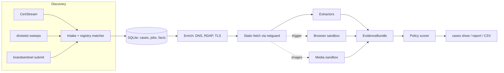

# BrandSentinel

BrandSentinel is a local-first tool for **brand-abuse detection and triage**. It finds
domains and URLs that may impersonate a protected brand, collects evidence about them
without trusting them, and ranks each case for an analyst with an explanation that cites
the evidence. Its Brand Registry describes the Isha ecosystem; the controlled lab uses a
fictional brand, "Lumina Foundation".

It is a single Python application with a SQLite store, a hardened network layer, and
rootless-Docker sandboxes for the parts that handle hostile content (images and browser
rendering). It is **not** a takedown service: it never submits anything to a suspect
site, and a priority is a ranking of analyst attention, not a finding of fraud.

> **Project maturity (2026-11-06).** Version 0.2.0 (milestone M8, commit `e40ffcb`) is the
> installed production build. It has not run live collection unattended. Decision models
> (Kev/Laya), model evaluation, unattended operation (M9) and the SP2 instance lock are
> **not implemented**. See [Status and maturity](docs/project/status.md).

## The problem

The earlier proof of concept (kept unchanged under [`legacy/`](legacy/)) found candidate
domains but silently dropped real lookalikes. For example, a substring whitelist treated
`sadhguru.org.verify-login.xyz` as official, and exclusion words were matched before
brand matching. It also stopped at discovery: analysts got no evidence and no reason why
a domain mattered. The original audit is recorded in the
[implementation plan](docs/plans/2026-10-08-001-feat-brandsentinel-local-pipeline-plan.md).

## What it does

| Capability | Implemented | Where it is described |
|---|---|---|
| Tiered brand matching with registry provenance (homoglyphs, IDN, folded and hyphenated forms, scoped exclusions) | yes | [Pipeline](docs/concepts/pipeline.md) |
| Discovery: CertStream, scheduled dnstwist sweeps, manual `submit`, durable raw log, `replay` | yes | [Pipeline](docs/concepts/pipeline.md) |
| Passive enrichment: DNS, RDAP, TLS, name similarity | yes | [Pipeline](docs/concepts/pipeline.md) |
| Hardened static fetch: `netguard` address policy, pinned DNS, per-hop redirect checks, size and time caps | yes | [Security model](docs/concepts/security.md) |
| Static extractors (credentials, payments/UPI, brand references, commerce, editorial cues) → versioned EvidenceBundle | yes | [Evidence and scoring](docs/concepts/scoring.md) |
| Deterministic, explainable policy (P1–P4 / `no_action`) with evidence references | yes | [Evidence and scoring](docs/concepts/scoring.md) |
| Media sandbox: images decoded, hashed, OCR'd and QR-decoded only in a network-less container; visual matching against a reference corpus | yes (production corpus is empty) | [Media runbook](docs/runbooks/media.md) |
| Isolated browser rendering (Chromium in a per-job container behind a validating egress proxy), cloaking comparison | yes | [Browser runbook](docs/runbooks/browser.md) |
| Analyst-requested render (`submit --render`, budget default 0), job telemetry, `run --until-idle` | yes (M8) | [CLI reference](docs/reference/cli.md) |
| HTML reports (strict CSP, escaped), CSV export, analyst labels | yes | [Triage runbook](docs/runbooks/triage.md) |
| Advisory decision models (Kev-0.8B, Laya) and labelled evaluation (`eval`) | **no** (`eval` is a stub) | [Roadmap](docs/project/roadmap.md) |
| Unattended 24×7 operation, supervision, soak (M9); instance lock (SP2) | **no** | [Roadmap](docs/project/roadmap.md) |

## Architecture in one picture



Details, trust boundaries and the sandbox network: [Architecture](docs/concepts/architecture.md).

## Quickstart (safe, offline)

Requirements: Linux, Python 3.12 and [uv](https://docs.astral.sh/uv/). No Docker, no
network access beyond installing dependencies, and nothing outside the checkout. (The CLI
itself is plain Python; the test suite's local network harness binds `127.77.0.0/24`,
which Linux routes to loopback and macOS does not by default. macOS is untested.)

```sh
uv sync                                   # creates .venv from uv.lock (with the dev group)
uv run brandsentinel version              # 0.2.0
uv run brandsentinel registry validate    # the committed Brand Registry
uv run brandsentinel match sadhguru.org.verify-login.xyz odisha.gov.in save-soil.shop
uv run pytest -m "not docker and not lab and not models"
```

From a clean clone (2026-11-06, commit `87c0d16`) the last command ran 1524 passed and
1 skipped (no host Tesseract), in about 56 s.

## Demo: from submission to explained case (offline, Linux)

```sh
uv run python docs/demo/offline_demo.py /tmp/bs-demo
uv run brandsentinel -c /tmp/bs-demo/demo.yaml cases list
uv run brandsentinel -c /tmp/bs-demo/demo.yaml cases show 1
```

This runs the real intake, queue, enrichment, hardened fetcher, extractors and policy over
five synthetic lab pages. Name resolution and the web server are the test suite's local
harness on loopback; no real site is contacted. The walkthrough and its expected output
are in [Offline demo](docs/guide/demo.md). These synthetic results show how a case is
built and explained. They are **not** a measure of real-world detection accuracy.

## Testing

| Suite | Needs | Command |
|---|---|---|
| Unit, integration, security (no containers) | Python only | `uv run pytest -m "not docker and not lab and not models"` |
| Real-container isolation and lab | Linux, rootless Docker, sandbox image, lab stack | `uv run pytest -m "docker or security"` |
| Documentation | the docs toolchain | `uv run --no-project --with-requirements docs/requirements.txt mkdocs build --strict` |

See [Testing and security validation](docs/development/testing.md).

## Security boundaries (summary)

- Every connection to an untrusted host goes through `netguard`: public unicast
  addresses on ports 80/443 only, DNS answers pinned, each redirect re-validated.
- Untrusted images and pages are processed only in rootless-Docker containers: no
  capabilities, read-only root, `no-new-privileges`, memory/CPU/PID/wall-time limits.
  Media containers have no network; browser containers reach the Internet only through
  the validating egress proxy.
- Production runs under a dedicated unprivileged account with its own rootless Docker
  daemon. Every command that opens a store refuses to run as root or without an explicit
  configuration (in the repository, not yet installed in production). `brandsentinel run`
  also refuses rootful Docker access. Other store-opening commands (including `submit`,
  `status` and `cases`) accept any non-root account and non-store commands still run as
  root, so production use is still restricted by procedure:
  [which commands enforce it](docs/concepts/security.md#which-commands-enforce-it).
- Stored artifacts are inert (content-addressed, mode 0600, never executed). Reports
  escape everything and use a strict CSP.

What these controls do **not** cover is listed in
[Security model](docs/concepts/security.md#limits-and-residual-risks).

## Documentation

- Website sources: [`docs/`](docs/index.md). Build it with the command in the testing table.
- For coding agents and new contributors: [`AGENTS.md`](AGENTS.md).
- Design authority: the [implementation plan](docs/plans/2026-10-08-001-feat-brandsentinel-local-pipeline-plan.md)
  and the [M8 plan](docs/plans/2026-10-30-001-feat-m8-analyst-render-telemetry-plan.md).

## Contributing

Read [`AGENTS.md`](AGENTS.md) first. In short:

- change code with tests;
- keep `uv run ruff check` and the offline suite green;
- run the security and Docker gates for any change under `src/brandsentinel/net/` or
  `src/brandsentinel/sandbox/`;
- update the documentation in the same change when public behaviour, configuration,
  architecture, security properties or deployment change
  ([documentation system](docs/development/documentation.md)).

No license file has been chosen yet. Until one is added, the repository is not licensed
for reuse.
