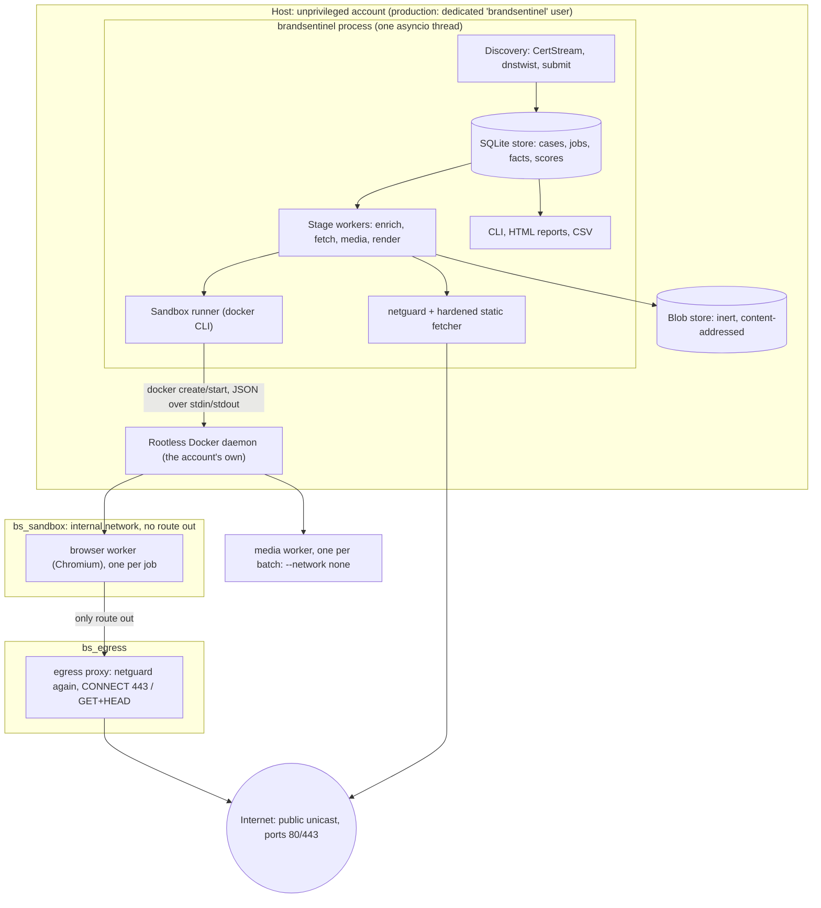

# Architecture

BrandSentinel is one Python process (`brandsentinel run`) on one host. Inside it, an
asyncio event loop runs discovery tasks and a bounded worker pool per pipeline stage, all
sharing one SQLite connection. Work that handles hostile content runs outside the process,
in short-lived rootless-Docker containers. This page describes what is implemented at
`e40ffcb`. The design intent is in
[the implementation plan](../plans/2026-10-08-001-feat-brandsentinel-local-pipeline-plan.md),
"High-Level Technical Design".

## Components and trust boundaries

| Boundary | What crosses it | Control |
|---|---|---|
| Process ↔ Internet (host side) | DNS, RDAP, TLS handshakes, static page and image fetches | `net/netguard.py` policy on every hop; `net/fetcher.py` caps; no cookies, no proxy environment |
| Process ↔ sandbox containers | job input on stdin, one JSON document on stdout | `sandbox/runner.py`: caps on output, strict output validation in the clients, kill by name at the wall-time limit |
| Browser container ↔ Internet | the page's own requests | internal network; the only member with a route out is the egress proxy (`net/proxy.py`), which re-applies netguard and pins the validated address |
| Media container ↔ anything | nothing | `--network none` |
| Store ↔ analyst | reports, terminal output, CSV | escaping (`textsafe.py`), Jinja autoescape and a strict CSP, CSV formula neutralizing |
| Account ↔ host | the account's files and its own Docker daemon | dedicated user, not in the `docker` group, does not own the code; `run` refuses rootful Docker, and the store-opening commands refuse root once the [CLI guard](security.md#which-commands-enforce-it) is installed |

The plan's diagram also shows a `DecisionProvider` talking to local Kev-0.8B and Laya
model servers. **That component does not exist yet** (U20, see the
[roadmap](../project/roadmap.md)). No model is called anywhere in the code.

## Source layout

| Package | Responsibility |
|---|---|
| `cli.py` | Typer command-line interface; loads config, opens the store |
| `config.py` | Pydantic configuration model (unknown keys rejected); `load_config` |
| `registry/` | Brand Registry model, loader (with lab overlay), legacy import |
| `matching/` | host normalization (IDN, confusables, folding) and the tiered matcher |
| `discovery/` | CertStream consumer, dnstwist runner, manual `submit`, discovery events |
| `store/` | SQLite connection and migrations, job queue with leases, blob store with quotas, raw logs, retention |
| `pipeline/` | orchestrator (workers, leases, telemetry), stages (enrich, fetch, scoring), scheduling (per-domain fairness, rechecks, idle detection), media and render stages, health |
| `enrich/` | DNS records, RDAP, TLS, name similarity |
| `net/` | netguard, the hardened fetcher, the egress proxy |
| `analysis/` | static extractors: page content, payments (UPI, bank, gateways), brand association, commerce, editorial cues, images, media text |
| `evidence/` | EvidenceBundle (versioned, provenance refs), terminal rendering |
| `policy/` | rules and the deterministic scorer |
| `sandbox/` | runner, preflight, network namespace checks, media and browser workers and clients, render triggers, cloaking comparison, self-tests |
| `visual/` | reference corpus, collector, perceptual-hash comparison |
| `triage/` | case loading, HTML report, CSV export |

## Runtime topology

| Element | Defined in | Notes |
|---|---|---|
| `bs_sandbox` (172.31.251.0/24, `internal: true`) | `docker/compose.yaml` | browser containers join only this network |
| `bs_egress` (172.31.252.0/24) | `docker/compose.yaml` | the proxy's route out |
| `bs-egress-proxy` (172.31.251.2:3128) | `docker/compose.yaml` | runs `brandsentinel proxy` from the sandbox image |
| `brandsentinel-sandbox:local` | `docker/Dockerfile.sandbox` | contains the whole wheel plus the `sandbox` extra (Pillow, Tesseract bindings, zxing, Playwright 1.63.0 / Chromium) |
| Lab: `bs_lab` (172.31.250.0/24), `bs_lab_sandbox` (172.31.254.0/24), lab proxies | `docker/lab.compose.yaml` | development only; the production proxy cannot reach the lab, and lab mode cannot use the production proxy |

Because the image contains the whole wheel, a code change normally needs a new image and
a gated promotion before it can run in production
([Deployment](../operations/deployment.md)).

## Design decisions worth knowing

- **One process, one thread, SQLite.** Simple to operate and reason about; every write
  serializes through `BEGIN IMMEDIATE`. Delivery is at-least-once with lease tokens, so
  handlers are idempotent and each (case, stage, round) finishes exactly once.
- **Our own egress proxy** rather than Squid: Squid forwarded Host-mismatched requests
  (`docs/runbooks/sandbox.md` has the evaluation).
- **Deterministic policy, not a model, decides priority.** Planned models are advisory only:
  they can add a review flag but never change a priority.
- **Rootless Docker, not VMs.** VM-level isolation (gVisor, Kata) is deferred. See
  [Security model](security.md#limits-and-residual-risks).
