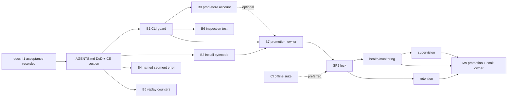

# Post-I1 engineering backlog and development workflow - Plan

The isolated-copy trial I1 r3 was accepted by the owner on 2026-11-09, within its offline scope.

This document returns development to the Compound Engineering workflow. It sets out:
- a definition of done;
- how the `ce-*` commands are used without crossing the owner's approval boundaries;
- the ordered backlog that follows from the 2026-11-06 incident, the I1 review findings, SP2 and M9.

**What it does not change:**
- The product contract (`2026-10-08-001-feat-brandsentinel-local-pipeline-plan.md`) and the owner decisions in `2026-10-31-001-roadmap-alignment.md` stand.
- IDs below are local to this document (B = backlog item, O = owner decision, T = trial tooling). Contract IDs are written "contract R45", "contract U22".

## 1. Where things stand (2026-11-09)

**Production:**
- M8 `e40ffcb` is installed and verified unchanged after the incident recovery (*operator-reported*).
- Live collection has not been authorized.

**I1 r3: accepted.**
- It proves: the corrected privileged launch chain; that M8 loads the production configuration as the service account; and that an offline `run --until-idle` on a production-shaped copy promotes exactly the due deferred work and stops by idle.
- It does not prove: any stage execution, egress, discovery, a live-store run, supervision, or behaviour over time.

**Open from the incident (owner's closure record, kept outside this repository):**

| Closure # | Item |
|---|---|
| 1 | the CLI runs as root for every command but `run`/`registry collect`, and a store-opening command without a configuration creates `./data` |
| 2 | running installed code as root writes bytecode into the code tree, both the venv and the bundled interpreter's standard library |
| 3 | operator rule (production CLI only as the account, with `-c`): **documented** in `docs/operations/deployment.md` (PR #18); a host-side guard is an owner decision |
| 5 | an unreadable raw-log segment aborts `run` with a traceback |
| 6 | an optional check of `/root` for caches |
| 7 | two due rechecks on the live store |
| 9 | evidence retention |

**Open from the I1 review:**
- S1–S7 (§5);
- trial-tooling residuals (§5, T-items).

## 2. Definition of done

A change is **done** when it is merged with every applicable item below satisfied. It is **accepted** only after a separate gated promotion. Agents never perform the promotion.

| # | Item | Required for | Evidence |
|---|---|---|---|
| D1 | **Scoped.** A plan in `docs/plans/` (or a bounded prompt with explicit stop conditions); the diff stays within the plan's files, or the deviation is explained | every change | PR description |
| D2 | **Threat-boundary review.** Answer five questions in the PR: (a) which boundary is touched: untrusted host, sandbox or container, privilege and account, the store, operator input; (b) which `AGENTS.md` §3 invariant could break; (c) does every new failure fail closed; (d) is any privilege, egress, file write or dependency added; (e) does anything new reach logs, and is it on the allowlist | every non-mechanical change; "none" is a valid answer with a reason | PR description |
| D3 | **Negative and adversarial tests.** For a boundary change, at least one test of the refused case and one of the hostile input, next to the positive test | boundary changes | test names in PR |
| D4 | **Regression test.** Fails on the old code; shown by running it against the parent commit | bug and security fixes | the failing output or count, quoted |
| D5 | **Gates.** `uv run ruff check`; the offline suite with counts; `uv run pytest tests/unit/test_docs.py`; the strict docs build. For `net/` or `sandbox/`: `-m "docker or security"` with **0 skipped** (SP3); if Docker is unavailable, say so and do not claim the gate | every change | counts, commit and date (`AGENTS.md` §8) |
| D6 | **Observability.** A new failure mode has a named error and a stable exit code, plus an allowlisted log or telemetry field (no URLs, page data or exception text). `status` shows new persistent state | behaviour changes | test or sample output |
| D7 | **Docs in the same change.** Per the table in `docs/development/documentation.md`, with the CLI reference regenerated. Status and roadmap are updated when maturity changes | behaviour, config, security, deployment changes | the diff |
| D8 | **Code review.** `ce-code-review` (`depth:full` for D2 (a)–(d) changes); findings fixed, or recorded in the PR's Known Residuals and in `docs/residual-review-findings/` | every non-mechanical change | review summary |
| D9 | **Approval boundaries respected.** No push, PR, merge or production action without the owner's explicit approval (`AGENTS.md` §6). A deployment need is written as a promotion item, not done | every change | none needed |

**Deliberately not required:** the full lab suite for non-detection changes, and a design doc for one-file fixes.

## 3. Using the Compound Engineering commands

| Step | Command | How it is used here |
|---|---|---|
| Frame | `ce-brainstorm` | only when scope is unclear (e.g. SP2's lock semantics) |
| Plan | `ce-plan` | for anything touching a boundary or more than one module. Plans go to `docs/plans/YYYY-MM-DD-NNN-*.md` with repo-relative paths and **no host paths, evidence names or personal data**, because the repository is public. Local R/U IDs; contract IDs are prefixed "contract" |
| Review plan | `ce-doc-review` | required for security plans before work starts |
| Execute | `ce-work mode:return-to-caller <plan>` | **the default invocation.** It implements and verifies locally, then returns a summary without the shipping tail. Plain `ce-work` ends in `ce-commit-push-pr`, which pushes and opens a PR: use it only when the owner has approved pushing for that branch |
| Isolate | `ce-worktree` | when work must not disturb the main checkout (untracked operator files exist in it) |
| Simplify | `ce-simplify-code` | optional, before review |
| Review | `ce-code-review` | always run explicitly after return-to-caller, because that mode skips it. Use `depth:full` for D2 changes |
| Commit | `ce-commit` | local commits on the feature branch. Never commit on `main` |
| Ship | `ce-commit-push-pr` | **only after the owner says to push**; the PR body carries D2, D5, D8 and Known Residuals |
| Learn | `ce-compound` | after a solved problem. Write flat `docs/solutions/YYYY-MM-DD-<slug>.md` (the existing layout, not category subfolders) and add it to `mkdocs.yml` navigation, or the strict build fails |
| Debug | `ce-debug` | failing tests and regressions |
| **Never** | `lfg` | it runs hands-off through a pushed, green PR |
| Not applicable | `ce-promote` | it writes launch copy. Production promotion is owner-run tooling with sealed evidence, outside CE |

**Session shape for a bounded task:**
1. Owner approves a plan.
2. `ce-work mode:return-to-caller docs/plans/<plan>.md`.
3. `ce-code-review` (with `plan:`, `base:main`).
4. Fixes.
5. `ce-commit`.
6. Report D1–D9 evidence.
7. **Stop.** The owner decides push, PR and merge, then promotion separately.

## 4. Smallest documentation change before feature work resumes

**One edit to `AGENTS.md`** (the entry point both agents and contributors read):
- replace §7 "How to validate a change" with **"Definition of done"**: the D1–D9 table in compressed form, keeping the existing five steps as D5 and D7;
- add a ten-line §7a, **"Working with Compound Engineering"**: the default invocation, the never/only-after-approval rows from §3, and the session shape.

**Nothing else:**
- no new site page;
- `docs/development/testing.md` and `documentation.md` stay the detailed references, and §7 links to them;
- this document stays the rationale.

The edit is made in its own small docs change after this plan is reviewed (sequence step 1).

## 5. Backlog

### 5.1 Security remediation (first)

| ID | Item | Source | Depends on | Size |
|---|---|---|---|---|
| **B1** | **CLI guard:** every store-opening command refuses UID 0 and refuses to run without an explicit configuration source, before any store is opened | closure 1 | O1 confirmation of the plan's decisions | S; plan `2026-11-09-002` |
| **B2** | **Installation bytecode:** `install.sh` installs the venv with precompiled bytecode and compiles the bundled interpreter's standard library. `validate.sh` fails if any `.py` under the prefix lacks a current `.pyc`; the check is factored into a testable helper. The incident's writes were in `site-packages/brandsentinel/*` and the interpreter's `html/` package | closure 2 | none (independent of B1); ships with B1 | S |
| B3 | **Production-store account enforcement:** every store-opening command applies `check_account` (not root, not the code owner, no rootful Docker) when the store is the production one. Needs a rule for "production" (e.g. a marker the installer writes in `data_dir`) and the developer opt-out | closure 1 (rest); roadmap | B1; **O2** | M |
| B4 | **Named error for an unreadable raw-log segment:** `run` exits with a stable code and an allowlisted message instead of a traceback | closure 5 | none | S |
| B5 | **Replay counters (S2):** add `skipped` (logged before the replay marker) to `ReplayStats`, so `records = ingested + duplicates + invalid + skipped`; unit test with a record older than the marker | S2 | none | XS |
| B6 | **Inspection side effects (S6):** an integration test that `status` and `cases list` on an already-migrated store with no orphan blobs change no byte. Docs keep "assume the command writes" | S6 | B1 (tests use explicit config) | XS |
| B7 | **Promotion of B1–B6:** new wheel and image, gated owner promotion, with the I1-style isolated acceptance on a copy | closure 1, 2 | B1, B2 (B3–B6 if ready) | operator |

### 5.2 Engineering notes (docs)

| ID | Item | Source |
|---|---|---|
| B8 | `docs/solutions/` entry: sudo 1.9 tty-keyed tickets break `setsid … sudo -n`; probe the chain before any privileged trial. The rule is already in deployment.md; this adds the diagnosis | S5 |
| B9 | `docs/solutions/` entry: a fail-closed snapshot invariant needs an explicit, anchored allowlist for host-volatile units, governed by an adversarial suite (raw hashes broke on a USB re-mount) | S7 |
| B10 | `eval` stub text names U20/U21 instead of "planned for M8" (existing roadmap follow-up) | roadmap |

### 5.3 Trial tooling (outside this repository; needed before the next privileged trial, not before B1)

| ID | Item | Source |
|---|---|---|
| T1 | each tool logs its own sha256 first; harness asserts it equals the sealed hash | S1 |
| T2 | acceptance criteria diff every table of the trial store, not 10 of 22 | S3 |
| T3 | trial directory created with `mkdir` under a root-owned parent; refuse symlinks; harness case with a planted directory and a planted symlink | S4 |
| T4 | holder checks by device:inode across `/proc/*/task` and mount namespaces, with every `/proc` error classified; root commands by absolute path | r2 residuals |
| T5 | allowlist changes need the adversarial suite and a review; recorded in the trial runbook | S7 |

### 5.4 SP2, monitoring, M9

| ID | Item | Contract | Depends on |
|---|---|---|---|
| B11 | **SP2 instance lock.** `run` holds an exclusive lock for its instance; `sandbox sweep`/`check` and a second `run` of the same instance leave a locked instance's containers alone. Done-when unchanged (contract SP2) | SP2 | B1 (shares the CLI entry path); `ce-brainstorm` on lock semantics |
| B12 | **Health and monitoring:** health samples; thresholds; `status` exits non-zero when unhealthy (so cron or a supervisor alerts); heartbeat file; model provider reported `not configured` (owner decision 2026-10-31) | contract U22, R35, R36 | B11 |
| B13 | **Retention and disk guard:** blob and `no_action` retention near the store cap; free-disk pause of the firehose and fetching | contract U22, R49 | B11 |
| B14 | **Supervision:** a systemd user unit for `run` under the account, restart on failure, orphan cleanup before lease recovery (existing) | contract U22, R33 | B11, B12 |
| B15 | **Offline suite in CI:** fix the 6 runner failures as test or code changes, then add the suite to the workflow | testing.md | none; before B11 is preferred |
| B16 | **M9 promotion and the rules-only 24 h soak** | contract M9, R45 | B7, B11–B14, **O3**, **O4** |

### 5.5 Owner decisions

| ID | Decision | Blocks |
|---|---|---|
| O1 | confirm the two decisions in plan `2026-11-09-002` (no root override; which explicit sources count) | B1 |
| O2 | how a store is recognized as production, and the developer opt-out for B3 | B3 |
| O3 | the two due live rechecks: let them run on the first live run, or supersede them by a reviewed procedure | any live run, B16 |
| O4 | authorization of live collection (and of any network-facing trial on a copy before it) | B16 |
| O5 | host-side guard against `sudo brandsentinel` (closure 3), the `/root` check (closure 6), retention of the trial copies and forensic evidence (closure 9) | none in code |

## 6. Sequence

1. **This docs change:** I1 acceptance in status, roadmap and index; this plan; plan 002.
2. **The `AGENTS.md` definition-of-done edit** (§4).
3. **B1** via `ce-work`, the first bounded task; then **B2** (independent, small); B4, B5, B6 as small follow-ups.
4. **B3** after O2.
5. **B7:** the owner's gated promotion of the remediation.
6. B8–B10 at any point, as docs-only changes.
7. **B15**, then **SP2 (B11)**, then **M9 (B12–B14)**, then **B16** after O3 and O4.
8. U20/U21 after M9 (owner decision 2026-10-31).
