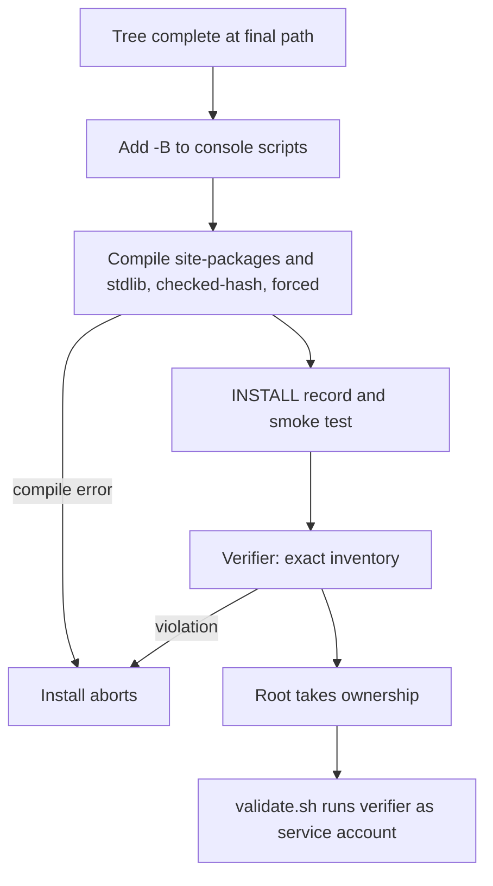

# Installation bytecode hardening (B2) - Plan

## Goal Capsule

- **Objective:** a new installation is built so that an accidental root run of its console scripts writes no Python bytecode under the install prefix, and the install does not complete unless a verifier finds the bytecode inventory and every launcher correct. This is bytecode-write prevention. It is not installation immutability.
- **Authority:** `AGENTS.md` sections 3, 6 and 7 override this plan. This plan refines backlog item B2 in `docs/plans/2026-11-09-001-post-i1-engineering-backlog.md` and records where it departs from that entry.
- **Execution profile:** development only, on a feature branch, against scratch prefixes. Test-first for the verifier.
- **Boundaries:** the production prefix is not inspected, even read-only, without separate owner authorization. Evidence directories and production tooling are not changed.
- **Stop conditions:** stop and ask if the work needs `sudo`, access to the production prefix, store or account, a live collection command, an evidence deletion, a push or a merge. Stop if a pinned dependency or the bundled interpreter has a source file that does not compile, or ships an orphan `.pyc`, because that needs an owner-reviewed allowlist. Stop if a console script cannot carry the `-B` flag.
- **Tail ownership:** the session ends with local commits and a D1-D9 report. Push, PR, merge and promotion are separate owner decisions. Promotion belongs to B7.

---

## Product Contract

### Summary

Installation will precompile the virtual environment and the bundled standard library as hash-validated bytecode, launch every console script with bytecode writing disabled from interpreter start, and verify the complete bytecode inventory. A guard in the package covers imports that do not go through a console script. No user-space control stops root from writing, so the plan states which paths it protects and leaves kernel-level immutability to owner decision O5.

### Problem Frame

The 2026-11-06 incident showed that running the installed CLI as root writes `.pyc` files into the code tree, in both the venv and the bundled standard library. B1 cannot help: its refusal runs after the console script has imported `brandsentinel.cli`.

Experiments on a replica of the install layout, using CPython 3.12.14 and root simulated in a user namespace, gave these results:

| Case | Files written under the prefix by a root run |
|---|---|
| No precompile, `brandsentinel version` | 442 |
| Package-level guard only | 13, including `_virtualenv`, `encodings.*`, `collections` and the package's own `__init__` |
| `-B` in the console-script shebang only | 0 for the CLI; 23 for bare `python -c 'import json'` |
| Timestamp precompile, then source mtimes change | 442 (every imported module is judged stale) |
| Checked-hash precompile, clean or after mtime change | 0, for `version`, `--help`, refused `status` and `cases list`, `sandbox check` |
| Checked-hash, one source edited, one `.pyc` truncated inside its header or deleted, no `-B` | 1 per affected module (Python regenerates it) |
| Same damage, with `-B` | 0 |
| Checked-hash, one `.pyc` truncated inside its body, with or without `-B` | 0, and the import fails with `EOFError` (no fallback to source) |
| Checked-hash, bare `python -O` | 23 (`opt-1` files are a different cache name) |
| Root over a mode-0555 tree | written anyway; a non-root user is silently skipped |

The current installer compiles nothing, and its smoke test leaves only the timestamp `.pyc` files of one `version` run. The virtual environment's `_virtualenv.pth` runs during `site` startup, before any application code. Startup cost of checked-hash over timestamp is about 10 ms (0.18 s against 0.17 s). A full precompile of a replica with the locked dev group produced 4,096 files and 83 MB of caches, with no compile failures.

### Write Prevention Versus Immutability

B2 prevents one class of write, by one class of process: Python bytecode, by a root process started through a console script. It does not make the tree immutable. Root can still modify, replace or delete anything under the prefix, and non-Python writes are untouched. The only available immutability controls are kernel-level and belong to owner decision O5. Documentation must use "bytecode-write prevention" and must not say the tree is immutable or protected from root.

The verifier is a point-in-time check of bytecode and launchers. A pass does not show that the tree is unmodified or that no root run occurred.

### Threat Assumptions

- **In scope:** an operator or tool accidentally runs an installed console script with effective UID 0, through `sudo` or a root shell, from any working directory, including with a stale, missing or damaged `.pyc`.
- **Reduced but not closed:** root running the bare interpreter or `-m` entry. Precompile covers the intact tree, and the package guard covers later imports only when `brandsentinel` is imported first.
- **Corrupt bytecode:** damage inside the header falls back to source; damage inside the body makes the import fail. The verifier detects both, and `-B` prevents repair by rewrite. A runtime failure from corrupt bytecode is the safe outcome: it does not run altered code silently.
- **Out of scope:** a malicious root, which can rewrite anything; root with `-O`, `-X pycache_prefix` or a hand-set environment on the bare interpreter; non-Python writes by root; processes holding file capabilities with a non-zero effective UID.
- **Assumed:** the install is built unprivileged at its final path and then handed to root, as `scripts/service-account/install.sh` does today.

### Requirements

**Precompile**

- R1. Installation compiles every `.py` under the venv's `site-packages` and the bundled standard library with the installed interpreter, in `checked-hash` mode, forcing replacement of any existing `.pyc`.
- R2. A compile failure aborts the install.

**Launch**

- R3. Every Python console script in `venv/bin`, first-party or third-party, is a direct shebang of the venv interpreter with `-B`. A launcher in any other form is never edited and fails verification, including uv's `#!/bin/sh` trampoline, which uv emits for long paths or paths with spaces.
- R4. Importing `brandsentinel` with effective UID 0 sets `sys.dont_write_bytecode` before any other package code runs, using only `os` and `sys`, which are loaded at startup.

**Verification**

- R5. A verifier fails unless each in-scope `.py` has a regular-file `.pyc` for the interpreter's cache tag with the current magic number, the checked-hash flags, a matching source hash and a body that unmarshals to a code object equal to one compiled in memory from the source. Nothing is executed.
- R6. The verifier fails on orphan bytecode, optimized-level bytecode, an interrupted-write temporary, bytecode outside the two compiled trees, or a sourceless `.pyc`. Its inventory covers bytecode files only; other files are not judged.
- R6a. Every regular file in `venv/bin` must be a hardened launcher, an ELF binary, or a named virtual-environment activation file. Symlinks must resolve inside the prefix to the interpreter. Anything else is a violation.
- R7. The verifier writes nothing, reports counts and at most a bounded list of paths, and has stable exit codes: 0 pass, 1 violations, 2 inspection incomplete.
- R7a. Any incomplete inspection exits 2, even if violations were also found: an unreadable path, a walk error, an unexpected exception, an absent stdlib or package sentinel, or an interpreter that is not the target venv's. Exit 0 requires a completed walk with a non-zero count.
- R8. `install.sh` runs the verifier as its last check, and `validate.sh` runs it under the service account and counts failure as a validation failure.
- R8a. `install.sh` publishes the `INSTALL` record atomically only after the verifier passes, so the record's presence means the install completed. `validate.sh` fails if the record is absent.

**Boundaries**

- R9. No change to the store, configuration, account checks, network policy or sandbox flags. Relative developer and lab configuration behaviour stays as it is.
- R10. Wheel `RECORD` files are not rewritten and nothing relies on them for a launcher's hash.

### Acceptance Examples

- AE1. **Covers R1, R3, R5.** Given a hardened replica, when root runs `brandsentinel version`, `--help` and a refused store command, then a before/after listing of the prefix is identical.
- AE2. **Covers R1.** Given a hardened replica, when every source mtime changes and root runs the CLI, then nothing is written.
- AE3. **Covers R3, R5.** Given a hardened replica with an edited source, a `.pyc` truncated inside its header or a deleted `.pyc`, when root runs the CLI, then nothing is written, the current source is what runs, and the verifier reports that exact file. Given a `.pyc` truncated inside its body, the import fails, nothing is written, and the verifier reports that file.
- AE4. **Covers R2, R6, R8.** Given a compile killed partway, when the install is re-verified, then the verifier fails and the install is not reported complete.

### Scope Boundaries

- Promotion, a production reinstall, or retrofitting the installed M8 tree: B7.
- Account enforcement: B3.
- The dev-group contents of the production venv: B21.

#### Deferred to Follow-Up Work

- Kernel-level immutability, such as a read-only bind mount of the prefix or `chattr +i`, and a host-side guard against `sudo brandsentinel`: owner decision O5. A read-only mount is the only option here that would also stop `-O` and non-Python writes.
- Compiling optimized levels: triples cache size for a path outside the threat assumptions.

---

## Planning Contract

### Key Technical Decisions

- KTD1. **Checked-hash mode.** It is independent of mtimes, so copies and later metadata changes cannot invalidate it, and an edited source still takes effect. `unchecked-hash` was rejected: it ran the old bytecode after a source edit, hiding drift. Timestamp mode was rejected by the table above, which rules out any precompile that relies on timestamps.
- KTD2. **`-B` in the shebang, added to the backlog design.** It is the only control tested that acts before `site` and `.pth` processing, and it also stops regeneration of stale or damaged files. Layered with precompile, either one alone still writes in a case the other catches. Linux passes the single shebang argument intact.
- KTD3. **Keep the package guard as a narrow third layer.** It costs two statements and covers `python -m` and direct imports with damaged bytecode. It cannot protect its own `__init__` `.pyc`, so it is never the sole control. The verifier does not depend on it.
- KTD4. **Do not set bytecode-off for non-root users.** The service account cannot write the tree, and developers keep their caches.
- KTD5. **Verifier as a Python script run with `-I -B -S`.** It reuses `importlib.util` for the hash and the cache path, avoids `site` side effects, and is testable without root. `validate.sh` keeps its shell structure.
- KTD6. **Exact inventory, fail closed.** An unexplained file is a violation. The inventory detects tree damage and writes by paths without `-B`. A root run through a console script leaves no trace in the prefix, so a pass is not evidence that no root run occurred.
- KTD7. **Ordering in the installer.** Harden after the tree is complete and before the `INSTALL` record and smoke test. Verify last, so a smoke-test write is caught. A failed install restarts from an empty prefix, which `install.sh` already requires.
- KTD8. **Root simulated with `unshare -r` in tests.** It gives real UID 0 and write access over test-owned files with no privilege on the host. It does not prove behaviour on a root-owned tree, which stays a B7 acceptance item.

### High-Level Technical Design

Three layers apply to a root process:

| Entry | Before package import | After package import | Damaged `.pyc` |
|---|---|---|---|
| Console script | `-B` | `-B` | no write |
| `python -m brandsentinel.<submodule>` | precompile only | guard | no write after the guard |
| Bare `python`, base-interpreter `bin/` wrappers, children started through `sys.executable` | precompile only | precompile only | regenerated (residual) |

A `.pyc` damaged inside its body fails the import on every entry; the verifier is the control for that case.

### Departures from Backlog B2

- Adds the `-B` shebang layer, because the package guard alone leaked 13 files.
- Publishes `INSTALL` last, so a partial install has no completion record.
- Expands the verifier from "every `.py` has a valid `.pyc`" to the exact inventory in R5 and R6, scoped to the two compiled trees plus a no-`.pyc` rule elsewhere.
- Adds a shared hardening helper and user-namespace root tests.
- Estimated size moves from S to M.

### Assumptions

- The production prefix is short and has no spaces, so uv generates direct shebangs. Observed: uv switches to a trampoline for a 230-character path and a path with a space. Both fail verification and need a plan change if they ever occur.
- The experiments' dependency set came from the developer venv built from the same `uv.lock`. Counts will vary slightly for a real install.

### Risks and Mitigations

| Risk | Mitigation |
|---|---|
| `RECORD` hashes for edited console scripts no longer match | observed: `uv pip check` passes and uninstall works; `image_manifest.py` compares package sources only; installs are never upgraded in place; noted in the runbook |
| Tests are skipped where user namespaces are restricted | dedicated marker with a stated skip reason; D5 reports the count and requires 0 skipped locally |
| A symlinked `.py` or `.pyc` exists in the bundled distribution | verifier refuses it; see Open Questions |
| Owner snapshot and trial tooling pin the old `.pyc` inventory | B7 promotion item below |

### Rollback

Development: revert the commits; nothing persistent is created. Production: B2 adds no migration and no store change, so a rollback is the existing tree swap paired with unchanged data. A swapped-back M8 tree has none of these protections.

### Open Questions

All are deferred; none blocks implementation.

- Whether the bundled distribution contains symlinked sources, and whether any needs a narrow, reviewed exemption: found when the verifier first runs on a replica.
- Whether the installed-layout tests fit the offline suite's run time or should be excluded by default: decided from the measured cost.

---

## Implementation Units

### U1. Bytecode verifier

- **Goal:** a read-only check of the full inventory.
- **Requirements:** R5, R6, R7.
- **Dependencies:** none.
- **Files:** create `scripts/service-account/check_bytecode.py`; test `tests/unit/test_check_bytecode.py`.
- **Approach:** take the prefix as an argument. Locate the stdlib from `venv/pyvenv.cfg`, resolving symlinks, and refuse a location outside the prefix. Report, do not stop, on the first violation. Exit 2 if the running interpreter is not the target venv's. Launcher classes are an allowlist (R6a), so an unknown form cannot pass. Each rule has a stable identifier in the report.
- **Execution note:** test-first; the verifier is the oracle for later units.
- **Patterns to follow:** the fail-closed checks in `scripts/service-account/install.sh`; subprocess style in `tests/unit/test_cli_guard.py`.
- **Test scenarios:**
  - A fully compiled small prefix passes with exit 0 and the expected count.
  - Missing `.pyc`; timestamp `.pyc`; `unchecked-hash` `.pyc`; wrong magic; truncated header; body truncated after a valid header; hash mismatch after a source edit: each exits 1 and names the file.
  - Orphan `.pyc`, `.opt-1` `.pyc`, `x.pyc.12345` temporary, and a `.pyc` under `src/`, `bin/` or `etc/`: each exits 1.
  - A symlinked `.pyc`, and a `__pycache__` that is a symlink out of the prefix: exit 1, target not read.
  - A console script with no `-B`, an extra interpreter flag, `#!/usr/bin/env python`, unrewritten `#!python`, a foreign interpreter, a uv trampoline, a plain shell script, and an unknown no-shebang file: each exit 1. An ELF binary and the named activation files pass.
  - A symlink in `venv/bin` escaping the prefix: exit 1.
  - Run by an interpreter other than the target venv's: exit 2.
  - A valid `.pyc` whose body is altered but still unmarshals: exit 1.
  - **False-pass detection:** every mutation starts from a tree asserted to pass, then must flip the result. A completeness test fails if any rule identifier has no mutation. The reported count must equal an independent count of `.py` files. Forcing an exception or a walk error mid-scan yields exit 2, including when no violation has been seen.
  - Missing `pyvenv.cfg`, a stdlib outside the prefix, an unreadable directory or file, an absent sentinel, an empty tree: exit 2, never 0.
  - A run changes no file in the prefix.
- **Verification:** all scenarios pass without root.

### U2. Hardening helper

- **Goal:** one step that applies shebangs and compiles, callable by the installer and tests.
- **Requirements:** R1, R2, R3.
- **Dependencies:** U1.
- **Files:** create `scripts/service-account/harden-bytecode.sh`; test `tests/integration/test_install_bytecode.py`.
- **Approach:** POSIX shell, `set -eu`, runs as the unprivileged builder and refuses root. Edits only regular files whose first line is exactly a venv-interpreter shebang. Compiles the real stdlib path, not its version symlink, with the compiling interpreter under `-I -B`. Idempotent.
- **Test scenarios:**
  - A replica verifies clean after the helper; a second run also verifies clean.
  - A source with a syntax error makes the helper exit non-zero.
  - Run as UID 0 in a user namespace: refused.
  - A binary, a `#!/bin/sh` file and a real uv trampoline in `venv/bin` are left byte-identical, and the verifier then fails on the trampoline.
  - Real uv-generated first-party and third-party-style launchers on a short path are hardened and still run.
- **Verification:** the verifier passes on the helper's output.

### U3. Installer and validation wiring

- **Goal:** installs cannot complete unhardened.
- **Requirements:** R2, R8.
- **Dependencies:** U1, U2.
- **Files:** modify `scripts/service-account/install.sh`, `scripts/service-account/validate.sh`; test `tests/integration/test_install_bytecode.py`.
- **Approach:** follow KTD7. Write `INSTALL` to a temporary name inside the prefix, then rename it after the verifier passes. Both scripts run the installed copy of the verifier with the installed interpreter under `-I -B -S`. `validate.sh` runs it before Docker steps and outside its `check` helper, which discards output: it saves the report under `$OUT`, prints it, and reports pass or fail with the exit code.
- **Test scenarios:**
  - Static ordering test: in `install.sh`, harden precedes the smoke test and the verifier follows it.
  - `validate.sh` invokes the installed verifier against its prefix, keeps the path list in its output, counts exit 1 and exit 2 as failures, and fails on an absent `INSTALL`.
  - Static test: the `INSTALL` rename follows the verifier, and no earlier step writes the final name.
  - A real `install.sh` interrupted before verification leaves no `INSTALL` record.
- **Verification:** one full run of the modified `install.sh` from a clean local commit with `PREFIX` set to an empty scratch directory, followed by the verifier, reported as evidence. It needs network access for the interpreter and dependencies; if unavailable, say so and do not claim it. It never targets the production prefix. The fresh pinned-input install stays in B7.

### U4. Package guard

- **Goal:** cover imports that bypass console scripts.
- **Requirements:** R4.
- **Dependencies:** none.
- **Files:** modify `src/brandsentinel/__init__.py`; test `tests/unit/test_bytecode_guard.py`.
- **Approach:** first statements of the module, using only `os` and `sys`.
- **Test scenarios:**
  - With an injected euid of 0, the flag is set after import; with non-zero it is unchanged.
  - A subprocess in a user namespace importing the package with a missing submodule `.pyc` writes no submodule `.pyc`.
  - An existing `False` flag for a non-root process is not changed to `True`.
- **Verification:** unit tests pass and the import remains free of side effects for non-root users.

### U5. Installed-layout tests under root

- **Goal:** prove AE1-AE4 on a realistic layout, including a control that shows the harness detects writes.
- **Requirements:** R1-R6.
- **Dependencies:** U1-U4.
- **Files:** extend `tests/integration/test_install_bytecode.py`; modify `tests/conftest.py` and `pyproject.toml` for an `installed_layout` marker.
- **Approach:** copy the running interpreter to a temporary prefix, create a venv there with a `.pth` hook and a small package, and run through `unshare -r` with a minimal environment. Compare full listings with mtimes.
- **Execution note:** the unhardened control is the D4 evidence that fails without the change.
- **Test scenarios:**
  - **Control:** an unhardened replica run as root writes at least one `.pyc`, and the verifier fails on it.
  - Covers AE1. Hardened replica: identical listing after CLI runs, from an arbitrary working directory.
  - Covers AE2. All mtimes changed: identical listing.
  - Covers AE3. Edited source, `.pyc` truncated inside its header, deleted `.pyc`: no write through the console script, current source runs, verifier names the file.
  - Covers AE3. `.pyc` truncated inside its body: the import fails, no write, verifier names the file.
  - Bare interpreter on an intact tree: no write. Bare interpreter on a deleted `.pyc`: records the known residual.
  - Covers AE4. A compile killed by SIGKILL: verifier fails, and no `INSTALL` record exists.
  - An entry-point script from a third-party-style package, hardened, run as root: no write.
  - After a real launcher edit, the package metadata still loads and `RECORD` is unchanged.
  - Read-only tree as a non-root user: the CLI runs, nothing written, no error.
  - Tree copied with changed mtimes and location of `__pycache__` preserved: verifier passes.
- **Verification:** 0 skipped on the development machine. A one-off run on the real wheel and locked dependencies, as in the Problem Frame, is reported as evidence.

### U6. Documentation

- **Goal:** the docs describe the control and its limits accurately.
- **Requirements:** D7 of the definition of done.
- **Dependencies:** U1-U5.
- **Files:** modify `AGENTS.md`, `docs/concepts/security.md`, `docs/operations/deployment.md`, `docs/runbooks/service-account.md`, `docs/project/status.md`, `docs/project/roadmap.md`, `docs/plans/2026-11-09-001-post-i1-engineering-backlog.md`. Lesson pages are a later documentation task.
- **Approach:** state "implemented, not promoted" and use the wording in Write Prevention Versus Immutability. Replace the "can still write bytecode" statements with the entry-point table's residuals. Add B7 items below to the backlog.
- **Test expectation:** none -- covered by `tests/unit/test_docs.py` and the strict site build.
- **Verification:** both pass.

---

## Verification Contract

| Gate | Command | Applies |
|---|---|---|
| Lint | `uv run ruff check` | always |
| Offline suite | `uv run pytest -m "not docker and not lab and not models"` | always, with counts |
| Installed layout | `uv run pytest -m installed_layout -rs` | always, 0 skipped locally |
| Regression proof | the control test and the verifier run on an unhardened replica | D4 |
| Docs | `uv run pytest tests/unit/test_docs.py` and the strict MkDocs build | always |

The `docker or security` gate does not apply, because nothing under `src/brandsentinel/net/` or `src/brandsentinel/sandbox/` changes. Evidence states that "root" was a user namespace on a developer machine.

**B7 promotion items, to be done by the owner only:** a fresh install from freshly pinned inputs; the verifier under the service account; a root-run listing comparison on an isolated real-root-owned copy; a new sandbox image, because the package changes; re-baselining owner snapshot and trial tooling for the larger `.pyc` inventory and for hash-based files; and a disk check for the added caches.

---

## Definition of Done

- U1-U6 satisfied, with every Verification Contract gate reported as command, commit, counts and date.
- D2 answers: privilege boundary touched; no new privilege, egress or dependency; failures fail closed; nothing new reaches logs.
- `ce-code-review` at `depth:full`, with findings fixed or recorded in `docs/residual-review-findings/`.
- Abandoned attempts removed from the diff.
- Stage reported as "Development complete", on local commits only.
