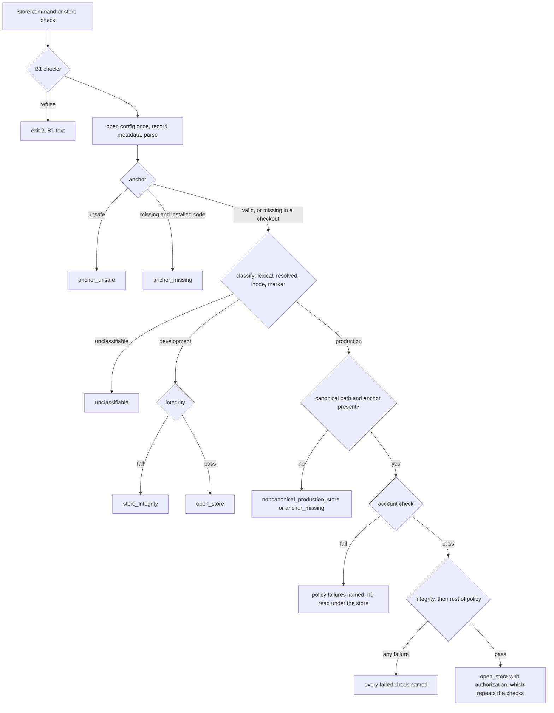

# Production-store account and configuration enforcement (B3) - Plan

## Goal Capsule

- **Objective:** before any store is opened, created, migrated or swept, the CLI decides whether the store is the production store. It refuses unless the process is the service account, running B3-or-later installed code, with the approved configuration as an absolute `-c` and no store variable. Marked production copies at any other location are refused. Root is refused for every command that acts on a store, a Docker daemon or the network.
- **Owner decisions (2026-11-10):**
  - O2-A approved: a root-owned anchor at `/etc/brandsentinel/production.yaml`.
  - O2-B approved: anchor path plus marker. The marker is an accidental-misuse signal, not an unforgeable identity.
  - O2-C revised: ordinary CLI use of a marked production copy at a noncanonical location is refused. An explicit trial workflow is deferred to a separate approval. Removing the marker is not a workaround.
  - O2-D approved: root refused for `sandbox sweep`, `sandbox selftest`, `sandbox check` and `proxy`. This adds `sandbox check` to the backlog's three.
  - O2-E approved: the service account may operate on development and scratch stores.
- **Plan approval (2026-11-10):** approved for development, U8 (`store check`) included. Future representative-data migration trials need a separately approved workflow that preserves production classification. Backup hard-link behaviour is a B7 operational pre-check, not a B3 blocker. The user-namespace tests may skip only when the environment lacks support; `REQUIRE_USERNS=1` makes such a skip an acceptance failure.
- **Authority:**
  1. `AGENTS.md` (§3, §6, §7) overrides this plan;
  2. this plan;
  3. `docs/concepts/security.md`;
  4. backlog item B3 in `docs/plans/2026-11-09-001-post-i1-engineering-backlog.md`;
  5. the B1 plan `docs/plans/2026-11-09-002-cli-root-and-config-guard-plan.md` and the B2 plan `docs/plans/2026-11-09-003-fix-install-bytecode-hardening-plan.md`. Their contracts stay unchanged, except that O2-D changes B1's R7 for four commands.
- **Stop and ask if:**
  - the work needs a change under `src/brandsentinel/net/`, `src/brandsentinel/sandbox/` or `docker/`;
  - an override for root or the production policy seems necessary;
  - a B1 refusal for a store command would change text, order or exit code, or a B2 launcher, verifier or `install.sh` step would change;
  - a test would have to be skipped, deleted or loosened. The approved exceptions are listed under Implementation Constraints;
  - the work needs a migration, or a write to any existing store's files or database header;
  - anything touches `/opt/brandsentinel`, `/etc/brandsentinel`, the live store, backups, the service account, `sudo`, Docker, a push or a merge.
- **Execution profile:** development only, on a feature branch from `origin/main` `af1b9cd`, against scratch paths. Test-first for U1 and U2. The owner's untracked files stay untouched. Invoke as `ce-work mode:return-to-caller docs/plans/2026-11-10-001-feat-b3-production-store-enforcement-plan.md`.
- **Tail ownership:** the owner. After local verification: `ce-code-review depth:full`, fixes, local commits, a D1–D9 report, then stop. Push, PR, merge and promotion (B7) are separate owner decisions.

---

## Product Contract

### Summary

B1 made every store-opening command refuse effective UID 0 and a missing configuration source. It did not decide which store is production, who may open it, or with which configuration. Today any non-root account can open any store it can write to, with any configuration, from any code. Only the 0700 home of the service account keeps other accounts out of the live store.

B3 adds:

- **classification** from a root-owned anchor outside the install prefix and a marker inside the production store;
- **canonical-location enforcement:** a production-class store is usable only at the anchor's exact store path;
- **store integrity** for every class: the database files and the directories the store code writes or deletes in may not be symlinks, and the database files may not be hard-linked;
- **a production policy** at the canonical store: the account by UID, clean account checks, no developer override, the installed code, and the approved configuration through an absolute `-c`;
- **installation-failure detection:** installed code with no anchor refuses every store command;
- **a read-only `store check` command** that runs every check without opening the store, so B7 can prove the approved invocation before any write;
- **root refusal** for four non-store commands (O2-D).

Development and lab use on scratch stores is unchanged, with three exceptions on any host. An unsafe anchor refuses every store command. A store with symlinked or hard-linked internals is refused. The installed venv's CLI refuses when no anchor is present (development uses the checkout).

### Problem Frame

| Gap today (`origin/main` `af1b9cd`) | Consequence |
|---|---|
| No notion of a production store | the CLI cannot apply a stricter rule to the store that matters |
| `check_account` runs only in `run` and `registry collect` | `submit`, `cases label`, `cases rescore`, `replay`, `report`, `export csv` run as any non-root account |
| `runtime.allow_developer_account` comes from whatever configuration was given | a chosen configuration file switches off the account checks |
| `-c` may be relative or a symlink; `$BRANDSENTINEL_CONFIG` and `$BRANDSENTINEL_DATA_DIR` are honoured | the store used depends on the working directory, link targets and the environment |
| Any importable `brandsentinel` is accepted | a checkout or a shadowing directory on `sys.path` can run against the live store |
| `open_store` creates a missing directory; the blob write, orphan sweep and raw-log pruning follow symlinked directories | a mistyped path creates a store; a scratch store with a symlinked `artifacts/` deletes another store's blobs |
| Four non-store commands run as root | they act on root's Docker daemon or open a listener |

The developer and the service account share one host. Once B7 installs the anchor, the developer's tests, lab and demo run with it present.

### Write, migration and delete paths (traced on `af1b9cd`)

| Path | Code | Follows a symlink at | Effect of a hard link |
|---|---|---|---|
| directory creation and mode | `open_store` → `ensure_private_dir(data_dir)`, `chmod 0700` | `data_dir` | n/a |
| database create, WAL switch, migrations | `store/db.py` `connect`: `os.open(O_CREAT)`, `sqlite3.connect`, `migrate` | `brandsentinel.db`; SQLite creates `-wal`, `-shm` and, before the WAL switch, `-journal` beside it | writes reach every linked name, including another store's database |
| blob write | `store/blobs.py` `_put` (`artifacts/tmp`, `mkstemp`), `_commit` (`os.replace` into `artifacts/sha256/<xx>/`, `unlink` on failure) | `artifacts/`, `artifacts/tmp/`, `artifacts/sha256/`, `artifacts/sha256/<xx>/` | none: new names only |
| orphan sweep (every `open_store`) | `BlobStore.sweep_orphans`: `tmp/*` and `sha256/*/*` older than 1 h with no row, `unlink` | the same directories (`glob` follows symlinked directories) | `unlink` removes only this store's name |
| raw-log write and pruning | `store/rawlog.py` (`O_CREAT|O_EXCL` segments in `raw/<source>/`); `store/retention.py` `prune_rawlog` | `raw/`, `raw/<source>/` | `unlink` removes only this name |
| RDAP cache | `enrich/rdap.py` under `cache/` | `cache/` | n/a |
| HTML reports | `triage/report.py` `write_private` (`O_TRUNC|O_NOFOLLOW`, then `chmod`) into `<data_dir>/reports` or `--out` | `reports/` (files themselves: not followed) | an existing hard-linked report file is truncated and rewritten through every name (accepted limit: reports are regenerated output, not evidence) |

R6 covers the database files and these directories, at open, without recursing into blob, segment or report files.

### Threat Model

| Actor | Intent | Primary boundary | What B3 adds |
|---|---|---|---|
| Operator as root (`sudo brandsentinel …`) | accident | none in user space | store commands: effective UID (B1, unchanged), plus real UID at the canonical store (R7). Four non-store commands: effective or real UID (R12) |
| Developer account (code owner, rootful Docker) | accident, curiosity against a copy | account home 0700 | lexical refusal of the live path without reading under the home; marked copies refused anywhere |
| Service account, wrong invocation | accident | none: it owns the store | the production policy; refusal of marked copies |
| Service account running code without B3 | accident | none | nothing (residual; B7 item) |
| Service account or copy owner, deliberate | misuse | none in user space | out of scope: they own the bytes and can remove the marker |
| Malicious root | any | none | out of scope (O5) |

### Misuse Scenarios

| # | Scenario | Expected result |
|---|---|---|
| M1 | root runs a store command | B1 refusal (unchanged) |
| M2 | root runs `sandbox sweep`, `selftest`, `check` or `proxy` | exit 2 with B1's root text, before Docker or a socket |
| M3 | the developer uses `-c` with `data_dir` at the live store | lexically canonical; `wrong_account`; nothing under the account home read |
| M4 | the developer symlinks a home path into the live store | `noncanonical_production_store` (resolvable link target) or `unclassifiable` (unresolvable); refused either way |
| M5 | anyone, the service account included, opens a marked byte copy in another directory | `noncanonical_production_store` |
| M6 | the service account uses a relative `-c`, `$BRANDSENTINEL_CONFIG` or `$BRANDSENTINEL_DATA_DIR` | `config_not_absolute`, `config_source` or `store_env_set` |
| M7 | the service account's `-c` is a symlink to, or a copy of, `service.yaml` | `config_symlink` or `config_not_approved` |
| M8 | the approved config is replaced between metadata check and read | read once from the descriptor whose metadata was recorded |
| M9 | `runtime.allow_developer_account: true` at the canonical store | `developer_override` |
| M10 | the account runs B3-or-later code from a checkout, another venv, or with an account-writable directory on `sys.path` (`PYTHONPATH`, `python -m` from a writable working directory) | `code_not_installed` or `python_env_set`; code without B3 is not stopped |
| M11 | the live database is hard-linked into a scratch directory | `store_integrity`, any class |
| M12 | the live store is bind-mounted elsewhere (user namespace) | same device and inode at a noncanonical path; `noncanonical_production_store` |
| M13 | the approved config's `data_dir` is missing | `store_missing`; nothing created |
| M14 | the anchor or any parent is a symlink (dangling included), not root-owned, group- or other-writable, unreadable by others, hard-linked, oversized, not a regular file, truncated or malformed | every store command refuses on the host, `anchor_unsafe` |
| M15 | the marker is deleted from the live store | still production by anchor path; `store check` and `validate.sh` report it |
| M16 | a library caller opens a production-class store without the CLI's authorization | refused by `open_store` (accidental callers only) |
| M17 | a scratch store has a symlinked `artifacts/`, `artifacts/sha256/<xx>/`, `raw/<source>/` or database file | `store_integrity`; neither store changes |
| M18 | installed code runs on a host whose anchor is missing, including with `PYTHONHOME` set or through another interpreter importing the installed package | every store command refuses, `anchor_missing` |
| M19 | a developer checkout on a host with no anchor opens an unmarked scratch store | development, as today |
| M20 | a database-only copy (`.backup`, `VACUUM INTO`, `cp brandsentinel.db`), or a copy with the marker deliberately removed, is opened elsewhere | development-class: **not detected** (documented limit) |
| M21 | an unmarked recovery point or trial copy made before B7 marking is opened elsewhere | development-class: **not detected** (documented limit) |
| M22 | a `data_dir` that is an ancestor of the live store (for example the account home) | `noncanonical_production_store` |

### Requirements

**Anchor**

- R1. The anchor is trusted only if:
  - every directory from `/` to its parent is a real directory owned by UID 0, not writable by group or others, and searchable by others;
  - the file, opened with `O_NOFOLLOW` and non-blocking, is a regular file owned by UID 0, readable by others, not writable by group or others, with one link and at most 64 KiB;
  - it parses under a strict schema: `account` (a name), `store_path`, `config_path` and `install_prefix` (absolute, normal, no symlink component), and a final `complete: true`.

  Any failure is `anchor_unsafe`.
- R2. The anchor is **missing** only when every existing ancestor passes R1 and the next component (`/etc/brandsentinel` or the file) does not exist (`ENOENT`). Any other error is `anchor_unsafe`.

  A missing anchor means "no production installation on this host" only for code not running from an installation. Code is running from an installation when a regular, root-owned `INSTALL` record exists in the parent of `sys.prefix`, or in the prefix derived from the resolved package directory (`
/venv/lib/pythonX.Y/site-packages/brandsentinel` → `
`). Such code refuses every store command with `anchor_missing`.

**Classification**

- R3. Classification reads only metadata and the marker, before anything under `data_dir` is read or written. Its first step is lexical: a normalized absolute `data_dir` that equals, lies under, or is an ancestor of the anchor's store path (by components) is production, without inspecting it. Otherwise a store is production if its resolved path equals or lies under the anchor's store path; if the caller can stat the anchor's store path and the store has the same device and inode; or if it holds a valid marker. Otherwise it is development.
- R4. A store is `unclassifiable` when the marker is unreadable or malformed, or the configured path or its nearest existing ancestor cannot be inspected and the lexical step did not already decide. A permission error on the anchor's own store path only disables the device-and-inode signal.
- R5. A production-class store is refused with `noncanonical_production_store` unless the configured `data_dir` is literally the anchor's store path. A marker found with no anchor is refused with `anchor_missing`.

**Store integrity**

- R6. A store is refused (`store_integrity`) when `brandsentinel.db`, `-wal`, `-shm` or `-journal` is a symlink or has more than one link, or when any existing `raw/`, `raw/<entry>/`, `artifacts/`, `artifacts/tmp/`, `artifacts/sha256/`, `artifacts/sha256/<entry>/`, `cache/` or `reports/` is a symlink. Development stores are checked after classification. Production stores are checked after the account check (R7) passes, so a wrong account never reads under the store.

**Production policy** (canonical production store only; every check runs, every failure reported)

- R7. Account: effective UID equals real UID equals the UID of the anchor's account, and that UID owns the store directory (`store_owner` otherwise). `check_account` passes with no warning. `runtime.allow_developer_account: true` is refused.
- R8. Configuration:
  - the source is `-c` alone (`config_source` if `$BRANDSENTINEL_CONFIG` is the source);
  - it equals the anchor's `config_path`, is absolute and normal, and has no symlink component;
  - it names a regular file owned by UID 0, not writable by group, others or the process, in a directory owned by UID 0 and not writable by group or others;
  - `$BRANDSENTINEL_CONFIG` and `$BRANDSENTINEL_DATA_DIR` are unset (`store_env_set`).
- R9. The configuration is opened once, non-blocking, and parsed from that descriptor. The metadata judged by R8 comes from the same descriptor's `fstat` and a per-component `lstat`. A non-regular source is still read as today, and the fact is recorded for R8. This read path applies to every class, so development behaviour, including symlinked configs and process substitution, is unchanged.
- R10. The production path fields are absolute: `data_dir`, `registry_path`, `discovery.dnstwist.dictionary`, `analysis.payment_providers`, `analysis.policy`, and `net.lab.registry_overlay` only when lab mode is on. The store directory exists (`store_missing` otherwise). A production store is never created.
- R11. Code identity:
  - the resolved package directory lies under `<install_prefix>/venv`;
  - every existing `sys.path` entry resolves under `<install_prefix>`, so a working-directory entry or a `.pth` addition outside it fails;
  - `PYTHONPATH`, `PYTHONHOME`, `PYTHONUSERBASE` and `PYTHONSTARTUP` are unset (`python_env_set`).

  Both sides are compared after resolution, by path components.

**Commands**

- R12. `sandbox sweep`, `sandbox selftest`, `sandbox check` and `proxy` refuse an effective or real UID of 0 with exit 2 and B1's root text, before configuration loading has any effect and before Docker or a socket is used.
- R13. `brandsentinel store check` runs B1's checks and R1–R11 as a store command would, prints the class, the deciding signal and every failed check, and exits 0 if a store command would proceed and 2 otherwise. It never calls `open_store` and writes nothing.

**Ordering and observability**

- R14. Order for store commands: B1's checks (unchanged) → one configuration read → anchor → classification → canonical location → (production: account check → integrity → rest of policy; development: integrity) → `open_store`. No refusal writes a file.
- R15. `open_store` repeats the anchor, classification and integrity checks. It refuses a production-class store without the authorization the CLI produced for that store's resolved path, device and inode and the effective UID. The installation-failure rule of R2 is CLI-only, so library callers and in-process test suites under an installed venv are unaffected.
- R16. Refusals exit 2. Store refusals begin `refusing to open a store:` followed by stable check names. No value from the environment, configuration or anchor is printed, and nothing is logged. `status` prints the store class and the deciding signal.

**Development and lab**

- R17. Development-class stores keep B1 behaviour, including relative locations, symlinked configuration files and the developer override. Their only new refusals are `anchor_unsafe` (R1), `anchor_missing` for installed code (R2), `unclassifiable` (R4) and `store_integrity` (R6). There is no production override.

**Provisioning and documentation**

- R18. The anchor template is committed as `config/production-anchor.yaml`; a root step in the runbook installs it to `/etc/brandsentinel/production.yaml` by write-then-rename. `install.sh` and B2's verifier do not change. A helper, `scripts/service-account/check_anchor.py`, runnable as the account without Docker, checks:
  - R1;
  - that `store_path` has no symlink component;
  - that `service.yaml`'s `data_dir` equals `store_path`;
  - that the installed package resolves under `install_prefix`;
  - with `--marker`, a valid marker in the store.

  `validate.sh` calls it with `--marker`.
- R19. Documentation states the marker's limits (M20, M21, deliberate removal) and the unchecked environment (`DOCKER_HOST`, `XDG_RUNTIME_DIR`, `PATH`, `HOME`, `LD_PRELOAD`). It also states that code without B3 is not stopped, that reports are not inspected for hard links, that subprocess CLI tests read the host's real anchor, and that removing a marker is not an approved procedure.

### Acceptance Examples

- AE1. **R3, R7.** With the anchor naming `/var/lib/brandsentinel/data` and the home 0700, the developer's `cases list` with that `data_dir` exits 2 naming `wrong_account`. Nothing below the home is read.
- AE2. **R8.** The service account's `status` with `-c etc/service.yaml` from `/opt/brandsentinel` exits 2 naming `config_not_absolute`.
- AE3. **R5.** A marked byte copy at `/var/lib/brandsentinel/trial-x/data`, opened by the service account with any configuration, exits 2 naming `noncanonical_production_store`.
- AE4. **R17.** With a valid anchor present, the developer's `-c config/lab.yaml status` prints today's output plus `store class: development`.
- AE5. **R12.** Root's `sandbox sweep` exits 2 with no Docker call.
- AE6. **R15.** Library `open_store` on a production-class scratch store under a test anchor raises the named refusal; the tree is unchanged.
- AE7. **R6.** For a scratch store whose `artifacts/sha256/ab` is a symlink into another store, `status` exits 2 naming `store_integrity`, and the other tree is byte-identical.
- AE8. **R2.** Installed code (a test prefix with a simulated root-owned `INSTALL`) and no anchor: `status` on a scratch store exits 2 naming `anchor_missing`. A checkout on the same host opens it.
- AE9. **R13, R10.** `store check` with a test anchor, a root-owned copy of the committed `config/service.yaml` with paths rewritten to scratch, and satisfied account checks exits 0 and writes nothing.

### Scope Boundaries

- **Out of scope:**
  - a deliberate service account or copy owner, and malicious root;
  - code without B3;
  - `DOCKER_HOST`, `XDG_RUNTIME_DIR`, `PATH`, `HOME`, `LD_PRELOAD`;
  - `report --out` and `export csv -o` destinations, and hard links to report files;
  - symlinks or links created after open during a long `run`;
  - installing the anchor, marking the live store and removing retained install trees (B7).
- **Not changed:** B1's store-command refusals and order; B2's launchers, verifier and `install.sh`; `load_config`'s semantics for non-store commands; `check_account`; `docker/`; development and lab workflows on scratch stores, apart from R17.

#### Deferred to Follow-Up Work

- **An explicit trial workflow** for production copies (O2-C), separately approved. Until it exists, B3-or-later code refuses marked copies. That includes the Gate-4-style schema check on a copy before a future migration.
- A database-resident identity (SQLite `application_id`), which would survive database-only copies. Setting it writes to the live store.
- Launcher `-I` with the matching verifier change (a B2 follow-up); a root-owned production launcher; host controls for the anchor and marker (O5).
- A marker-provisioning tool (the runbook step is manual; a malformed marker fails closed).

### Marker Limits

The marker is an accidental-misuse signal, not an identity.

- **Deliberate removal:** whoever can write the store directory can delete it. The live store remains production by anchor path; a copy becomes development-class.
- **Database-only copies:** `.backup`, `VACUUM INTO` or copying `brandsentinel.db` alone does not carry the marker.
- **Selective copies:** a copy that skips the marker loses it. The name has no leading dot, so ordinary glob copies keep it.
- **Copies made before B7 marking:** existing recovery points and trial copies are development-class when opened elsewhere.
- **Code without B3** ignores the marker.

File permissions on the live store, its backups and its copies remain the protection for production data. Documentation must not describe the marker as tamper-proof.

### Backup and Snapshot Tooling (read-only examination)

- The repository contains no backup, snapshot or restore tooling. `docs/concepts/storage.md` and `docs/operations/deployment.md` describe a recovery point only as "a copy of the whole `data_dir`", owner-operated outside the repository. The only hard-link handling in the repository is in `install.sh`, which copies and refuses hard-linked files under the prefix.
- **Conclusion:** no hard links in repository tooling. The owner's tooling is outside the repository and was not examined.
- **If owner tooling ever hard-links the live database files:** R6 refuses the live store (fail closed, no data loss). Blob and segment hard links are not refused, because the store only creates or unlinks those names.
- **B7 pre-check:** the owner confirms that recovery-point and snapshot tools copy rather than link the database files.

### Outstanding Questions

**Blocking:** none.

**Deferred to implementation:**

- Module and helper names; the authorization's type.
- The marker filename (working name `BRANDSENTINEL-STORE`) and schema version field.
- Whether resolution uses `os.path.realpath(strict=True)` plus per-component `lstat` or a descriptor walk.

---

## Planning Contract

### Alternatives Considered

| Approach | Recognizes production by | Limitation | Disposition |
|---|---|---|---|
| A. Configuration flag | the caller's config | the caller chooses the config | rejected |
| B. Account | `euid` | breaks SP3 and lab use under the account | rejected as classifier (O2-E); policy check |
| C. Path, from a root-owned anchor | `data_dir` | misses copies | adopted (O2-A, O2-B) |
| D. Marker in the store | marker present | removable by the directory's owner | adopted as misuse signal (O2-B) |
| E. Installed code | code location | cannot stop older code | policy check (R11), installation-failure signal (R2) |
| F. SQLite `application_id` | database header | setting it writes to the live store | deferred |
| G. Production launcher | n/a: fixes the invocation | does not classify | deferred |
| H. OS controls | n/a | root bypasses; does not stop the account's mistakes | primary boundary between accounts; O5 |

### Review Decisions on Scope (round 2)

The scope reviewer proposed cuts. The owner asked for the anchor chain, missing-anchor behaviour and integrity coverage, so those stay. The narrower options were adopted where they lost nothing:

| Proposal | Decision | Reason or residual |
|---|---|---|
| R6 only for database files | **kept as listed** | the sweep and blob write follow the listed directories into another store; the list is bounded to the traced paths and is not recursive |
| full anchor chain → parent only | **kept** | owner area 1; cost is one `lstat` per component |
| drop installed-code detection (R2) | **kept, made robust** | owner area 2; detection now also uses the package directory, so `PYTHONHOME` or another interpreter cannot hide an installation |
| drop the code-identity path check (R11) | **kept** | the anchor already carries `install_prefix`; the `sys.path` rule closes working-directory shadowing |
| backstop as a boolean | **kept with binding** | binding is a three-field comparison; it closes a swap between policy and open |
| move the `validate.sh` helper to B7 | **kept, standalone** | B7 needs it before Docker is authorized; it is also what `validate.sh` calls |
| no pre-live passing proof | **added `store check` (R13)** | otherwise the first proof of the passing path is a write to the live store |

### Key Technical Decisions

- **KTD1. Trust from ownership and location.** The anchor's chain and file must be root-owned and not writable by others, compared with literal UID 0. Tests patch, by module attribute, the anchor path, the chain root (`/` in production, a temporary root in tests), the trusted UID, and a function that returns candidate `INSTALL` paths. The environment never selects them.
- **KTD2. Anchor replacement and truncation.** Root replaces the anchor by write-then-rename into a root-only directory, so readers see the old or new file whole. The file is read once from its descriptor. A truncated in-place write lacks the final `complete: true` line or is invalid YAML, so it is refused.
- **KTD3. Installed versus checkout.** R2's two signals use B2's `INSTALL` record, published last. A checkout has none. Scratch installs in tests are not root-owned. In a user namespace a real root-owned record shows as UID 65534 and is not detected; store commands do not run in namespaces today.
- **KTD4. Canonical location only (O2-C).** A production-class store is used only at the anchor's store path. There is no trial branch.
- **KTD5. Lexical first.** The live path, its subpaths and its ancestors are recognized from the configured string before any filesystem call, so the developer is refused by name without touching the 0700 home.
- **KTD6. One configuration read for every class.** `load_config` splits internally into read and parse-from-bytes. The new helper opens non-blocking, records `fstat` and per-component `lstat`, reads, and parses through the same environment merge and validation. Non-store commands keep `load_config`.
- **KTD7. Authorization in `open_store`:** a keyword-only parameter, default none. All 10 `open_store` call sites are in `cli.py`; other callers (tests, the demo) are unchanged. It stops accidental callers, not hostile Python.
- **KTD8. No change to `sandbox/preflight.py`.** The policy calls `check_account` with injected `paths` and `sockets` in tests. SP3 is not required. B7 still needs a new image, because `cli.py` runs in the proxy container.
- **KTD9. Stable check names, exit 2:**
  - anchor and classification: `anchor_unsafe`, `anchor_missing`, `unclassifiable`, `noncanonical_production_store`, `store_integrity`;
  - account: `wrong_account`, `store_owner`, `account_checks`, `developer_override`;
  - configuration: `config_source`, `config_not_absolute`, `config_not_normal`, `config_symlink`, `config_not_regular`, `config_not_root_owned`, `config_writable`, `config_not_approved`, `path_not_absolute`, `store_env_set`;
  - code and store: `code_not_installed`, `python_env_set`, `store_missing`.

### High-Level Technical Design

`store check` follows the same flow and stops before `open_store`.

### Relationship to OS permissions

| Control | Stops | Does not stop |
|---|---|---|
| Home 0700, store owned by the account | every other non-root account | root; the account itself |
| Root-owned install tree and `/etc/brandsentinel` | the account changing its code or the anchor | root |
| B1 + B3 root refusal | accidental root use of B3-or-later CLI | root with other tools or older code |
| B3 policy and canonical location | the account's wrong invocations of B3-or-later code; accidental use of marked copies | a deliberate account; code without B3; unmarked copies |
| B3 integrity check | scratch stores reaching another store's files at open | changes after open; deliberate misuse |
| O5 host controls | `sudo brandsentinel`; anchor tampering | n/a |

### Implementation Constraints

- No change under `net/`, `sandbox/` or `docker/`. No migration, no new dependency, and no change to `install.sh`, the launchers or `check_bytecode.py`.
- Approved test changes that tighten:
  - `tests/unit/test_cli_guard.py` moves the four O2-D commands from `NON_STORE_COMMANDS` into a root-refused set (exit 2 as root, existing codes as non-root), and classifies `store check`;
  - `tests/unit/test_docs.py` updates the enforcement-table column parsing and its account-gate mapping, so that checks reached through `_load_for_store` count.

  No assertion about store commands changes.
- An autouse fixture in `tests/conftest.py` imports the identity module inside `try/except ImportError` and does nothing when the module is absent, so the D4 old-code run reaches assertions. When the module is present, it points the anchor path and the `INSTALL` candidates at nonexistent temporary paths. This isolates **in-process** tests only. Subprocess CLI tests (`tests/integration/test_offline_demo.py`, `tests/lab/test_static_demo.py`) read the host's real anchor and installation state (R19).
- Every test uses temporary paths and touches none of `/opt`, `/etc/brandsentinel`, `/var/lib` and `/var/backups`. Anchor examples in docs avoid a `data_dir` key, because `tests/unit/test_docs.py` validates YAML blocks with `data_dir` as `Config`.

### Sequencing

U1 → U2 → U4 → U3 → U8. U5 after U3's shared helper. U6 after U1. U7 last. U5, U6 and U8 are separately landable commits.

---

## Implementation Units

### U1. Anchor, classification and integrity

- **Goal:** read-only anchor validation, installation detection, classification, canonical-location test and integrity check.
- **Requirements:** R1–R6.
- **Dependencies:** none.
- **Files:** `src/brandsentinel/store/identity.py` (new); `tests/unit/test_store_identity.py` (new); `tests/conftest.py` (autouse fixture).
- **Approach:** module attributes for the anchor path, chain root, trusted UID and the `INSTALL`-candidates function. Strict anchor and marker schemas. `lstat`-based integrity. Standard library and `yaml` only.
- **Execution note:** test-first.
- **Patterns to follow:** `config.py` validation; `scripts/service-account/check_bytecode.py` for ownership and type checks.
- **Test scenarios:**
  - **Anchor present or absent:**
    - a valid anchor is used;
    - `ENOENT` on the anchor directory or on the file in a checkout → marker-only classification (M19);
    - the same with a simulated root-owned `INSTALL` beside `sys.prefix`, or beside the prefix derived from the package directory, and with `PYTHONHOME` set → `anchor_missing` (M18, AE8).
  - **Anchor chain and file (M14), each → `anchor_unsafe`:**
    - a parent that is a symlink (dangling included), group- or other-writable, not searchable by others, owned by another UID, or `ENOTDIR`;
    - an anchor directory at mode 0700;
    - the file as a symlink, FIFO (no hang), directory, hard-linked, mode 0664 or 0600, owned by another UID, or over 64 KiB;
    - malformed YAML, an unknown key, a relative or symlinked path, or no final `complete: true`.
  - **Replacement:**
    - the anchor renamed over while open → the parsed content is that of the opened file;
    - the file truncated inside the last value or line → `anchor_unsafe`.
  - **Classification, lexical and resolved:**
    - configured `data_dir` equal to the anchor store path with that path's parent at mode 000 → production, canonical, with no `lstat` below the parent (M3, AE1);
    - with no marker present → still production (M15);
    - under it, or an ancestor of it → `noncanonical_production_store` (M22);
    - a symlink resolving into it → `noncanonical_production_store`;
    - an unresolvable symlink → `unclassifiable` (M4);
    - a patched `stat` returning the anchor store's device and inode → `noncanonical_production_store` (M12);
    - a sibling sharing a string prefix (`data2`) → development;
    - a marker elsewhere → `noncanonical_production_store` (M5, AE3);
    - a marker with no anchor → `anchor_missing`.
  - **Anchor store not stat-able:** `EACCES` on the anchor store path with the store elsewhere → development.
  - **Bad marker or path:** a marker that is malformed, oversized, a symlink, a directory or unreadable → `unclassifiable`; an unreadable ancestor of the configured path → `unclassifiable`.
  - **Integrity, for each class:**
    - each listed directory as a symlink, including `artifacts/sha256/ab` and `raw/certstream` → `store_integrity` (M17, AE7);
    - `brandsentinel.db`, `-wal`, `-shm` or `-journal` as a symlink or with two links → `store_integrity` (M11);
    - a hard-linked blob or segment file → accepted.
  - **No writes:** no case creates or modifies a file (tree listing before and after).
- **Verification:** all pass; a static check shows the module calls no write or mkdir API.

### U2. Production policy and single configuration read

- **Goal:** the policy as a pure function, and the one-read configuration helper.
- **Requirements:** R7–R11, R16.
- **Dependencies:** U1.
- **Files:** `src/brandsentinel/store/policy.py` (new; working name); `src/brandsentinel/config.py`; `tests/unit/test_production_policy.py` (new); `tests/unit/test_config.py`.
- **Approach:** injected facts in, an authorization or every failed check out. `check_account` unchanged.
- **Execution note:** test-first.
- **Test scenarios:**
  - **All conditions met** → an authorization bound to resolved path, device, inode and euid.
  - **Reporting:** each check failing alone → exactly its name; several failing → all names in a stable order.
  - **Configuration source:**
    - `-c` relative, containing `..`, with a symlink component, a FIFO, a directory, owned by the account, mode 0664, in an account-writable directory, or not the approved path → the matching check (M6, M7);
    - `$BRANDSENTINEL_CONFIG` as the source → `config_source`;
    - either store variable set, even to the approved value → `store_env_set`.
  - **Account:**
    - euid ≠ ruid, or euid not the anchor account → `wrong_account`;
    - store directory owned by another UID → `store_owner`;
    - a `check_account` warning → `account_checks`;
    - `allow_developer_account: true` → `developer_override` (M9).
  - **Code identity (M10):**
    - package under `/opt/brandsentinel.prev-x/…`, under the prefix's `src/`, or in another venv → `code_not_installed`;
    - a `sys.path` entry that is an account-writable temporary directory (the `python -m` working-directory case) → `python_env_set`;
    - `PYTHONPATH` or `PYTHONHOME` set → `python_env_set`.
  - **Paths and store:**
    - a relative production path field → `path_not_absolute`;
    - the committed `config/service.yaml` passes the path rule (R10), including its inherited relative lab-overlay default while lab mode is off;
    - store directory missing → `store_missing` (M13).
  - **Configuration helper:**
    - parses each committed config exactly as `load_config` does;
    - a symlinked development config and a FIFO source with a writer both load as today;
    - a path replaced after open is never read (M8).
  - **Output safety:** no terminal escape or newline from a path reaches a refusal.
- **Verification:** all pass; the policy performs no I/O itself.

### U4. Store-layer backstop

- **Goal:** R15.
- **Requirements:** R6, R10, R15.
- **Dependencies:** U1, U2.
- **Files:** `src/brandsentinel/store/__init__.py`; `tests/integration/test_store_identity_open.py` (new).
- **Test scenarios:**
  - development store, no authorization → opens as today; the existing integration suite is unchanged;
  - production-class store without authorization → refused, tree unchanged (AE6, M16);
  - authorization for another store or another euid → refused;
  - store renamed and replaced after the policy → refused by device and inode;
  - production path missing → refused, nothing created;
  - integrity failure on a development store → refused before `connect` or `sweep_orphans`, and the symlink target is unchanged;
  - a simulated installed prefix with no anchor: library `open_store` on a scratch store still opens (R2 is CLI-only).
- **Verification:** integration suite passes with no new skips.

### U3. CLI wiring and status

- **Goal:** R14, R16, R17 in `_load_for_store`; the authorization passed to `open_store`; the `status` line.
- **Requirements:** R2, R14, R16, R17.
- **Dependencies:** U1, U2, U4.
- **Files:** `src/brandsentinel/cli.py`; `tests/unit/test_cli_production_guard.py` (new); `tests/unit/test_cli_guard.py`; `tests/unit/test_cli.py`.
- **Test scenarios:**
  - the 14 store commands, parametrized, under a patched anchor: M3–M7, M9–M13, M17, M18, M22 → exit 2, `refusing to open a store:`, the check name, tree unchanged, `open_store` not reached;
  - policy satisfied (patched UIDs and trusted owner, `preflight.code_paths`, injected sockets, `install_prefix` and `sys.path` arranged around the imported package) → `open_store` reached with an authorization;
  - development: B1's suite unchanged; `config/lab.yaml` as today plus the status line (AE4); a checkout with no anchor and no marker as today (M19);
  - precedence: euid 0 at the canonical store → B1's root text;
  - real process: a `-c` program that patches the attributes inline and calls `app()`, with `PYTHONPATH` unset → exit 2 with the specific check name, tree unchanged;
  - structural: every store command passes the helper's authorization to `open_store`.
- **Verification:** offline suite passes; D4 per the Verification Contract.

### U8. Read-only `store check`

- **Goal:** R13.
- **Requirements:** R13.
- **Dependencies:** U3.
- **Files:** `src/brandsentinel/cli.py`; `tests/unit/test_cli_production_guard.py`.
- **Test scenarios:**
  - every refusal case from U3 → exit 2 with the same names; tree unchanged;
  - the passing configuration from U3, with a root-owned copy of the committed `config/service.yaml` rewritten to scratch paths → exit 0, class and signal printed, `open_store` patched to raise is never reached (AE9);
  - as root → B1's root text.
- **Verification:** the structural test classifies it as a store-inspecting command that never opens a store; the enforcement table lists it.

### U5. Root refusal for non-store commands

- **Goal:** R12.
- **Requirements:** R12.
- **Dependencies:** U3 (shared helper only).
- **Files:** `src/brandsentinel/cli.py`; `tests/unit/test_cli_production_guard.py`; `tests/unit/test_cli_guard.py`.
- **Test scenarios:**
  - each of the four commands with euid 0, and with ruid 0 → exit 2 with B1's root text; Docker and socket calls patched to raise are never reached (M2, AE5);
  - the same commands as non-root → existing exit codes;
  - `version`, `match`, `registry validate`, `eval` and `--help` as root → unchanged;
  - `docker/Dockerfile.sandbox` sets a non-root `USER`, and every `user:` in `docker/*.yaml` names a non-root user (today `pwuser`), never `root` or `0`.
- **Verification:** the structural test classifies every leaf command.

### U6. Anchor template, helper and provisioning

- **Goal:** R18.
- **Requirements:** R18.
- **Dependencies:** U1.
- **Files:** `config/production-anchor.yaml` (new); `scripts/service-account/check_anchor.py` (new); `scripts/service-account/validate.sh`; `tests/unit/test_check_anchor.py` (new); `docs/runbooks/service-account.md`.
- **Approach:** the helper reuses U1's validation, with stable exit codes like `check_bytecode.py` (0 pass, 1 violations, 2 incomplete). The runbook documents the root install of the anchor by write-then-rename, and marker provisioning by the account. Agents never run either.
- **Test scenarios:**
  - the committed template validates against the U1 schema and contains no `data_dir` key;
  - the helper flags an unsafe anchor, a `store_path` with a symlink component, a mismatch with `service.yaml`, a package outside `install_prefix`, and (with `--marker`) a missing or malformed marker.
- **Verification:** tests pass; `install.sh` unchanged.

### U7. Documentation and review record

- **Goal:** R19, D7, D8.
- **Dependencies:** U1–U6, U8.
- **Files:**
  - `docs/concepts/security.md` (enforcement table, account section, Marker Limits, unchecked environment);
  - `docs/operations/deployment.md` (production CLI operations; recovery; trials on copies now need the deferred workflow);
  - `docs/runbooks/service-account.md`;
  - `docs/concepts/storage.md` (classification and integrity before open; backups copy, never link);
  - `AGENTS.md` §3 item 3, §10;
  - `docs/project/status.md`, `docs/project/roadmap.md`;
  - `docs/reference/cli.md` (regenerated for `store check`);
  - `tests/unit/test_docs.py`;
  - `docs/residual-review-findings/feat-b3-production-store-enforcement.md` (new).
- **Test expectation:** `tests/unit/test_docs.py` passes, including the enforcement table.
- **Verification:** strict site build passes.

---

## Verification Contract

| Gate | Command | Expectation |
|---|---|---|
| Lint | `uv run ruff check` | clean |
| New tests on old code (D4) | `git archive af1b9cd src` to the scratchpad; run the new test files with that `src` on `PYTHONPATH` | files importing new modules error at collection (counted); CLI refusal tests, patching with `raising=False`, fail on assertions; development and precedence cases, in a file importing no new module, pass |
| Marker rollback compatibility | `git archive af1b9cd` and `git archive e40ffcb` (the M8 release) to the scratchpad; open a scratch store containing the marker with each | both open it; recorded in the D5 report (a verification step, not a committed test, so it needs no `.git` at run time) |
| Real-ownership passing path | `tests/integration/test_store_identity_userns.py` (new): in a user namespace where the test runs as a mapped non-zero UID over a chain created by the namespace root, `store check` exits 0 | runs where user namespaces with subordinate IDs are available; skips with a reason elsewhere; `REQUIRE_USERNS=1` makes a skip a failure (B2 pattern) |
| Offline suite | `uv run pytest -m "not docker and not lab and not models"` | all pass; counts, commit, date; the only new skip is the user-namespace test where unsupported, reported |
| Docs | `uv run pytest tests/unit/test_docs.py` | pass |
| CLI reference | `uv run python docs/tools/gen_cli_reference.py --check` | exit 0 |
| Site | `uv run --no-project --with-requirements docs/requirements.txt mkdocs build --strict` | pass |
| SP3 | not required (no `net/`, `sandbox/` or `docker/` change); not run without separate approval for Docker | stated in the report |

No BrandSentinel command runs against a real store, `/opt/brandsentinel`, `/etc/brandsentinel` or the service account.

---

## Operational Notes

**B7 promotion items** (never done in development; each step under its own approval):

1. **Owner pre-checks:**
   - recovery-point and snapshot tools copy rather than hard-link database files;
   - the S6 snapshot allowlist is re-baselined for `/etc/brandsentinel/production.yaml` and the marker;
   - the canonicalization of a staged prefix into `/opt/brandsentinel` renames trees and does not symlink them (R11 compares resolved paths).
2. **Backlog B7 gates:**
   - freshly pinned offline install inputs;
   - a new installation and image (the CLI runs in the proxy container);
   - the B2 bytecode verifier passing;
   - SP3 `docker or security` under the account with 0 skipped, plus `sandbox check --strict`, under their Docker authorization.
3. **Anchor:** installed by root, write-then-rename, before any B3 code opens a store or the offline suite runs from the installed tree. `check_anchor.py` without `--marker` passes as the account, with no Docker.
4. **Marker:** the live store marked by the account as a required gate, before any later reinstall or rollback swap. `check_anchor.py --marker` passes. The full `validate.sh` follows, under its Docker authorization.
5. **Pre-live proof:** `brandsentinel store check -c /opt/brandsentinel/etc/service.yaml` as the account against the live store reads metadata only and exits 0.
6. **Refusal acceptance on a marked copy:**
   - the developer;
   - the account with the approved configuration pointed at the copy (`noncanonical_production_store`);
   - a relative `-c`, a store variable, a symlinked config, a checkout on `PYTHONPATH`;
   - a scratch store with a symlinked `artifacts/`.

   Root refusal is proven by development tests and the user-namespace test, never by running `sudo brandsentinel`.
7. **First open:** the existing gated first open of the live store by the account with the approved invocation.
8. **Retained trees:** retained pre-B3 install trees made non-executable for the account, or removed under O5.
9. **Snapshots:** a fresh S6 snapshot before and after.

**I1 and T-item compatibility:**

- I1-style trials ran installed code on byte copies of the store. Once B3 is installed and the store is marked, such a trial is refused. Trials on marked copies, including a Gate-4-style schema check before a future migration, wait for the separately approved trial workflow.
- Copies made before marking are development-class (M21). They are not a sanctioned trial route.
- T1–T5 tooling gains two rules: never remove a marker, and record any trial on an unmarked pre-B7 copy as such.

**Operator invocation:** `brandsentinel -c /opt/brandsentinel/etc/service.yaml …` as the account. These must be unset: `BRANDSENTINEL_CONFIG`, `BRANDSENTINEL_DATA_DIR`, `PYTHONPATH`, `PYTHONHOME`, `PYTHONUSERBASE` and `PYTHONSTARTUP`. Use the installed launcher, not `python -m` from a writable directory. Those are the only checked inputs besides the account and the files.

**Rollback:**

- code rollback to the M8 release ignores the anchor and marker (verification step) and removes B3's protection;
- a data restore to the anchor path is production by path; a restored, unmarked recovery point is marked again before use;
- no runtime switch disables B3; reverting is the gated rollback to the previous release;
- a malformed anchor blocks every store command on the host, the developer's included; the fix is a root correction.

**Development and lab:** unchanged on scratch stores except as R17 lists. The developer uses the checkout. The installed venv's CLI refuses store commands while no anchor exists.

## Risks

| Risk | Mitigation |
|---|---|
| A check that passes only under real conditions misfires at the live store | `store check` before the first open; the user-namespace test with real ownership; the committed `service.yaml` tested against R10 |
| Anchor and `service.yaml` drift | R8 refuses a non-approved path; `check_anchor.py` cross-checks `store_path` |
| Owner tooling hard-links the database | B7 pre-check; R6 fails closed without data loss |
| SP3 under the account breaks | O2-E; the in-process fixture; R2 is CLI-only; the account's temporary stores lie outside the anchor store path; B7 installs the anchor before tests run from the installed tree |
| Over-strict checks block the owner mid-incident | every failure named; `store check` diagnoses without writing; no override |
| TOCTOU between checks and the SQLite open | device-and-inode binding and repeated checks in `open_store`; the remaining window needs write access to an account-owned directory (residual) |

---

## Definition of Done

- R1–R19 met; U1–U8 verified per the Verification Contract, with counts, commit and date.
- **D1–D9 report (`AGENTS.md` §7):**
  - D1: this plan, with the 2026-11-10 owner decisions.
  - D2:
    - boundaries: privilege and account, the store, operator input;
    - §3 invariant 3 strengthened;
    - every new failure exits 2 before any write;
    - no privilege, egress or dependency added;
    - one new host file (the anchor), one new store file (the marker), one new command (`store check`);
    - no log fields.
  - D3: M1–M19 and M22 mapped to named tests; M20 and M21 documented as limits.
  - D4, D5: per the Verification Contract; SP3 stated as not required and not run.
  - D6: named checks, exit 2, the `status` class line, `store check`.
  - D7: the pages in U7.
  - D8: `ce-code-review depth:full`; findings fixed or recorded in the residual file.
  - D9: the B7 items above as promotion items; nothing done in production.
- **Cleanup:** no experimental code or unused helper in the diff.
- **Local commits on a feature branch only.** Stage reached: development complete, at most.

## Sources

- `src/brandsentinel/`: `cli.py`, `config.py`, `store/__init__.py`, `store/db.py`, `store/blobs.py`, `store/rawlog.py`, `store/retention.py`, `store/fsutil.py`, `enrich/rdap.py`, `triage/report.py`
- `src/brandsentinel/sandbox/preflight.py` (`check_account`: real UID, injectable arguments)
- `scripts/service-account/`: `install.sh` (copies, refuses hard links; `INSTALL` published last), `validate.sh` (runs Docker Compose), `check_bytecode.py`
- `docker/Dockerfile.sandbox` and `docker/*.yaml` (`USER pwuser`, `user: pwuser`)
- `docs/concepts/storage.md` and `docs/operations/deployment.md` (no repository backup tooling); `docs/runbooks/handoff.md` (earlier trial copies inside the account home; Gate-4 schema check on a copy)
- `tests/conftest.py`, `tests/unit/test_cli_guard.py`, `tests/unit/test_docs.py`, `tests/unit/test_config.py`, `tests/integration/test_offline_demo.py`
- `docs/residual-review-findings/fix-cli-root-config-guard.md`, `fix-install-bytecode-hardening.md`
