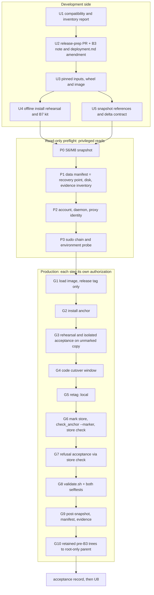

# Production promotion of B1-B3 (B7) - Plan

## Goal Capsule

- **Objective:** install B1, B2 and B3 in production through a gated promotion:
  - B1: refusal of root and of a missing configuration source;
  - B2: checked-hash bytecode, `-B` launchers and an `INSTALL` record;
  - B3: the production anchor and the store marker.

  The data directory, the recovery point, the two overdue rechecks and all retained evidence stay unchanged. The only intended change in the data directory is the store marker.
- **Release:** `main` at `fdd5003` contains B1 (#21), B2 (#22) and B3 (#23). B4-B6 are not implemented and are out of scope.
- **Status:** plan only. Nothing has been run. Each step marked **[AUTH]** or **[PRIV-READ]** needs its own explicit owner authorization (`AGENTS.md` §6). Approving this plan authorizes none of them.
- **Authority:**
  1. `AGENTS.md`;
  2. the B1-B3 plans (`2026-11-09-002`, `2026-11-09-003`, `2026-11-10-001`) and their residual findings;
  3. backlog item B7;
  4. this plan.

  Where this plan departs from a B3 operational note, the note is amended first by a reviewed change (U2). It is never overridden here.
- **Stop and ask** if a step would:
  - alter retained evidence;
  - open the live store or run `run` against it;
  - remove a marker;
  - weaken a check or accept a skip.
- **Recommendation:** **GO** for U1, the first safe task. **HOLD** for every privileged or production step (see "GO/HOLD").

**Terms:**
- **S6** is the owner kit's "installation accepted" state. S6′ is the same state for the B7 installation.
- **T1-T5** are the trial-tooling items in backlog §5.3.
- "B3 note *n*" is item *n* of the B3 plan's Operational Notes.
- Tool names such as "the backup tool" and "the restore tool" refer to the owner's tooling, which lives outside this repository.

---

## Problem Frame

B1-B3 are merged but not installed. In the 2026-11-06 incident, root CLI runs wrote bytecode into the code tree and created a stray store, and recovery took several days of gated work. B7 installs those guards before any live run (O7).

B7 differs from the M6-M8 promotions in four ways:

1. **New persistent objects outside the code tree.** A root-owned host file, `/etc/brandsentinel/production.yaml`, and a file inside the live data directory, `BRANDSENTINEL-STORE`.
2. **A different installed tree.** B2 adds checked-hash `.pyc` files for `site-packages` and the bundled standard library, `-B` launchers and an `INSTALL` record. Every content pin of the M8 tree goes stale.
3. **Copies are refused once marked.** B3 refuses a marked copy at any other location. The isolated acceptance and the copy-based rehearsals that M7 and M8 used cannot run on a marked copy.
4. **The CLI refuses invocations that older procedures used:**
   - root, for `sandbox check|selftest|sweep` and `proxy`;
   - on the production store: a relative `-c`, a store variable, `PYTHONPATH`, or `python -m`;
   - with no anchor present: every store command run from an installation (`anchor_missing`).

---

## What B7 changes (complete inventory)

| Area | Change | Reversible by |
|---|---|---|
| Installation | new root-owned tree at `/opt/brandsentinel` from the release commit, with the B2 bytecode inventory, `-B` launchers and an `INSTALL` record | code rollback (rename) |
| Installation | the M8 tree renamed aside, then moved into a root-only parent at G10 | rename back |
| Image | new sandbox image loaded under a release tag; `:local` retagged to it at G5 | retag `:local` to the M8 image |
| Containers | G8 recreates on the new image `bs-egress-proxy` (left running) and the lab containers (`bs-lab-web`, `bs-lab-proxy`, `bs-lab-sandbox-proxy`, left stopped); test networks as `validate.sh` leaves them | the ordered G8 rollback |
| Account home | `validate.sh` writes a `sp1-validation-<time>` result directory | kept as evidence |
| Host configuration | `/etc/brandsentinel/` (0755, root) and `production.yaml` (0644, root), written then renamed into place | root removes them; M8 ignores them |
| Data directory | adds `BRANDSENTINEL-STORE` (regular file, account uid, mode 0444, one link) and changes the directory's mtime. **Nothing else changes**: database files, `-wal`/`-shm`/`-journal` presence, blobs, segments and modes | the marker stays (KTD6); M8 ignores it, as tested |
| Trial copy | the G3 copy (OB3), made root-only 0700 afterwards | retained under O5 |
| Schema | **none**: still v5; no migration between `e40ffcb` and `fdd5003` | |
| Configuration | `service.yaml` unchanged; its paths are already absolute (B3 R10) | |
| Account | unchanged: no group, no sudo rule, no unit | |
| Snapshot references | new B7 references beside the M8 ones (U5) | keep the M8 references |
| Docs (repo) | U2 before the promotion; U8 after acceptance | git |

Dependencies are unchanged: `uv.lock` is identical to M8, and so are `docker/`, `net/` and `sandbox/`. The wheel still differs, and the image contains it, so the image differs too.

---

## Contradictions between B1-B3 and the M8 deployment

| # | Contradiction | Resolution |
|---|---|---|
| X1 | **Disk.** The root filesystem holds `/opt` and `/var/lib`, and on 2026-11-10 it had less free space than the runbook's 8 GiB prerequisite and the M8 kit's floor. B7 needs a second tree and a second image | Hard blocker. OB2. Nothing is deleted without O5 |
| X2 | **Invocation chain.** Runbook steps 5-9 and the `validate.sh` header use `systemd-run --user -M`. M8 and I1 r3 replaced it with `sudo -u` and direct sockets, with sudo first, because transient units drift the host-unit snapshot. Under `sudo -u`, `env_reset` drops `XDG_RUNTIME_DIR`, which `validate.sh` requires | U2 rewrites the runbook with the full environment: `XDG_RUNTIME_DIR=/run/user/<uid>` and the account's socket as `DOCKER_HOST`. P3 probes that exact chain and environment |
| X3 | **Isolated acceptance.** The backlog requires one on a copy. B3 (O2-C) and `deployment.md` refuse marked copies and call pre-marking copies "not a sanctioned trial route" | U2 amends B3 note 6 and `deployment.md` through review, so that one recorded B7 acceptance on an unmarked copy of the current recovery point becomes an exception. The owner then decides OB3. If the amendment or OB3 is refused, the acceptance is waived and the gap recorded |
| X4 | **Retained pre-B3 trees.** These are the M8 aside, the M7 aside and the failed trees. They lack B1-B3, ignore the anchor and marker, and can still open the live store. B3 note 8 requires them to be made non-executable or removed. The incident records retain them as evidence, and O5 says nothing is deleted | G10 renames them into one root-only 0700 parent before acceptance. Only the path changes; contents, modes and owners stay the same. Root can rename them back for a rollback. The method is OB5. Without G10, the bypass is a residual and the stage is not claimed |
| X5 | **Version.** The release is `0.2.0`, the same as M8, and the kit pins `WANT_VERSION`. The owner bumped the version before the M8 build for the same reason | U2 bumps it (OB1) |
| X6 | **Path-bearing files.** The prefix is embedded in the `.pyc` files, the `-B` launcher shebangs and `pyvenv.cfg`. Pins taken at another prefix give false mismatches: the M7 P2 attempt-1 class of defect | KTD3: pin by verifier verdict and normalized content, never by raw bytes taken elsewhere |
| X7 | **Order.** The B3 CLI refuses every store command with no anchor. `check_anchor.py` needs B3 code. `validate.sh` step 0 needs the marker | Order: anchor (G2) → copy acceptance (G3) → code (G4) → marker (G6) → validate (G8) |
| X8 | **Subprocess tests read the host anchor** (B3 residual). From G8 on, the account's SP3 subprocesses also read it, and the device/inode check stats the live store, read-only | G2's verification re-runs the developer's suites against the real anchor. G8 is described honestly: scratch `submit` and `run --until-idle` against temporary stores |
| X9 | **First live open.** The promotion pattern ends with one, but opening the store sweeps blobs, resets modes and creates WAL files | B7 accepts on `store check`, which does not open the store. The first open waits for the live-run authorization (OB4) |
| X10 | **Backup tooling.** The backup tool's current revision uses `systemd-run -M`, and its verifier is pinned to the current state (L2) | Not needed if P1 shows that the live store equals the recovery point (OB6). Otherwise, revised tools first |

**Checked and consistent:**
- The owner's backup and restore tools use `cp -a` and `mv -T [--exchange]`, never hard links.
- The M8 kit moves the old tree aside and installs at the canonical path, with no symlink.
- The proxy runs as `pwuser`.
- The interpreter lives inside the prefix.
- `store check`, `sandbox check`, `sandbox sweep` and `sandbox selftest` open no store.
- Only `run` promotes deferred work (`pipeline/scheduling.py: promote`).
- `installed_layout` tests are not in the SP3 selection.

---

## Key Technical Decisions

- **KTD1: the invariant is a manifest of the data directory.**
  - At P1 and G9, record every entry: path, type, mode, owner, link count, size and sha256, plus the presence of `-wal`, `-shm` and `-journal`.
  - The two manifests must be equal except for the marker and the directory's mtime. This is what proves that no open, sweep, migration or recheck promotion happened. A database hash alone proves none of them.
  - B7 runs no `run` and no open against the live store. SP3's scratch `run` invocations use temporary stores only.
- **KTD2: order.**
  - **Anchor first.** M8 ignores it, so the new code is never live without enforcement.
  - **Copy acceptance (G3) next,** while the anchor exists and the store is still unmarked.
  - **Then code, marker and validation.**
- **KTD3: pins come from the verifier, not from bytes taken elsewhere.**
  - `.pyc` files are pinned by `check_bytecode.py`'s verdict (source hash, cache tag, checked-hash flag).
  - Launchers and `pyvenv.cfg` use the M7 r3 "normalized (N)" classification.
  - A rehearsal at the canonical path inside a private mount namespace is optional. If it is used, it must run the installer as a mapped non-zero UID (the installer refuses UID 0), and it cannot reproduce root ownership.
- **KTD4: no automatic restoration.** A failure stops, classifies the state, prints it and leaves recovery to the owner. Rollback is code-only, because the schema is unchanged and the store is unwritten. A data restore is reserved for a breach of KTD1. **Any rollback leaves production unguarded:** CLI use against the live store is frozen until B7 is re-promoted.
- **KTD5: root never demonstrates a refusal.**
  - Root refusal is proven by the user-namespace tests, with `REQUIRE_USERNS=1 REQUIRE_INSTALLED_LAYOUT=1`.
  - Real root ownership is verified by metadata only: the kit's ownership scan, the anchor-chain check and B3's own ownership checks. Never by `sudo brandsentinel`.
- **KTD6: the marker is never removed.** Rollback to M8 is compatible with it.
- **KTD7: evidence is read by hash and metadata only.** The P1 inventory is compared again at G9. G10 is the only planned metadata change to retained trees, and it is a rename authorized by OB5.
- **KTD8: refusals are exercised only through `store check`.** It never opens a store, even if a case were wrongly accepted. Every G7 case targets the live path through the installed console script. The data-directory manifest is taken again after every case.

---

## High-Level Technical Design

### Sequence and authorization

### Rollback architecture

A row covers its step and every later step until the next row. Every rollback is an owner decision, never automatic (KTD4), and needs a fresh authorization. Every state after a code rollback is **"production unguarded"**: no CLI use against the live store until B7 is re-promoted.

| Reached | State | Rollback | Data |
|---|---|---|---|
| before G2 | M8; at most an extra image tag | nothing to roll back; the tag may stay | unchanged |
| G2-G3 | M8 + anchor; the G3 copy exists | leave the anchor (M8 ignores it), or root removes it if it blocks the developer. The copy is made root-only and retained | unchanged |
| G4 interrupted (signal, power loss) | partial tree, or M8 moved aside with no `INSTALL` record | the kit classifies the state on restart; the restore tool brings M8 back code-only; the failed tree is kept under a "failed" name | unchanged |
| G4-G5 done | B7 code; `:local` = new image; proxy still on M8 | code-only restore, then retag `:local` to the M8 image | unchanged |
| G6 interrupted | the marker's temporary file may be left in the data directory | STOP. The owner removes only that named temporary file (never the marker), and the manifest is taken again | temporary file only |
| G6-G7 done | + marker | as for G4-G5. The marker stays | marker only |
| G8 interrupted or failed | proxy and lab containers possibly on the new image; lab possibly running | in order: stop the lab; retag `:local` to M8; restore the code; recreate the proxy from the M8 tree's Compose file **[AUTH Docker]**; recreate the lab containers stopped; record container IDs | marker only |
| G9 or G10 failed | promoted state, an unexpected delta | STOP and preserve. Decide by the delta: rename trees back (G10), code rollback, or investigation | as found |
| at any point, manifest differs | KTD1 broken | STOP; preserve as evidence. The owner chooses a restore from the verified recovery point through the restore tool, then re-marks it, or an investigation | restore |

**Decision points:**

| Point | After | Outcome |
|---|---|---|
| DP1 | the G4 content check | pass, or stop |
| DP2 | `store check` at G6 | a named failure leads to an anchor correction by root, or to a code rollback |
| DP3 | G8 | any failure stops. A clearly environmental cause (egress, port 3129) may be retried under a **new** authorization; a security, sandbox or skip failure leads to the G8 rollback |
| DP4 | G9 | an unexpected delta leads to STOP and preservation |

---

## Implementation Units

**Legend:**
- **[DEV]**: development side, covered by this plan.
- **[DEV-AUTH]**: needs approval for the developer's own Docker daemon or network (§6).
- **[PRIV-READ]**: privileged, changes nothing.
- **[AUTH]**: changes production.

### U1. Compatibility and inventory report [DEV]: the first safe task

- **Goal:** a reproducible comparison of `fdd5003` against `e40ffcb`, as the basis for the pins and the delta contract.
- **Contents:**
  - migrations (v5) and the bundle field tree;
  - `config/` keys, and `service.yaml` against B3 R10;
  - `uv.lock`;
  - every path-bearing installed file (X6);
  - the predicted B2 inventory and its size, from the B2 and B3 plans, the code and existing dev-side test artifacts. No new install, because `uv python install` needs network;
  - the image-layer delta predicted from `docker/`;
  - the free space B7 needs.
- **Where:** the developer's scratch space; a summary goes into U2's PR.
- **Test expectation:** none. This is a report, and every claim cites a command and its result.
- **Done when:** every row of the inventory has a measured value or "measurable only in U3 or in production".

### U2. Release-preparation PR [DEV]

- **Goal:**
  - the version bump (OB1);
  - runbook steps 5-9 rewritten for the `sudo -u` chain with its explicit environment (X2);
  - the G2-G8 order (X7);
  - the console-script invocation for `store check`;
  - the amendment to B3 note 6 and `deployment.md` for the single recorded B7 copy acceptance (X3), for the owner's review.
- **Files:**
  - `pyproject.toml` and its lock entry;
  - `docs/runbooks/service-account.md`;
  - the `scripts/service-account/validate.sh` header comment;
  - `docs/operations/deployment.md`;
  - `docs/plans/2026-11-10-001-feat-b3-production-store-enforcement-plan.md` (Operational Notes only);
  - `tests/unit/test_docs.py` if needed.
- **Test scenarios:**
  - `brandsentinel version` prints the new number;
  - `test_docs.py` and the strict site build pass;
  - the offline suite is unchanged.
- **Done when:** the owner merges it. The release commit is the merge commit.

### U3. Pinned inputs, reproducible wheel and image [DEV-AUTH]

- **Goal:** the M8 build-and-acceptance pattern for the release commit.
  - **Inputs:** a frozen source clone (`GIT_OPTIONAL_LOCKS=0`), a private uv-cache copy and the Python download cache, each sealed.
  - **Wheel:** built twice, with equal hashes.
  - **Image:** built from the commit; `image_manifest.py` reports `verdict: ok`; the lower layers equal the M8 image's.
- **Acceptance on the developer's runtime:**

  | Check | Required result |
  |---|---|
  | `-m "docker or security"` | 0 skipped |
  | `sandbox selftest media` and `sandbox selftest browser` | both pass |
  | T2a-dev | 28/28 |
  | offline suite | passes |
  | `-m installed_layout` with `REQUIRE_USERNS=1 REQUIRE_INSTALLED_LAYOUT=1` | 0 skipped |

  Afterwards the developer's `:local` tag is restored and the lab stopped. Outputs go to a filesystem with headroom, never `/`.
- **Done when:** a sealed build record names the commit, the wheel, the image ID, the archive and the counts.

### U4. Offline install rehearsal and B7 kit [DEV-AUTH]

- **Goal:** a B7 kit, generated from the M8 kit the way M8's was generated from M7's:
  - an aside name for M8, and a code-only restore of M8;
  - `WANT_VERSION` and the release commit;
  - pins following KTD3;
  - a refusal to start if the anchor is absent (X7).

  The rehearsal installs from the U3 inputs, offline (`uv python install` uses the pinned download cache).
- **Test scenarios:**
  - each M7 and M8 kit defect class is reproduced: a pin-classification mismatch, a copy of a 0444 pin, a retry from a restored state;
  - a `.pyc` or launcher carrying a different prefix is rejected by its verifier pin, never accepted silently;
  - a missing anchor stops before the window;
  - **interruption:** the kit is killed after each step of the window (after the aside rename, mid-install, before `INSTALL`, after `chown`), and each time it classifies the state and the restore brings M8 back;
  - REALPERM-mode tests run with real ownership, with no pass-through sudo stubs.
- **Done when:** the kit is sealed, its tests pass with counts, and the root installer is regenerated for the sealed kit.

### U5. Snapshot references and expected-delta contract [DEV; one owner-side check]

- **Goal:** the snapshot and normalization tools gain B7 references, and a contract lists exactly what may differ from P0 to G9:
  - **`/opt` listing:** the new tree and the aside;
  - **`/etc/brandsentinel`:** its entries;
  - **data directory:** the marker (with its metadata) and the directory's mtime;
  - **account daemon:** image tags; the proxy's and the three lab containers' IDs, images and states; test networks as `validate.sh` leaves them;
  - **account home:** one `validate.sh` result directory.

  Anything else is a STOP.
- **Test scenarios** (an adversarial suite, governed by T5). Each of these is detected:
  - a planted file in the data directory;
  - a changed database byte;
  - a `-wal` that appears;
  - a deleted blob;
  - a hard-linked database;
  - a symlinked anchor;
  - a leftover temporary marker file;
  - a marker with the wrong mode or owner;
  - an extra `/opt` entry;
  - a running lab container.
- **Owner-side check [PRIV-READ]:** the M8 reference still matches the sealed pre-B7 evidence.
- **Done when:** sealed, and the allowlist change has been reviewed (T5).

### U6. Isolated-acceptance tooling for G3 [DEV]

- **Goal:** the tool and procedure for G3, applying the I1 r3 lessons and T1-T4:
  - the tool logs its own hash first;
  - every table is compared;
  - the copy is made with `mkdir` under a root-owned parent;
  - holders are checked by device and inode.
- **Test scenarios:**
  - a planted directory or symlink at the copy path;
  - a marker present in the source;
  - an anchor missing at start: refused;
  - a copy left writable afterwards: detected.
- **Done when:** sealed with its test counts.

### U7. Preflight and production gates

These run in the owner's gated tooling, one authorization per line, through the P3-probed chain.

**Read-only preflight:**

| Step | What | Pass |
|---|---|---|
| P0 **[PRIV-READ]** | production snapshot, normalized | S6/M8; the normalized invariant matches the accepted M8 reference |
| P1 **[PRIV-READ]** | the data-directory manifest (KTD1) compared with the verified recovery point (OB6); free space; evidence inventory hashed: recovery points, displaced and forensic stores, trial copies, aside and failed trees, archives | equal; space is at least the kit floor plus U1's estimate; inventory sealed |
| P2 **[PRIV-READ]** | as the account: `id`, subordinate ranges, linger, `user@` active, rootless daemon PID and launcher hash, proxy image = M8, no rootful socket, not in the `docker` group, `/etc/brandsentinel` absent | all as expected |
| P3 **[PRIV-READ]** | sudo-chain probe for the B7 launcher, including `XDG_RUNTIME_DIR` and the account's socket | probe PASS |

**Production changes:**

| Step | What | Pass |
|---|---|---|
| G1 **[AUTH]** | stream the image into the account's daemon under the release tag | `id_matches: true`; `:local` and the proxy unchanged |
| G2 **[AUTH]** root | install the anchor, write then rename | the developer reads it without privilege: 0644 root, a root-owned chain not writable by others, content equals the template. The developer's offline suite and installed-layout tests pass against the real anchor (X8). Snapshot delta is `/etc/brandsentinel` only |
| G3 **[AUTH]** (OB3) | U6 tooling on a byte copy of the current, unmarked recovery point. Steps: (a) install the B7 kit at a scratch prefix and roll it back; (b) as the account, run B7 code `run --until-idle --no-enrich --no-fetch` with sandbox and discovery off; (c) `store check` on a marker-only scratch directory through a scratch config; (d) make the copy root-only 0700 | (a) passes; (b) the copy classifies as development, the two rechecks are promoted in the copy only, and the I1 criteria hold across every table; (c) exit 2 `noncanonical_production_store`; live manifest, recovery point and snapshot unchanged. Recorded as "a trial on an unmarked pre-B7 copy" |
| G4 **[AUTH]** root + developer | the B7 kit window: M8 aside, install, `chown`, content check | kit exit 0 (S6′). Then as the account: `check_bytecode.py` exit 0, and `check_anchor.py` without `--marker` all PASS |
| G5 **[AUTH]** | retag `:local` to the new image, keeping the M8 tag | tags as expected; proxy still on M8 |
| G6 **[AUTH]** account | write the marker (temporary name `.marker.new`, renamed into place); `check_anchor.py --marker`; `/opt/brandsentinel/venv/bin/brandsentinel -c /opt/brandsentinel/etc/service.yaml store check`, with the store and Python variables unset | marker is a regular file, account uid, 0444, one link, and no temporary file remains; all PASS; `store class: production (anchor path)`; `store check: ok`; manifest = P1 plus the marker |
| G7 **[AUTH]** account, developer | refusal acceptance (B3 note 6) via `store check` only (KTD8), each case against the live path through the installed console script: the developer with the approved `-c`; the account with a relative `-c`; with `BRANDSENTINEL_DATA_DIR`; with `PYTHONPATH` set to an empty root-owned directory; with a symlink to the approved config; a scratch store with a symlinked `artifacts/` (development-class, `store_integrity`). Expected check names are recorded per case beforehand from the U3 tests | each case exits 2 with exactly its expected names. Manifest unchanged after every case. No root case (KTD5) |
| G8 **[AUTH Docker + egress]** account | `validate.sh` with the P3 environment: Compose recreates the proxy and lab containers on the new image; `sandbox check --strict`; `-m "security or docker"`, with scratch `submit` and `run --until-idle` against temporary stores. Then `sandbox selftest media` and `sandbox selftest browser` | `0 failed, 0 errors, 0 skipped`; no warnings; `SP1 VALIDATION: PASS`; both selftests exit 0; lab stopped |
| G9 **[PRIV-READ]** | post-snapshot against the U5 contract; data-directory manifest; evidence inventory; marker metadata | only the contracted deltas; manifest = G6's; inventory = P1's |
| G10 **[AUTH]** root (OB5) | rename the retained pre-B3 trees (the M8 aside, the M7 aside, the failed trees) into one root-only 0700 parent | contents, modes and owners unchanged (inventory re-hashed); the account cannot traverse the parent |

### U8. Acceptance record and documentation PR [DEV, after acceptance]

- **Goal:** the owner's acceptance record, kept outside the repository. Then a docs PR:
  - `docs/project/status.md`: B1-B3 production-accepted, *operator-reported*;
  - `deployment.md` and `AGENTS.md`: drop "not yet installed in production";
  - the residual pages: what B7 verified.
- **Test scenarios:** `test_docs.py` and the strict build pass.
- **Done when:** the owner merges it.

---

## Handling the two overdue rechecks

The live store holds two deferred enrichment rechecks, both overdue (O3, L4). Only `run` promotes deferred work; `status` and `store check` do not.

**What B7 guarantees:**
- no `run` and no open against the live store;
- the KTD1 manifest proves it.

In G3 the rechecks are promoted only in the copy, offline, with enrichment off.

**What B7 does not do:**
- **It does not decide O3.** Unless superseded first, the rechecks fire on the first live run with enrichment on.
- **It does not rehearse a supersession.** After marking, such a procedure must work through the production policy, or through the approved trial workflow (backlog item below). That workflow is therefore a prerequisite of O3's supersession option and of B16. If OB3 is granted and a supersession procedure exists by then, it may be rehearsed inside G3.

---

## Risks from the changed production-copy trial policy

| Risk | Effect | Mitigation |
|---|---|---|
| No trials on marked copies | Gate-4-style schema checks, R-style data rehearsals and isolated acceptances are refused after G6 | G3 runs before marking. **New backlog item:** an approved trial workflow, prerequisite of the next migrating promotion, of O3's supersession option and of B16 |
| A restore drops the marker | the recovery point predates marking. A restored store is production by path but unmarked | re-mark after any restore. Take the next recovery point after G6 so that it carries the marker |
| Displaced, forensic and future recovery copies are marked | opening them elsewhere is refused | intended: they are verified by hash only (KTD7) |
| Pressure to remove a marker for a trial | classification erodes | KTD6; trial tools refuse a store whose marker was removed |
| Unmarked pre-B7 copies (G3's, earlier trials, recovery points) remain development-class | a confusable copy of production data | root-only 0700; each use recorded as such; retained under O5 |
| A malformed anchor blocks every store command on the host | the developer is blocked too | G2 verification; a root correction |

---

## STOP conditions

On a STOP: stop, classify the state, preserve it and report. Never retry without a new authorization.

- **Disk:** below the kit floor plus U1's estimate (X1).
- **Baseline:** P0 is not S6/M8, or its normalized invariant does not match. The data manifest differs from the recovery point (P1). The evidence inventory changes.
- **Launch:** the sudo-chain probe or its environment check fails. A tool's self-hash differs from its seal (T1).
- **Build:** the image ID or wheel hash differs from U3's record. A content, entry or bytecode pin does not match. The kit exits non-zero.
- **Install checks:** `check_bytecode.py` or `check_anchor.py` exits 1 or 2. `store check` is not `ok`.
- **Refusals:** a G7 case is accepted, or refused with unexpected names.
- **Tests:** any failure, error or skip in U3, U4, U6, G2's re-runs, G3 or G8, including either selftest.
- **Data:** any data-directory manifest delta other than the marker and the directory mtime, including a leftover temporary marker file or wrong marker metadata.
- **Runtime:** a daemon, proxy or lab-container identity change outside its step. A host-unit change outside the normalization allowlist. Any CLI use against the live store after a rollback.

---

## Acceptance criteria (all must hold)

1. **Build:** the wheel and image equal U3's sealed record, and the image loaded with `id_matches: true`.
2. **Install:** `/opt/brandsentinel` is the release tree. It is root-owned, nothing in it is group- or world-writable, its `INSTALL` record names the commit, and `check_bytecode.py` passes as the account.
3. **Anchor and marker:**
   - the anchor is root-owned 0644 in a root-owned chain and equals the template;
   - the marker is a regular file, account uid, 0444, one link;
   - `check_anchor.py --marker` and `store check` both pass.
4. **Refusals:** every G7 case is refused with its expected names. Root is covered by U3's user-namespace tests only.
5. **Validation:** SP3 `security or docker` as the account with 0 skipped, `sandbox check --strict` without warnings, and both selftests pass.
6. **Invariants:**
   - the data-directory manifest from P1 to G9 differs only by the marker and the directory mtime;
   - the evidence inventory is unchanged except for G10's rename;
   - the snapshot delta equals the U5 contract.
7. **No bypass:** the retained pre-B3 trees are not reachable by the account (G10). Otherwise the stage is not claimed.
8. **Isolated acceptance:** G3 accepted, or waived (OB3) with the gap recorded.
9. **Stage:** Production promoted. **Not** Operationally validated: no live run and no first open (OB4).

---

## Prerequisites and owner decisions

**Prerequisites:**
- U1 and U2 done;
- U3-U6 sealed;
- disk headroom (OB2);
- authorization of the developer's Docker and network use for U3 and U4;
- P0-P3 passed.

**Owner decisions:**

| ID | Decision | Blocks |
|---|---|---|
| OB1 | release version number | U2, U3 |
| OB2 | how to reach disk headroom: move retained items to another filesystem under O5, or enlarge it. Nothing is deleted without O5 | P1, G1-G4 |
| OB3 | approve U2's amendment and sanction G3 on an unmarked copy of the current recovery point, or waive the isolated acceptance | G3, criterion 8 |
| OB4 | the first live open inside B7 (M6 Gate-5 style, with a manifest check), or deferred to the live-run authorization (recommended) | none |
| OB5 | G10's method for the retained pre-B3 trees: root-only parent (recommended) or another means under O5 | G10, criterion 7 |
| OB6 | reuse the current recovery point (if P1 shows equality), or first take a fresh one with revised backup tools | P1, G3 |
| OB7 | Docker authorization for G8, including public IPv4 egress for the proxy tests, as at M8 P5 | G8 |
| — | O3 (rechecks), O4 (live collection) and O6 (run configuration L1, alerts, CertStream) are **not decided by B7**. B7 keeps the rechecks unpromoted | live runs |

---

## Scope Boundaries

- **Out of scope:**
  - live collection;
  - any `run` on, or open of, the live store;
  - the recheck decision (O3);
  - B4-B6;
  - B21 (the production venv keeps the dev group, which `validate.sh` needs);
  - kernel-level immutability (O5).
- **Deferred to follow-up work:**
  - the approved trial workflow for marked copies;
  - JSON output for `store check`;
  - scheduled backups (B17).

---

## D1-D9 for B7

| # | How B7 meets it |
|---|---|
| D1 | this plan; backlog B7; the B3 operational notes (amended through U2 where B7 departs from them) |
| D2 | privilege and account (anchor, root refusal); the store (marker); the container runtime (image, proxy, lab); host configuration (`/etc/brandsentinel`). Every gate fails closed. No new privilege, egress path or dependency |
| D3 | G7; the U4, U5 and U6 adversarial and interruption suites; the U3 user-namespace tests with skips forbidden |
| D4 | the U3 suites on the release commit; U4 regression cases for every past kit defect class |
| D5 | U3 and G8 counts with 0 skips; commit, date and evidence manifests in the owner's records |
| D6 | named exit-2 refusals; `status` shows the store class; `store check` |
| D7 | U2 and U8 docs changes, with `test_docs.py` and the strict build |
| D8 | this plan's document review (coherence, feasibility, security, adversarial; 2026-11-10). Each kit and tool revision is reviewed independently before its gate |
| D9 | every privileged or production step is tagged in U7; this plan authorizes none |

---

## GO/HOLD

- **GO now:** U1.
- **Next, in order:**
  1. U2, once OB1 is decided;
  2. U3, under the developer's Docker and network authorization;
  3. U4 (needs the same authorization) and U5, after U3;
  4. U6, in development.
- **HOLD:** every [PRIV-READ] and [AUTH] step. Blockers:
  1. disk below the floor (X1, OB2);
  2. U3-U6 not built or sealed;
  3. OB3 and U2's amendment not decided;
  4. SP3 has not been run anywhere on the B3 code, which is the CLI inside the proxy container.

**Exact first safe task:** U1, the compatibility and inventory report of `fdd5003` against `e40ffcb`. It runs in the developer's checkout and scratch space only. No Docker, network, sudo or production path is involved. Its result sizes OB2 and seeds U4 and U5.

---

## Sources

- `AGENTS.md`
- `docs/plans/2026-11-09-001-post-i1-engineering-backlog.md` (B7, §5.3 T-items, L1-L4, O3-O7)
- `docs/plans/2026-11-09-002-cli-root-and-config-guard-plan.md`
- `docs/plans/2026-11-09-003-fix-install-bytecode-hardening-plan.md`
- `docs/plans/2026-11-10-001-feat-b3-production-store-enforcement-plan.md` (Operational Notes, Marker Limits)
- `docs/residual-review-findings/` (B1-B3 pages)
- `docs/operations/deployment.md`, `docs/runbooks/service-account.md`
- `scripts/service-account/{install.sh,validate.sh,check_anchor.py,check_bytecode.py,harden-bytecode.sh}`
- `config/production-anchor.yaml`, `config/service.yaml`, `docker/compose.yaml`, `docker/lab.compose.yaml`
- `src/brandsentinel/store/{identity.py,policy.py}`, `src/brandsentinel/cli.py`, `src/brandsentinel/pipeline/scheduling.py`
- The owner's M6-M8 promotion, backup and incident records outside this repository. They were read only, summarized here, and are not cited by path in this public plan.
