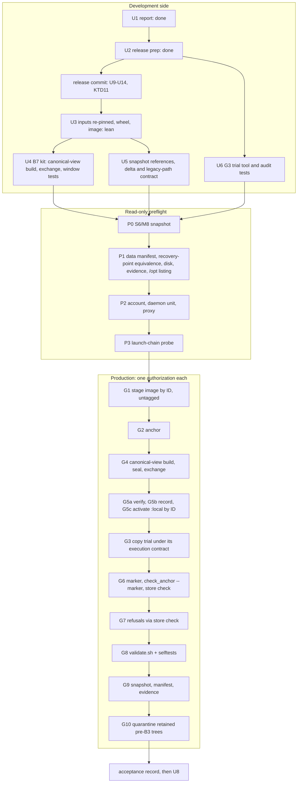
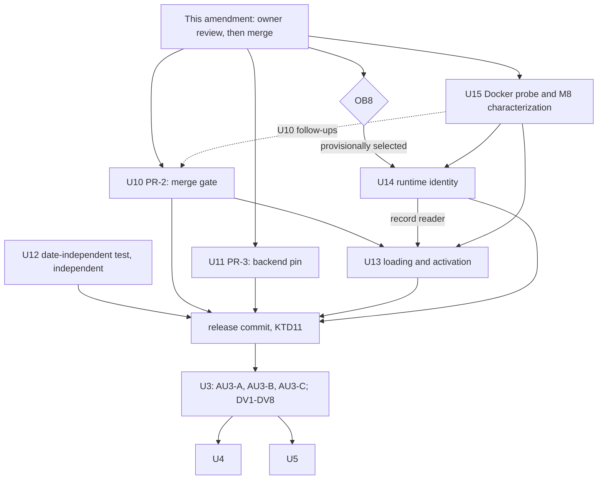

# Production promotion of B1-B3 (B7) - Plan

## Goal Capsule

- **Objective:** install B1, B2 and B3 in production through a gated promotion. Revision 2026-11-16 adds image staging and activation by ID (U13) and, if OB8 includes it, runtime image identity (U14).
  - B1 refuses root and a missing configuration source.
  - B2 adds checked-hash bytecode, `-B` launchers and an `INSTALL` record.
  - B3 adds the production anchor and the store marker.

  The data directory, the recovery point, the two overdue rechecks and every retained piece of evidence stay unchanged. The only intended change in the data directory is the store marker.
- **Release:** version **0.2.1** (U2). B1 (#21), B2 (#22) and B3 (#23) are in `main` since `fdd5003`. The **release commit** is the later `main` commit that also contains the U3 prerequisites U9-U13, and U14 if OB8 includes it (KTD11). B4-B6 are out of scope.
- **Revision 2026-11-16:** reconciles the first U3 run (U3-A), which stopped at its test gates, with this plan. It adds:
  - the remediation units U9-U11 (labelled PR-1 to PR-3 in the owner's remediation records), plus U12;
  - image loading and activation (U13), runtime image identity (U14, scope decision OB8), and a diagnostic Docker-behaviour probe with M8 characterization (U15);
  - the release-commit and evidence rules (KTD11-KTD13);
  - the revised U3 acceptance, and the G1/G5/G8 integration.

  It also changes:
  - the release base, from `fdd5003` to the release commit (KTD11);
  - U3's prerequisites, acceptance and HOLD conditions;
  - G1 (staging, with a capacity limit of one attempt), G5 and G8;
  - the image rows of the inventory, rollback, intermediate-state and U5 delta tables;
  - the STOP conditions, acceptance criteria 1, 10 and 11, and D2, D3 and D8;
  - U4's scope (the G1/G5/G8 integration and a load check).

  Final wording before commit: the G1 stream filter is marked as a proposed design, conditional on U15, with an acceptance condition whose failure is a STOP. I-IMG's scope is stated: enforced on the B7 promotion path, procedural for M8 and pre-B3 paths. A U15 contradiction is a STOP and owner review. U12's one gate role is U3's offline-suite acceptance.

  Owner review corrections: U13 adds a real-daemon filter acceptance test to its merge gate, and the Compose fallback of an ID-embedding name requires demonstrated race-safe enforcement against an independent retag, or is a STOP.
- **Revision 2026-11-11:** U1 (the compatibility and inventory report, owner-held) is done, and this revision incorporates it. A design review in U2 then specified, and demonstrated on a scratch analog, three things: the cutover topology (KTD9), the copy trial's preventive layer (G3), and the intermediate deployment states. The owner's provisional directions on OB1-OB7 are recorded under "Owner decisions". They direct planning only and authorize nothing.
- **Status:** plan only.
  - U1 and U2 are done, and so is U9 (PR-1, #25).
  - U10 (PR-2) is an open draft (#26), not authorized to merge.
  - U11-U15 have not started, and U3 is on HOLD.

  Each step marked **[AUTH]** or **[PRIV-READ]** needs its own explicit owner authorization (`AGENTS.md` §6).
- **Authority:**
  1. `AGENTS.md`;
  2. the B1-B3 plans (`2026-11-09-002`, `2026-11-09-003`, `2026-11-10-001`) and their residual findings;
  3. backlog item B7;
  4. this plan.

  The one departure from a B3 operational note (the G3 trial) is recorded as an amendment in the B3 plan and in `deployment.md` (U2).
- **Stop and ask** if a step would do any of these:
  - alter retained evidence;
  - open the live store or run `run` against it;
  - remove a marker;
  - weaken a check or accept a skip;
  - delete historical evidence to make space.

**Terms:**
- **S6** is the owner kit's "installation accepted" state.
- **T1-T5** are the backlog's §5.3 trial-tooling items.
- "B3 note *n*" is item *n* of the B3 plan's Operational Notes.
- "The backup tool" and "the restore tool" are the owner's tooling, which lives outside this repository.
- Sizes are labelled **measured**, **historical** (from the owner's sealed records), **estimate** or **unknown**.

---

## Problem Frame

B1-B3 are merged but not installed. In the 2026-11-06 incident, root CLI runs wrote bytecode into the code tree and created a stray store, and recovery took several days of gated work. B7 installs those guards before any live run (O7).

B7 differs from M6-M8 in five ways:

1. **New persistent objects outside the code tree:** the anchor `/etc/brandsentinel/production.yaml`, the marker `BRANDSENTINEL-STORE` in the live data directory, and (revision 2026-11-16) the image approval record beside the anchor (KTD12).
2. **A different installed tree:** B2 adds checked-hash `.pyc` for `site-packages` and the bundled standard library, `-B` launchers and an `INSTALL` record. Every content pin of the M8 tree goes stale.
3. **Copies refused once marked:** B3 refuses a marked copy anywhere but the canonical path. Isolated acceptance and copy-based rehearsals cannot use a marked copy.
4. **The CLI refuses invocations older procedures used:**
   - root, for `sandbox check|selftest|sweep` and `proxy`;
   - on the production store, a relative `-c`, a store variable, `PYTHONPATH` or `python -m`;
   - with no anchor, every store command run from an installation;
   - inside a user namespace, where root-owned files appear as the overflow UID (X12).
5. **The rootless daemon starts from inside the code tree** (X11), so the cutover window has a service dependency that the M8 kit only detected and did not prevent.

---

## U1 results (summary)

The owner holds the U1 report and its sealed evidence. Repository-derivable facts:

- **Schema: unchanged.** The migration trees are byte-identical (v5). Store, pipeline, policy and analysis code is unchanged, and `bundle/4` too. The only store-layer change is the pre-open guard. M8 code opens a marked scratch store and keeps the marker byte-identical.
- **Configuration: unchanged.** The configuration model and its defaults are identical, and `service.yaml` is unchanged. B3's `path_failures(service.yaml)` is empty. The anchor template agrees with `service.yaml`.
- **Dependencies: unchanged.** `uv.lock` was byte-identical to M8's until U2. U2 changes only the project's own version line (X13). `docker/` and the image build script are unchanged.
- **Bytecode (measured, CPython 3.12.14):**
  - code objects compiled from the same source under different paths compare **equal**, so the verifier passes at any prefix;
  - the marshalled `.pyc` bytes **differ** and embed the absolute path.

  So:
  - identical wheels do **not** give byte-identical installations;
  - verifier success does **not** prove byte identity;
  - launcher shebangs, `pyvenv.cfg`, `INSTALL` and the wheel RECORD files also carry the prefix or a time.
- **Sizes:**
  - the M8 install tree is 419,057,664 B (historical: three identical rehearsal installs);
  - B2 adds about 3,650 `.pyc` files and about 73 MB (estimate), so the B7 tree is about 0.49 GB (estimate, 0.48-0.51 GB);
  - the image changes only its two top layers (historical: layers 0-4 are shared with M7 and M8). The increment on a daemon is about 0.67 GB (estimate, 0.45-0.75 GB).
- **Copy classification (measured, B3 `classify` on a synthetic layout):**
  - an unmarked sibling copy, or an unmarked recovery-point copy, is development-class;
  - a marked copy is production;
  - **the account's home `/var/lib/brandsentinel`, an ancestor of the store, is production**;
  - installed B7 code refuses every store command until the anchor exists.

---

## U3-A results and remediation (revision 2026-11-16)

**Terms.** The owner-held U3 proposal splits U3's authorization into three slices:
- **AU3-A:** offline (pinned inputs, wheel builds, test suites);
- **AU3-B:** the image build, which needs package-index access for its pip layer, and registry access for the `docker/dockerfile:1` frontend and the base image only if a read-only check shows they are not already present;
- **AU3-C:** the Docker gates, including the SP3 tests that need public egress.

"U3-A" is a run under AU3-A. The owner's remediation records call the units U9, U10 and U11 "PR-1", "PR-2" and "PR-3". Both names are kept.

**U3-A outcome (2026-11-11, owner-held evidence): stopped at the test gates.** These passed:
- the Python archive verified against its checksum, then copied into durable developer storage (X14);
- the uv cache equal to its content and metadata pins;
- an offline install complete with 46 packages, identical to M8's;
- the lock differing from M8's only in the project version;
- the sandbox requirements byte-equal to M8's;
- two wheel builds with equal hashes.

**Findings and where each is handled:**

| Finding | Row | Handled by |
|---|---|---|
| The build backend is unpinned. The cached backend version differed from the one in the M8 image, and M8's rehearsal wheel differed from its image wheel | X16 | U11 |
| The verifier compared only `.py`, `.sql` and `.j2` files, so it missed 4 of the wheel's 91 package files, the dist-info, the dependency set and the bytecode the image imports | X20 | U10 |
| The "offline" suite resolved names through the host's resolver, and a fetch stop condition raced | | U9 (merged) |
| Inside a user namespace, the offline demo fails `anchor_unsafe` (X12) and the 8 real-ownership `installed_layout` tests cannot run | X18 | OB9; U3 |
| A date-dependent test began failing on 2026-11-13, on `main` too | X19 | U12 |
| PR-2's review found that loading is not transactional, and that sandbox eligibility follows a mutable tag | X17 | U13, U14 |

**Remediation state (verified in git and on GitHub, 2026-11-16):**

| Unit | Alias | State |
|---|---|---|
| U9 | PR-1 | merged: #25 into `main` `f78913d` |
| U10 | PR-2 | draft #26, head `e3a135a` on base `f78913d`. CI passes; CI does not run the verifier tests. Five review rounds. Not authorized to merge |
| U11 | PR-3 | not started |
| U12 | none | not started |
| U13 | none | not started; needs this amendment |
| U14 | none | not started; scope decision OB8 |
| U15 | none | not started; Docker-behaviour probe and M8 characterization before U13 (review finding, revision 2026-11-16) |

---

## What B7 changes (complete inventory)

| Area | Change | Reversible by |
|---|---|---|
| Installation | new root-owned tree at `/opt/brandsentinel`, built at the canonical path in a private mount namespace, then exchanged into place atomically (KTD9) | exchange back |
| Installation | the M8 tree under an aside name after the exchange; moved into the quarantine parent at G10, after acceptance | rename back, then exchange |
| Installation | a staging directory beside `/opt/brandsentinel` (same filesystem) during G4 only | renamed by the exchange; a failed one is retained |
| Image | new image streamed into the account's daemon **untagged**, saved by ID (G1, KTD12); `:local` tagged by the approved ID at G5c, with the M8 image under a hold tag by its ID | retag `:local` by the M8 ID |
| Host configuration | the image approval record (root-owned, beside the anchor; exact name and format set in U14), written at G5b after a passing G5a | G5r writes the M8 ID; M8 code ignores the record |
| Account runtime | the image-lock file in the account's runtime directory (transient, outside the G9 snapshot) | removed with the runtime directory |
| Evidence | the sealed `docker events` log of the account daemon, G1-G9 | kept as evidence |
| Containers | G8 recreates `bs-egress-proxy` (running) and the lab containers (left stopped) on the new image | ordered G8 rollback |
| Account home; `/var/lib` | one `validate.sh` result directory in the account's home; the G3 trial directory `/var/lib/brandsentinel-b7-trial/` (root-owned parent, outside the account's home) | kept as evidence |
| Host configuration | `/etc/brandsentinel/` (0755 root) and `production.yaml` (0644 root), written then renamed into place | root removes; M8 ignores |
| Data directory | adds `BRANDSENTINEL-STORE` (regular file, account uid, mode 0444, one link) and changes the directory mtime. **Nothing else** | the marker stays (KTD6) |
| Schema, configuration, account | **none** | |
| Snapshot references | B7 references beside the M8 ones (U5) | keep M8 references |
| Docs (repo) | U2 (#24); revision 2026-11-16; the U10, U13 and U14 runbook, deployment and security pages; U8 after acceptance | git |

---

## Contradictions between B1-B3 and the M8 deployment

| # | Contradiction | Resolution |
|---|---|---|
| X1 | **Disk.** The root filesystem holds `/opt`, `/var/lib`, `/var/tmp` and `/var/backups`. It has enough space for B7 above its floors for **one** G4 attempt only (see "Capacity") | Capacity contract below. OB2 |
| X2 | **Launch chain.** The runbook used `systemd-run --user -M`, which M8 and I1 r3 abandoned because transient units drift the host-unit snapshot | **Done in U2:** the runbook defines the sudo-first, `env -i` chain with explicit runtime variables and a working directory the account owns |
| X3 | **Copy trial.** B3 and `deployment.md` call pre-marking copies "not a sanctioned trial route" | **Done in U2:** one exception is recorded in both, for G3 only, under its execution contract |
| X4 | **Retained pre-B3 trees** can still open the live store without the guards | G10 quarantine after acceptance; ordering in U5 |
| X5 | **Version** was still 0.2.0 | **Done in U2:** 0.2.1 |
| X6 | **Path-bearing files.** Bytes depend on the prefix | KTD3 verification layers; the canonical-view build (KTD9) makes the final-path bytes reproducible |
| X7 | **Order.** No anchor means every installed store command refuses. `check_anchor.py` needs B3 code. `validate.sh` needs the marker | Order: G1 → G2 anchor → G4 code → G5a verify, G5b record, G5c activate → **G3 trial** → G6 marker → G7 → G8 → G9 → G10 |
| X8 | **Subprocess tests read the host anchor** (B3 residual) | G2 verification re-runs the developer's suites against the real anchor. G8's scratch `run` invocations use temporary stores only |
| X9 | **First live open** | Deferred beyond B7 (OB4) |
| X10 | **The backup tool** uses `systemd-run -M` (L2) | Not needed if P1 establishes recovery-point equivalence and restore usability (OB6). Otherwise revised tools come first |
| X11 | **Rootless daemon restart hazard.** The account's `docker-rootless.service` has `ExecStart=/opt/brandsentinel/bin/dockerd-rootless.sh`, and that launcher re-executes its own path (`"$0"`) inside rootlesskit. With `Restart=always`, `RestartSec=2` and `StartLimitBurst=3` per 60 s, a daemon exit while the canonical path is absent or incomplete fails three times, then the unit stays failed and every container stays down | KTD9 plus the daemon guards; tested in U4 (see "Cutover topology") |
| X12 | **User namespaces.** Inside one, root-owned files appear as UID 65534 (measured). Installed B3 code then refuses (`anchor_unsafe`), and installation detection fails | No namespace around installed code (G3 uses observation, not confinement). U4 harnesses use `--map-auto` with `setpriv`, as the installed-layout tests do |
| X13 | **Lock hash.** The version bump changes `uv.lock`'s hash (one line, the project's own version). The M8 kit pinned the old hash | U3 re-pins the lock hash and asserts that every dependency entry equals M8's |
| X14 | **Aged inputs.** The pinned Python download cache sits in `/var/tmp`, which has a 30-day age-out rule; its directory dates from 2026-10-18 and its contents are unverified. The M8 inputs on the home filesystem exist | U3 inventories, verifies and re-pins into durable storage before any reproducibility claim (see "Pinned inputs") |
| X15 | **Developer filesystem capacity.** An M8-style build and rehearsal (two image archives, three retained rehearsal trees, three cache copies) would end below the kit's 5,120 MiB floor on the developer's home filesystem | The lean U3/U4 workflow (see "Capacity"). No historical evidence is deleted |
| X16 | **Build backend unpinned.** `pyproject.toml` requires `hatchling>=1.25`. The image path (`scripts/build-sandbox-image.sh`) and the install path (`scripts/service-account/install.sh`) build the wheel separately, and may resolve different backends. The wheels then differ in `WHEEL` and `RECORD`, and the load profile's dist-info equality fails | U11 pins the backend for both paths |
| X17 | **Image eligibility follows a mutable tag.** `docker load` applies the stream's tags before any check. Sandbox preflight checks only that `sandbox.image` exists (`src/brandsentinel/sandbox/preflight.py`). The runner and the Compose files start containers by tag (`src/brandsentinel/sandbox/runner.py`, `docker/compose.yaml`) | KTD12; U13 and U14 |
| X18 | **User-namespace test artefacts.** The offline demo refuses with `anchor_unsafe`, and the 8 real-ownership tests need `newuidmap`, which nested isolation blocks | U3 runs on real ownership, under the isolation OB9 chooses |
| X19 | **Date-dependent test.** `test_full_replay_skips_records_older_than_event_retention` pins the replay time to a fixed date, but stamps the record with the wall clock | U12 |
| X20 | **The verifier contract was under-specified.** U3 said only "`image_manifest.py` with `verdict: ok`" | U10 defines the profiles and the binding; the revised U3 acceptance names them |
| X21 | **The Python install follows ambient uv configuration** (found in U10's review, 2026-11-17). `install.sh`'s `uv python install` does not run through `scripts/uv-clean.sh`. A downloads-list URL from `UV_PYTHON_DOWNLOADS_JSON_URL` or from any `uv.toml` (working directory, user or system) makes it install an arbitrary archive, checked only against the checksum that list supplies (reproduced with uv 0.12.20) | **Unresolved; a mandatory blocker before U3's release build. Not an accepted risk.** Resolving it needs U3's Python-archive inputs written down and a fix under its own owner authorization; no unit is assigned yet. Until then `install.sh` runs only from a clean environment with no `uv.toml` (runbook step 4) |

**Confirmed consistent:**
- the backup and restore tools copy (`cp -a`, `mv --exchange`), never hard-link;
- the proxy runs as `pwuser`;
- the interpreter is inside the prefix;
- `store check`, `sandbox check|sweep|selftest` and `check_anchor.py` open no store;
- only `run` promotes deferred work;
- `installed_layout` tests are not in the SP3 selection.

---

## Key Technical Decisions

- **KTD1: the invariant is a manifest of the data directory.**
  - The manifest records every entry with path, type, mode, owner, link count, size and sha256, plus the presence of `-wal`, `-shm` and `-journal`.
  - Taken at P1 and G9, the two must be equal except for the marker and the directory mtime.
  - No `run` and no open against the live store.
- **KTD2: order.**
  - **Anchor (G2) first.** M8 ignores it.
  - **Code (G4), then verification, the approval record and activation by ID (G5a-G5c).**
  - **Then the copy trial (G3)** with the installed B7 code, while the anchor exists and the store is still unmarked. This needs no second tree on the root filesystem.
  - **Then marker (G6), refusals (G7), validation (G8), snapshot (G9), quarantine (G10).**
- **KTD3: verification layers.** No single check proves the installed tree.

  | Layer | What it proves | What it does not prove |
  |---|---|---|
  | (a) `check_bytecode.py` verdict (source hash, cache tag, checked-hash flag, code equality) | every `.pyc` matches its source and the launchers are hardened | byte identity, the path embedded in a `.pyc`, the rest of the tree |
  | (b) final-path content manifest: every file's sha256 at the canonical path, compared with the U4 rehearsal **built at the canonical path** (KTD9) | the tree's bytes are the rehearsed bytes | that the rehearsal was right (that is (a), (c) and U3) |
  | (c) package set (`pip freeze`) equals the lock; wheel hash equals U3's double build | the dependencies and the package | file layout |
  | (d) ownership and modes: root-owned, nothing group- or world-writable, no hard links | the permission boundary | content |

  A raw-byte comparison against a rehearsal at any other prefix is never used. A normalized ("N") comparison is the fallback only for files proven to carry nothing but the prefix.
- **KTD4: no automatic restoration.** Rollback is code-only, unless KTD1 breaks. **Any rollback leaves production unguarded:** CLI use against the live store is frozen until B7 is re-promoted.
- **KTD5: root never demonstrates a refusal.** Real root ownership is verified by metadata only.
- **KTD6: the marker is never removed.**
- **KTD7: evidence is read only, by hash and metadata.** G10's renames are the only planned change.
- **KTD8: refusals are exercised only through `store check`,** against the live path, with a manifest after every case.
- **KTD9: build at the canonical view, then exchange.** The design is specified in full under "Cutover topology", and the U2 design review demonstrated its mechanics on a scratch analog.
  - **Build:** the developer builds inside a private mount namespace in which the canonical path is a bind mount of a staging directory, a sibling of `/opt/brandsentinel` on the same filesystem. The rest of `/opt` is masked, so every embedded path is the final one.
  - **Seal:** first the N1 detection check (no live build process or open reference into staging; N1 does not prove that no mount reference persists). Then root takes ownership, which is the write barrier, and checks KTD3 (a)-(d). The sealed content manifest is re-taken after the exchange and at G9.
  - **Exchange:** one `renameat2(RENAME_EXCHANGE)` (`mv -T --exchange`) swaps the trees. Then M8 is renamed to its aside name.
  - **Result:** at every instant the canonical path names a complete tree, with the same pinned launcher. This is **path** atomicity. It does not keep the Docker service up (see "Path atomicity is not service availability").
  - **This replaces the M8 kit's install-in-place window.** Whether `install.sh` runs unchanged in the namespace is unproven until U4 (K11).
- **KTD10: capacity accounting is per filesystem.**
  - Floors are never lowered.
  - Staging image storage (the developer's daemon, home filesystem) and production image storage (the account's daemon, root filesystem) are accounted separately.
  - A failed install is retained, so each retry consumes a tree's worth of space.
- **KTD11: one release commit, and evidence bound to it.**
  - **The release commit** is the `main` commit that contains U9-U13 (and U14 if OB8 includes it), at version 0.2.1. U3 works from a frozen clone of it, and records its commit and tree hash.
  - **Built from it:** the wheel (from both paths, with equal sha256 by U11), the image and its ID, the bound release report and `manifest_sha256`, and the lock sha.
  - **Results that may carry over from another commit:** only those that depend on tree contents alone, and only when the two tree hashes are equal. These are lint, the unit and offline suites, the docs build, and reviews of unchanged files.
  - **Results that never carry over:**
    - anything that names a commit (the `INSTALL` record);
    - artifact identities (the wheel's sha256, the image ID);
    - real-image and runtime results (SP3, selftests, T2a, `installed_layout`);
    - the owner's approval.
- **KTD12: image eligibility is an approved ID, never a tag.**
  - **Invariant I-IMG:** a failed or unapproved image never becomes eligible for sandbox execution, including during partial failure, interruption or concurrent execution. "Eligible" covers sandbox jobs and the egress proxy.
  - **Scope of enforcement.** I-IMG is enforced on the controlled B7 promotion path: the kit's stream filter, the G5 tools, the Compose wrapper and, once B7 code is installed at G4, U14. It is **not** enforced universally while M8 and pre-B3 execution paths remain available. Before G4, and for pre-B3 trees until G10, it rests on the freeze, with detection only (F5'). The account's own manual Docker commands are outside it at any time (see the residuals).
  - **The approval record** is root-owned and names one approved image ID. Root writes it at G5, from the owner's approval of the sealed build record. It is separate from any verifier pass.
  - **No load can name an image.** A validating stream filter refuses any name-bearing archive member before it reaches `docker load` (G1). This is a proposed design, conditional on U15 and on the filter's acceptance condition (see "The G1 stream filter").
  - **Approval before activation.** G5 verifies against the installed tree first; root then records the ID; activation tags only the recorded ID.
  - **Starts are bound to the ID.** Compose starts receive the record's ID, not a tag. At runtime, U14 (OB8, provisionally selected) makes tags non-authoritative for the runner and preflight.
  - See "Image loading and activation".
- **KTD13: acceptance evidence comes from the final release commit and its artifacts.**
  - **What counts:** acceptance evidence (U3, U4's rehearsal, P0-P3 and the G-steps) is taken only on the approved release commit (by tree hash) and on the artifacts built from it (the wheel's sha256, the image ID).
  - **Environment fingerprint.** U3's build record, U4's rehearsal record, and the records of P2, G1 and G8 each hold one. It contains:
    - the tree hash and the artifact identities;
    - the Docker engine, containerd and Compose plugin versions; rootlesskit and slirp4netns versions; the storage driver and image store;
    - the base image digest;
    - the kernel release;
    - the uv version and hash, and the pinned-input hashes;
    - the tesseract version;
    - the OB9 isolation method.
  - **Re-verification.** Before U4, G1 and G8, and at acceptance, each piece of evidence is compared with the current fingerprint. Evidence whose trigger changed is re-run before acceptance. An unexplained difference is a STOP.

    | Trigger | Invalidates |
    |---|---|
    | tree hash, wheel or image ID | everything except tree-only results (KTD11) |
    | Docker engine, containerd, Compose, rootless stack, storage driver or image store | DV1-DV8, SP3, selftests, T2a, the G1 filter allowlist |
    | base image digest | the image and every real-image result |
    | kernel release | SP3, selftests, the `installed_layout` and user-namespace tests |
    | uv, or pinned inputs | the wheels, the offline install, the image |
    | tesseract, or the OB9 method | the offline suite |
  - **Runs on other commits or artifacts** (U10's, U13's and U14's tests and merge gates, U15) are development evidence. They inform decisions and accept nothing.
  - **For U10:** its merge needs no real-image evidence, because acceptance is taken on the release commit and its artifacts in any case. U10 changes neither the wheel nor the image.

---

## High-Level Technical Design

### Sequence and authorization



G-numbers are stable identifiers. G3 runs after G5.

### Development sequence before U3 (revision 2026-11-16)



**Why this order:**
- **U12 first:** it is independent and test-only, and it removes a known failure from every later suite count.
- **U10 before U13:** both change `load-image.sh`, and merging U10 first avoids stacked branches. U10 changes neither the wheel nor the image, and acceptance is taken on the release commit and its artifacts in any case (KTD13).
- **U11 is independent of U10** (different files), but must land before the release commit, which needs equal wheels from both paths.
- **U15 before U13:** U13's load contract depends on Docker behaviour (K14, K15) that only a real daemon shows. Settling it before the release commit avoids a new release commit and a full U3 rerun later.
- **U14 before U13** (OB8 provisionally selected): U14 owns the single approval-record reader that U13's scripts and Compose wrapper call. If OB8 is reversed, U13 defines the record and its reader.
- **U3 runs only on the release commit.** U6 does not depend on it and may proceed after U2, as before.

### Rollback architecture

A row covers its step and every later step until the next row. Every rollback is an owner decision with a fresh authorization. Every state after a code rollback is **"production unguarded"** (see "Intermediate deployment states").

| Reached | State | Rollback | Data |
|---|---|---|---|
| G1-G2 | M8; an extra **untagged** staged image (KTD12); anchor | leave both, or root removes the anchor. A rejected staged image is retained untagged as evidence; removing it is an O5 decision | unchanged |
| G4 before the exchange | M8 at canonical; staging tree present | none needed; production unchanged. Staging retained as failed | unchanged |
| G4 exchange interrupted | before or after the exchange, never in between (one `renameat2` call) | the classifier reports which; continue or roll back as in the next rows | unchanged |
| G4 exchanged, aside rename pending | B7 at canonical; M8 under the staging name | exchange back (M8 to canonical, B7 to the staging name, then renamed as failed) | unchanged |
| G4 done, G5 | B7 at canonical; M8 at the aside name; approval record and `:local` name the B7 image ID | exchange aside ↔ canonical; rename B7 as failed; G5r writes the M8 ID into the record; retag `:local` **by the M8 ID** under the image lock (KTD12) | unchanged |
| G3 stopped | as above + trial directory | trial directory made root-only and retained; assess with KTD1 | unchanged |
| G6 interrupted | the marker's temporary file may remain | STOP. The owner removes only that named temporary file, then the manifest is taken again | temporary file only |
| G6-G7 | + marker | as for G4-G5. The marker stays | marker |
| G8 interrupted or failed | proxy and lab possibly on the new image | in order: stop the lab (through the wrapper); G5r (root); retag `:local` by the M8 ID under the lock; exchange the code back; recreate the proxy from the M8 tree's Compose file (the one allowed unwrapped start), then a post-start check against the M8 ID **[AUTH Docker]**; recreate the lab stopped | marker |
| G10 done | trees quarantined | rename the M8 tree out of quarantine (root), then exchange | marker |
| any point: KTD1 broken | | STOP and preserve. The owner chooses a restore from the verified recovery point (then re-mark) or an investigation | restore |

**Decision points:**

| Point | Where | Outcome |
|---|---|---|
| DP1 | after the G4 seal | stop before the exchange on any KTD3 or N1 failure |
| DP2 | G6 `store check` | anchor correction by root, or rollback |
| DP3 | G8 | retry only under a new authorization and for an environmental cause; otherwise roll back |
| DP4 | G9 | STOP and preserve |

---

## Intermediate deployment states

From G2 until the acceptance record, a **freeze** applies. The only CLI use against the live store is `store check` (G6, G7), which never opens it. There is no `status`, no `cases list` and no `run`, so the two overdue rechecks stay deferred: only `run` promotes them. The freeze is procedural. The table shows where B3 also enforces it and where nothing does.

| State | Canonical code | Anchor / marker | `:local` / proxy image | Who may open the live store | Unguarded paths | Rollback |
|---|---|---|---|---|---|---|
| after G2 | M8 | yes / no | M8 / M8 | anyone the M8 CLI lets in, as today (M8 ignores the anchor) | all of M8 | none needed |
| after G4 + G5 | B7 | yes / no | B7 / **M8** (a running or restarted container keeps its image ID) | B7 lets only the account with the approved `-c`, clean variables and the installed launcher open it. Root, the developer, a relative `-c`, store or Python variables, and copies are refused with named exit 2. The approved path is frozen procedurally | **the M8 aside tree** and older pre-B3 trees: their CLIs ignore the anchor and refuse nothing for most commands | exchange back; G5r writes the M8 ID into the record; retag `:local` by the M8 ID under the image lock (see "Rollback architecture") |
| during and after G3 | B7 | yes / no | B7 / M8 | as above. The trial identity is refused by the kernel and by B3 (see the G3 contract) | as above | as above; trial directory retained root-only |
| after G6 + G7 | B7 | yes / **yes** | B7 / M8 | as above; marked copies are now refused anywhere | as above | as above; the marker stays (M8 ignores it) |
| after G8 | B7 | yes / yes | B7 / **B7** | as above | as above | the ordered G8 rollback |
| after G10 | B7 | yes / yes | B7 / B7 | as above | **none reachable by the account** (the quarantine parent is root-only 0700) | un-quarantine, then exchange |

**Datastore integrity across the states:**
- the live database is never opened;
- a rollback is code-only;
- the marker is the only data change.

The KTD1 manifest is checked at G3 (before and after), at G6, after every G7 case, and at G9. Any other delta is a STOP.

**Rechecks:** they stay deferred and unpromoted through every state. G3 no longer runs `run`, even on the copy.

**Image eligibility across the states (KTD12):**
- From G1 until G5b the staged B7 image is ineligible, and until G5c it is unnamed: the G1 filter lets no name through.
- From G5b the record names the verified, approved B7 ID; from G5c `:local` does too.
- With B7 code (from G4), U14 disables sandbox stages on any mismatch. Before G4, and in pre-B3 trees until G10, M8 resolves `:local` and its loader can move it. That is **procedural** (the freeze forbids M8's loader and any `run`), and **detected** by the identity checks and the event log (F5').

---

## Cutover topology (KTD9)

**Physical layout on the root filesystem:**
- **Canonical:** `/opt/brandsentinel`, the M8 tree, root-owned.
- **Staging:** `/opt/brandsentinel.b7-staging`. Root creates it at G4 as an empty directory owned by the developer, mode 0755, as in runbook step 4. It is a sibling of the canonical directory, on the same filesystem (`stat -c %d` equal; else STOP), and is not a mount point.

**Build namespace** (the developer, no root):

```text
unshare --user --map-current-user --keep-caps --mount --propagation private --net
  1. bind-mount the staging directory onto a private stash point
  2. mount an empty tmpfs (0755) over /opt          -> M8 and every sibling become unreachable
  3. mkdir /opt/brandsentinel; bind-mount the stash onto it
  4. run install.sh with PREFIX=/opt/brandsentinel, offline, from U3's inputs
```

**Properties:**
- **Mount identity:** inside the namespace, `/opt/brandsentinel` has the host staging directory's device and inode, so every write lands in the staging tree.
- **Host visibility:** private propagation means the host's mount table never shows these mounts.
- **Final-path semantics:** `realpath` is the canonical path, so shebangs, `pyvenv.cfg`, `.pyc` and RECORD files carry it. The staging name appears nowhere.
- **UID view:** root-owned files appear as UID 65534 inside (X12). `install.sh` does not need root ownership; the M8 kit already ran it in a user namespace.

**Demonstrated in the U2 design review** on a scratch analog (an ext4 directory tree standing in for `/opt`; no root, no real `/opt`; evidence owner-held):
- equal device and inode inside and outside;
- zero host-visible mounts;
- the sibling tree unreachable from the build;
- the two path-bearing files carrying the final path, with zero occurrences of the staging name;
- the canonical tree untouched during the build.

**Seal (root), only after N1:**
- **N1 (a detection check, at scan time):** no process is in the build's mount namespace (its recorded `mnt:` inode, scanned across `/proc/*/ns/mnt`), and no process references the staging tree by device and inode through an open descriptor, its working directory, its root or a memory mapping (`/proc/*/fd`, `cwd`, `root`, `map_files`). The review showed why: a bind mount alive in another namespace does **not** block the host's rename, and a late write through it lands in the moved tree.
  - **N1 does not prove** that no mount reference persists. A mount namespace can outlive its processes when an nsfs bind mount or a descriptor held by an unrelated process pins it, and a bind mount can exist elsewhere. A process scan sees neither. N1 does not prove the absence of every writable path either.
  - **The write barrier is the seal.** After `chown -R root:root` and `chmod -R go-w`, a surviving non-root mount reference gives no new write access, because opens are checked against root ownership. Only descriptors opened before the seal keep write access, and N1 sees them only while their holder is alive.
  - **The residual is caught after the fact.** The sealed content manifest (KTD3 b) is re-taken after the exchange and at G9 and must be unchanged. A difference is a STOP.
- Then `chown -R root:root` and `chmod -R go-w`, followed by KTD3 (a)-(d) on the staging tree. Layer (b) compares raw bytes with the canonical-view rehearsal, and also checks that the staging name appears in no file.

**Exchange prerequisites:**
- GNU `mv` with `--exchange` (coreutils 9.5 or later; the host has 9.12, measured);
- `renameat2(RENAME_EXCHANGE)` support on the root filesystem (ext4, measured);
- both paths exist;
- same filesystem: `EXDEV` otherwise (demonstrated);
- neither path a mount point in root's namespace: `EBUSY` otherwise (demonstrated);
- N1 passed;
- run by root.

The kit probes the exchange first on two scratch directories in `/var/tmp`, which is on the same filesystem.

**Window:**
1. the daemon guard (below);
2. the exchange;
3. the aside rename;
4. the daemon guard again;
5. the account-side checks (`check_bytecode.py`, `check_anchor.py` without `--marker`).

**Demonstrated on the analog:**
- 2,376 exchanges ran concurrently with 1,312 reads of the canonical launcher, with zero missing or wrong;
- a rollback is one exchange;
- a missing target, a cross-filesystem pair and a local mount point each fail with nothing changed.

**Interruption and failure behaviour:**

| Point | State | Behaviour |
|---|---|---|
| build or seal interrupted | production unchanged | staging retained as failed; no retry without O5 (capacity) |
| exchange call fails | unchanged (a single call) | stop |
| crash or power loss around the exchange | on ext4 the exchange is one journaled metadata operation: expected pre- or post-exchange after recovery | the classifier must recognize both. This is **not** testable by power cut in U4; recorded as an expectation |
| after the exchange, before the aside rename | B7 canonical, M8 under the staging name | classifier state "exchanged, not renamed"; continue, or exchange back |
| post-checks fail | B7 canonical, M8 aside | DP1 or DP2: exchange back |

### Path atomicity is not service availability

The exchange guarantees that a daemon **(re)start** at any instant finds a complete launcher with identical bytes. It does not keep the daemon or the proxy running, and it does not replace them:

- **The running daemon** is unaffected by the exchange: it does not re-read the launcher while running. No BrandSentinel process runs during G4 (holder check by device and inode).
- **A daemon crash for an unrelated reason** still restarts it, and the restart now succeeds. Failures not caused by the path are still bounded by `StartLimitBurst`.
- **Containers keep their image IDs.** The proxy runs the M8 image until G8 recreates it. G5 activation affects only new containers.
- **Availability is measured, not assumed:** the account's unit `MainPID`, `NRestarts` and `ActiveState`, and the proxy container's ID and state, must be unchanged across the window. Otherwise exit 4.

**Dependency trace (X11)**, from `setup-rootless.sh`, the pinned `dockerd-rootless.sh` and `docker/*.yaml`:
- `docker-rootless.service`: `ExecStart=$PREFIX/bin/dockerd-rootless.sh`, `PATH=/usr/local/bin:/usr/bin:/bin`, `Restart=always`, `RestartSec=2`, `StartLimitBurst=3` per 60 s;
- the launcher re-executes `"$0"` inside rootlesskit, so its path is resolved twice per start;
- the helper binaries are in `/usr/bin`;
- every container is `restart: unless-stopped`.

Moving the launcher outside the code tree (a unit change) is optional later hardening that needs its own authorization.

### U4 acceptance tests for the cutover

The harness runs in a user namespace on a tmpfs `/opt`, with `--map-auto` and `setpriv` (X12).

| Test | Pass |
|---|---|
| W1 | a watcher hashes the canonical launcher in a tight loop through repeated exchange and rename cycles: zero misses and zero mismatches (as on the analog) |
| W2 | killed after staging creation, mid-build, mid-`chown`, after the exchange and after the aside rename: the classifier reports a defined state; rolling back leaves M8 canonical; W1 sees no gap |
| W3 | exchange unsupported, `EXDEV`, `EBUSY` or `ENOENT`: stop before the window, nothing renamed |
| W4 | staged launcher hash ≠ pin: stop before the exchange |
| W5 | a stubbed unit report with a changed `MainPID`, `NRestarts` or `ActiveState`, or a changed proxy container ID: exit 4 with the state printed |
| W6 | a sentinel planted in the "real" tree and in a sibling: never read by the build |
| N1 | (a) a live process in the build namespace, or one holding a writable descriptor, working directory or mapping into staging: seal refused. (b) a namespace pinned with **no** process (an nsfs bind mount or a descriptor held elsewhere): recorded as **not detected** by N1. After the seal, a write through it by a new open fails (root ownership), and a write through a descriptor opened before the seal is caught by the post-exchange manifest re-check |
| N2 | the host mount table shows no build mount during or after the build |
| N3 | the canonical path inside equals the staging directory outside (device and inode); staging on another device: refused |
| N4 | no file contains the staging name; every shebang and `pyvenv.cfg` names the canonical path; the raw manifest equals the canonical-view rehearsal's |
| N5 | `install.sh` completes unchanged inside the namespace (K11); if not, STOP and re-plan |

---

## Image loading and activation (KTD12)

### Today's behaviour (verified in the repository)

- **`scripts/service-account/load-image.sh` loads, then verifies.**
  - It runs `docker load`, which applies every tag the stream carries.
  - It refuses a stream that loaded an image other than the expected ID.
  - Only then does it run the verifier by ID. A failure leaves the image loaded and tagged.
- **Preflight checks existence only.** `check_runtime` in `src/brandsentinel/sandbox/preflight.py` passes if `sandbox.image` (default `brandsentinel-sandbox:local`) exists. It does not check which image the tag names.
- **Containers start by tag.** `SandboxRunner` in `src/brandsentinel/sandbox/runner.py` creates every container by that tag. `docker/compose.yaml` creates the egress proxy by the same tag.

### Failure paths against I-IMG

| # | Path | Effect without new controls |
|---|---|---|
| F1 | the stream carries `:local` | `:local` moves to the unverified image when it loads |
| F2 | the load is interrupted after the tags are applied (K14) | as F1, with no report |
| F3 | the verifier fails, is incomplete or is killed | the image stays loaded, under whatever tags the stream carried |
| F4 | an activation or rollback retags from a tag, not an ID | the wrong image becomes `:local` if that tag had moved |
| F5 | a `run` is active when the tag moves, or the tag moves between preflight and container creation | the runner starts an image preflight never saw |
| F6 | Compose recreates the proxy while `:local` names an unapproved image | the proxy runs it, with egress |
| F7 | the approval record is missing, unsafe or wrong | the trust anchor is unclear. The verifier checks only an ID's format, not where it came from |
| F8 | a staged untagged image is pruned or garbage-collected before G5 (K15) | activation finds nothing |

### Options

| Option | Design | Against I-IMG |
|---|---|---|
| A | load as today, and restore `:local` after a failure | **Rejected.** A compensating action fails exactly when a run is interrupted or its cleanup fails (F1-F3) |
| B | **tag-free staging and ID-bound starts, scripts only (U13).** A validating stream filter refuses any name-bearing archive member before `docker load` receives it. G5 verifies against the installed tree, then root records the ID, then activation tags `:local` by that ID. Every Compose start receives the record's ID from a wrapper, under a lock | F1-F4, F6-F8 prevented or fail closed. **F5 is not prevented** once the freeze ends: the runner still creates containers by tag |
| C | **B plus runtime identity enforcement (U14).** Preflight requires `sandbox.image` to resolve to the record's ID, and the proxy container to run it. The runner creates every container by the resolved ID | F1-F8 prevented or fail closed; F5 closed by U14 |

**Selected provisionally: option C (OB8, 2026-11-16).** It is a planning decision, subject to this contract and to SP3 acceptance, and authorizes no implementation.

**U14: value, cost and SP3.**
- **Value:**
  - it closes F5 (the runner's time-of-check/time-of-use gap, and concurrent runs) for every instance and stage;
  - preflight refuses a proxy on another ID;
  - I-IMG then holds by enforcement, not by the freeze.
- **Cost:**
  - a change under `src/brandsentinel/sandbox/` and a record reader;
  - security tests, a full-depth review and docs;
  - widening 0.2.1 beyond B1-B3;
  - **a delay to installing the B1-B3 guards**, since the release commit waits for U14's merge gate;
  - **no live-store exercise in B7.** The enforcing path is first exercised at G8 by `sandbox check --strict` and the selftests under the account. The SP3 tests construct the runner directly, so they exercise only the by-ID creation.
- **SP3:**
  - `docker or security`, 0 skipped, on U14's head as its merge gate (`AGENTS.md` D5);
  - again on the release commit in U3, and under the account at G8;
  - the image is rebuilt in any case.
- **Risk:** a U14 defect disables sandbox stages. That fails closed, and none run during the freeze.

### How I-IMG is enforced (option C)

"Prevented" means the unapproved image is never named, never started, or never selected, by mechanism. "Fails closed" means sandbox stages are disabled visibly (`needs_media`, `needs_render`). "Procedural" means it rests on the freeze. "Contained" means detection after the fact. Neither procedural nor contained is ever counted as prevention.

| # | Path | Control | Class |
|---|---|---|---|
| F1 | a name-bearing stream at G1 | the **G1 stream filter** (see "The G1 stream filter") | **Prevented** once the filter meets its acceptance condition: the daemon never receives a name. Until then **blocked**: G1 does not start |
| F2 | an interrupted G1 load | the filter kills the load instead of ending the stream, so no name is ever transmitted | **Prevented** once the filter meets its acceptance condition: at most unnamed content remains (DV3). Until then **blocked**, as F1 |
| F3 | a verifier failure | G1 runs no verifier, and the staged image is unnamed. **G5a** must pass before root writes the record (G5b) | **Prevented** |
| F4 | retag or rollback from a tag | the activation and rollback tools accept only IDs, under the image lock, and re-read the result | **Prevented** |
| F5 | runner TOCTOU, or a concurrent `run`, once B7 code is installed | U14: preflight resolves once and checks against the record; the runner creates every container by that ID, lab mode included | **Prevented** (fails closed on a mismatch) |
| F5' | before G4, M8's runner, M8's `load-image.sh` and runbook step 6 from the M8 or aside tree | none in code: M8 resolves `:local` at container creation, and its loader applies a stream's tags | **Procedural.** The freeze forbids M8's loader and any `run` from G1 to G10. Detected by the `:local` identity checks and the event log below |
| F6 | Compose and the proxy | see "Compose" below | **Prevented** for wrapped creating subcommands; **contained** otherwise |
| F6' | direct `docker run` starts in the SP3 and lab tests (`tests/security/test_sp1_isolation.py`, `tests/lab/test_browser_sockets.py`) | U13 makes them take the image ID from `tests/docker_support.py`'s resolution, which uses the same rule as the wrapper | **Prevented** |
| F7 | a wrong or unsafe record | root writes it only at G5b (an ID with a passing G5a report and the owner's approval) or at G5r (the M8 ID from the sealed M8 promotion records), each under the image lock. Readers check that it is root-owned, in a safe chain, a regular file with exact keys and a well-formed ID | **Fails closed.** Provenance of the ID stays a residual |
| F8 | the staged image is pruned or garbage-collected | activation finds nothing | **Fails closed.** A retry needs O5 |

**Identity checks and event log** (detection, used by the procedural rows):
- `:local` must resolve to the M8 ID at P2, G1, G2, G4 and G5a, and to the record's ID from G5c through G9. A difference is a STOP.
- From G1 to G9, the account's `docker events` (image load, tag, untag and import; container create and start) is streamed into a sealed log. A gap, such as a daemon restart, is recorded and is a HOLD.
- Acceptance criterion 10 is judged from this log, not from snapshots.

### The G1 stream filter

**Status: proposed design, not a proven security boundary.** Everything in this section is conditional on U15 showing, on a real daemon with scratch images:
- real-Docker compatibility: a name-free archive saved from an image loads by ID only, and a killed load leaves no name (DV1, DV3);
- the adversarial name surface: every member, field and annotation that Docker honours as a name, probed with crafted scratch archives for each candidate route (DV6, DV8).

The filter counts as preventing F1 and F2 only after U13's adversarial tests and U3's dry run on the release stream also pass. Until then G1 does not start.

**Acceptance condition.** The filter must not let any archive be interpreted by Docker as assigning or replacing a tag, and in particular an approved tag such as `:local`. Each of the following is a **STOP and owner review**, never a waiver, a workaround or a redesign by the implementer:
- a discrepancy between what the filter parses and what the daemon loads or names;
- an archive format, member type or metadata shape that DV8 did not record;
- ambiguous metadata, meaning a member or field whose effect on naming cannot be classified;
- inability to establish this property from the evidence above.

- **Where it runs:** in the account, from the sealed B7 kit copy (root-owned, hashes in the U3 build record). It uses the root-owned M8 installation's interpreter, under `-I -B` and the standard library only; the kit records that interpreter's version. It never runs from a developer-writable path.
- **It owns the load.** It starts `docker load` as its own child process and writes to it. On any refusal it kills that child (SIGKILL) instead of ending the stream, so a clean end of archive never follows a refusal. G1 passes only if both the filter and the load exit 0, and the load reports exactly one `Loaded image ID:` line for the expected ID.
- **Member structure** is allowlisted by DV8. Refused outright:
  - unknown paths, absolute or `..` paths, devices;
  - duplicate names, PAX global headers, GNU sparse members.

  Symlinks are refused unless DV8 shows that the save format uses them, and then only the exact relative pattern DV8 records.
- **Large members** (layer blobs) are forwarded as they stream, after path, type and size checks. Their sha256 is computed in passing, and a mismatch with the member's digest name kills the load before the next member.
- **JSON members are validated before they are forwarded.** These are the top-level `index.json`, `manifest.json`, `oci-layout` and `repositories`, and any blob whose content begins with `{`. Each has a size cap; a `{` blob over the cap is refused.
  - **Exact schemas** per member type (fixed from DV8): unknown keys are refused, any descriptor `annotations` are refused, `RepoTags` must be absent or empty, and a `repositories` member is refused.
  - This covers every name route: `org.opencontainers.image.ref.name`, `io.containerd.image.name`, and nested index or manifest blobs, whatever DV8 shows the daemon honours.
- **The configuration reference** must equal the expected ID where the image store makes the ID the configuration digest (DV1, K16).
- **Raw bytes:** accepted members are forwarded byte-for-byte, PAX headers and padding included, so a name-free archive arrives hash-equal.
- **Dry run in U3:** the filter, with the load replaced by a null sink, must accept the release stream on the developer side. This is a G1 prerequisite, so a refusal never costs the single G1 attempt.

### Compose (F6)

A pre-start tag check followed by `compose up` is a time-of-check/time-of-use race, because Compose resolves a tag when it creates a container. A check after the start is containment only. So the tag is removed from the start path.
- **Compose files:**
  - `egress-proxy` (`docker/compose.yaml`), and `lab-proxy` and `lab-sandbox-proxy` (`docker/lab.compose.yaml`), take their image from a required variable with no default, and set `pull_policy: never`;
  - other services (`certstream`, `lab-web`) keep their pinned images.
- **The wrapper fronts every Compose subcommand** used by `validate.sh`, `tests/docker_support.py` and the runbook:
  - **Creating subcommands** (`up`, `create`, `run`): under the image lock, it reads the record through U14's reader and sets the variable to the record's **ID** (DV7). It clears any inherited value, passes an empty env file, and refuses a project directory that holds a `.env` file.
  - **Non-creating subcommands** (`stop`, `down`, `start`, `restart`, `ps`, `logs`): it sets the variable to a fixed reference that names no image, without reading the record. Stopping and rollback therefore work even with a missing or unsafe record. `pull_policy: never` keeps that reference from ever being fetched.
  - `validate.sh`'s lab stop goes through the wrapper, and a failed stop is a FAIL (no `|| true`).
- **Selection rule:** the same as U14's. Enforce when an anchor exists and either the effective user is the anchor's account or the store is production-class. Otherwise resolve `:local` to an ID once and pass the ID. So a developer on a host that has an anchor is unaffected.
- **Root's record changes are serialized too.** G5b and G5r take the same lock, opened read-only with `O_NOFOLLOW`, so a wrapped start never reads a record that is about to change. The wrapper re-reads the record after the start, before releasing the lock.
- **If DV7 shows Compose rejects an ID reference:** a name that embeds the full ID is still a tag, and any tag is mutable. The image lock serializes only the kit's own tools, not an independent `docker tag` or `docker load`. So this fallback is allowed only if U15, U13's real-daemon tests and U3 demonstrate race-safe enforcement: an independent retag of that name between the wrapper's check and container creation cannot make Compose create a container from another image. A check after the start is containment and does not count. If immutable identity at creation cannot be guaranteed this way, it is a **STOP and owner review**, never an accepted residual or a redesign by the implementer.
- **Containment:** after each creating subcommand, the wrapper confirms that the three sandbox-image services run the record's ID. On a mismatch it stops and removes the container and fails. This is detection, not prevention.
- **Restarts** reuse the creation-time image ID.
- **The G8 rollback exception:** the M8 tree's Compose files use `:local` and know no wrapper. The rollback recreates the proxy from them only after G5r and the retag of `:local` by the M8 ID under the lock, followed by a post-start check against the M8 ID. This is the only Compose start allowed outside the wrapper.

**The image lock:** a blocking `flock` with a bounded timeout. A timeout is a named failure with a stable exit code. It follows the runner's lease conventions (the account's runtime directory, 0700, `O_NOFOLLOW` creation), but blocks rather than refusing.

**Residuals (accepted limits):**
- **The account controls its own daemon.** A manual `docker load`, `docker tag`, `docker run` or `docker compose` outside the kit bypasses these controls, including an exported or env-file variable that names a stale ID. They are accident controls, as `AGENTS.md` §3 describes; file permissions are the boundary between accounts. Such starts are only contained, by U14's proxy check, the identity checks and the event log.
- **Pre-B3 trees until G10** (F5'): procedural, as above.
- **No mid-run revocation.** A `run` keeps the ID it resolved and approved at start; withdrawing an approval means stopping the run.
- **Provenance and self-attestation.** The expected ID must be copied from sealed records. The G5a report is produced by the account; only the owner's approval binds it.
- **Parser differential.** The filter's view of the tar stream (Python) and the daemon's (Go) could differ on crafted input. The structural refusals above narrow this, and U13 tests the known divergence points.

### Activation sequence (option C; directional)

```mermaid
sequenceDiagram
  participant Dev as developer daemon
  participant Acc as account daemon
  participant Root as root
  participant Run as preflight, runner, Compose wrapper
  Dev->>Acc: G1: docker save by ID, through the filter, which owns docker load (sealed kit copy)
  Note over Acc: no name ever reaches the daemon; staged, unnamed, ineligible
  Acc->>Acc: G5a (after G4): load profile against the installed B7 tree, by ID; report sealed
  Root->>Root: G5b (under the image lock): write the record, only for an ID with a passing G5a report and the owner's approval
  Acc->>Acc: G5c (under the image lock): hold-tag M8 by its ID; tag :local by the record's ID; re-read
  Run->>Acc: preflight: :local resolves to the record's ID, and the proxy runs it, else stages disabled
  Run->>Acc: containers and Compose creates by the record's ID
```

**Interruption states:**

| Point | State | Result |
|---|---|---|
| G1 refused, or interrupted | the load was killed; at most unnamed content; `:local` unchanged | nothing eligible changed; STOP and classify. A retry needs O5 |
| G5a fails or is interrupted | staged, unnamed; no record | nothing eligible changed; STOP |
| between G5b and G5c | record = B7 (verified, approved), `:local` = M8 | U14: mismatch, so sandbox stages are disabled until G5c completes or G5r restores M8. A wrapped create would start the recorded, approved B7 ID. M8 trees use M8 (procedural) |
| G5c interrupted | `:local` = M8 or B7 (a tag operation is atomic); the M8 hold tag may be missing | both images are approved. Re-run G5c (idempotent); the hold tag is checked at G8 and G9 |
| G8 rollback | G5r writes the M8 ID; `:local` is retagged by the M8 ID under the lock | fails closed while the two differ |

### Docker behaviour to verify on a real daemon

This table is authoritative for where each item runs. U15 results are development evidence. U3 re-runs DV1 and DV3-DV8 on the release commit, using scratch images and a scratch Compose project beside the release image. DV2 is a G1 pass condition. P2 requires the account daemon's engine, containerd, Compose, storage driver and image store to equal those recorded where DV1, DV7 and DV8 were established. Otherwise it is a HOLD before G1, so no capacity is spent.

| # | Check | Where |
|---|---|---|
| DV1 | `docker save <ID>` produces an archive with no names, and a name-free archive loads as `Loaded image ID:` only. Records the image store, and that `.Id` is the same kind of digest on both daemons | U15; U3; G1 (account, pass condition) |
| DV2 | the image ID survives `save` and `load` between the daemons (K16) | G1 `id_matches: true`; U3 only if a second daemon is authorized |
| DV3 | what a killed or truncated name-free load leaves behind (K14); whether a stream ending at a member boundary loads | U15; U3 |
| DV4 | a staged unnamed image persists until activation, and the previously active image persists under a hold tag after re-tagging (K15) | U15; U3 |
| DV5 | tagging by ID, and `create`/`run --pull never <ID>`, behave as assumed on the image store | U15; U3 |
| DV6 | a stream that carries a tag moves that tag on load (confirms F1 and F5') | U15; U3; scratch tags only |
| DV7 | Compose accepts an ID for `image:` through a required variable, `pull_policy: never` prevents fetching the non-creating reference, and a restart keeps the creation-time ID | U15; U3; scratch project |
| DV8 | the member layout of `docker save <ID>`: paths, types, symlink use, the JSON schemas of each metadata member, and which members and annotations the daemon honours as names, probed with crafted scratch archives for each candidate route (`RepoTags`, `repositories`, descriptor annotations, nested index or manifest blobs, duplicate and symlinked members) | U15; U3 on the release stream |

---

## G3: execution contract for the copy trial

**Purpose:** show the B7 code operating on production-shaped data. The contract has three independent layers:
- **Prevention:** the live store is unreachable. The kernel enforces it, independent of the code under test.
- **Detection:** every access is recorded.
- **Outcome:** the stores are proven unchanged.

**An audit alone prevents nothing, and a classification result alone proves nothing.**

**Placement:**
- after G5, so B7 is installed and the anchor present;
- before G6, so the live store is unmarked and the source is pre-B7;
- before G8: no Docker.

**G3-A only:** `store check`, `status` and `cases list` on the copy. The earlier G3-B (`run --until-idle` on the copy) is removed from B7 and deferred to the approved trial workflow. So the overdue rechecks are not promoted even in the copy.

| # | Layer | Contract element | Verified by |
|---|---|---|---|
| C1 | input | **Source:** the pre-B7 recovery point, unchanged (manifest equals P1's sealed manifest) and unmarked | the root-run copy tool, before copying |
| C2 | input | **Copy:** a byte copy (`cp -a`) into `/var/lib/brandsentinel-b7-trial/<time>/data`, **outside the account's home**. The parent is created root-owned by `mkdir` (T3). The copy is owned by the trial identity, mode 0700. No symlinks; no link count above 1; copy manifest = source manifest; source unchanged afterwards | the copy tool |
| C3 | prevention | **Trial identity:** an unprivileged identity that is **not** the service account, not root, and not in the account's group. The chain uses no sudo for the trial itself. It has no permission to traverse the account's home (`/var/lib/brandsentinel`, 0700) or `/var/backups/brandsentinel` (root-only). Default: the developer account; alternative: a dedicated temporary trial account (a host change; OB3a) | P2 records those directories' owners and modes. G3's first step is a **negative probe**: as the trial identity, `stat` of the live store must fail with `EACCES`, or the trial is refused |
| C4 | prevention (code) | **B3's own refusal:** the live path is production-class by anchor path, so any CLI attempt by the trial identity is refused (`wrong_account`, `config_not_approved`). This layer is in the code under test, so it is not relied on alone | U3 tests; the classification evidence (below) |
| C5 | input | **Configuration:** generated, root-owned 0444, sha256 logged. `data_dir` = the copy; registry and policy at their installed paths; discovery off; sandbox off; no `docker_host`. Never the approved configuration. The tool refuses a `data_dir` that equals, lies under, or is an ancestor of the anchor's store path, lexically or resolved | the trial tool, before launch |
| C6 | input | **Invocation:** `env -i` with a minimal environment, working directory and `TMPDIR` inside the trial directory, absolute `-c`, the installed console script. No user namespace (X12) | argv and environment logged |
| C7 | detection | Each command runs under `strace -f -y -qq -e trace=%file,%network,%process -o <trace>`, as the trial identity on its own child (`ptrace_scope` = 1, measured). Audit, fail-closed: (i) no path under the live store or `/var/backups` except calls that failed with `EACCES`; (ii) every write-mode open lies under the trial directory; (iii) no `AF_INET` or `AF_INET6` socket; (iv) dirfd-relative paths resolved through `-y`; (v) a truncated or unparsable trace is INCOMPLETE, which is a failure. **This records access. It does not prevent it** | the audit script; the trace is sealed |
| C8 | outcome | Live data-directory manifest (KTD1) and recovery-point manifest equal before and after; every table of the copy compared (T2), with no row change expected for G3-A | root-run manifest tool; table diff |
| C9 | retention | The copy and trial directory are made root-only (0700) and retained; trace, configuration, manifests and outputs are sealed | G9 inventory |

**Classification evidence** (U2 design review, scratch layout, B3 code, the live store's parent made inaccessible to the caller):
- the unmarked copy outside the account's home classifies as development;
- the live path and the account's home classify as production by anchor path;
- `stat` and a SQLite open of the live store are refused by the kernel (`EACCES`).

So C3 and C4 are compatible with B3 as written.

**What G3 shows and does not show:**
- **It shows:** the installed B7 code opens, migrates (no-op) and sweeps a production-shaped copy without touching the live store.
- **It does not show:** the service account's behaviour on the production store (G6 and G7 show that), or anything about network stages.
- **Exposure:** the trial identity can read a copy of production data. The owner decides whether that is acceptable (OB3a).

**If no non-account trial identity is accepted, G3 stays blocked.** Running it as the service account would rest on detection and on B3 alone, and this plan does not accept that as prevention.

**U6 tests** (developer side, synthetic layout, the live-store path as a parameter):
- **Refused before launch:**
  - the negative probe succeeds (the "live" store is readable by the trial identity);
  - a `data_dir` equal to, under, or an ancestor of the live path;
  - a symlinked copy directory;
  - a marker in the copy;
  - the approved configuration named;
  - `strace` missing.
- **Audit failures:**
  - a planted `openat` under the live path (a stand-in made readable for the test);
  - a write outside the trial directory;
  - an `AF_INET` socket;
  - a truncated trace.
- **Positive case:** a clean G3-A run passes, with only `EACCES` entries under the live path.

---

## Capacity by filesystem (KTD10)

**Measured on 2026-11-11** (point-in-time; re-measured at P1 and at every gate):

| Filesystem | Holds | Available | Floors kept |
|---|---|---|---|
| root | `/opt`, `/var/lib` (the account's daemon and data), `/var/tmp`, `/var/backups` | about 10.1 GiB | 8 GiB (runbook); 8,704 MiB (M8 kit preflight); 8 GiB at `load-image.sh` start |
| home | the developer's daemon, build and rehearsal outputs, the kit's scratch, the pinned inputs | about 9.4 GiB | 5,120 MiB (M8 kit preflight) |
| `/tmp` (tmpfs) | not used by the kit | | |

**Root filesystem: production image storage and the installation** (estimates until measured):

| Item | Estimate | Measured at |
|---|---|---|
| image increment in the account's daemon (G1) | 0.67 GB (0.45-0.75) | G1 |
| staged B7 tree (G4; becomes canonical) | 0.49 GB (0.48-0.51) | U4 (developer), G4 |
| G3 trial copy | about 1 MB (recovery point about 0.3 MB in 2026-11 records) | P1 |
| `validate.sh` output, container layers | < 0.05 GB | G8 |
| **Total** | **≈ 1.2 GB (worst ≈ 1.3 GB)** | |

- **Headroom after B7:** about 0.4-0.75 GiB above 8,704 MiB.
- **One G4 attempt only.** A failed staging tree is retained, and a second attempt would breach the floor. A retry needs a decision under O5 first.
- **One G1 attempt only, on the same basis.** A rejected staged image is retained untagged, so a second G1 needs another image increment and an O5 decision.
- **The B7 kit preflight** requires `8 GiB + image + tree + margin` before G1 and before G4, with the estimates replaced by U3/U4 measurements.

**Home filesystem: staging image storage and rehearsals.** Lean U3/U4, preferred over any deletion:

| Item | M8 pattern | Lean |
|---|---|---|
| developer-daemon image build | 0.67 GB | 0.67 GB (one build) |
| image archives | 2 × 1.19 GB | **0**: `docker save` streamed twice into `sha256sum` and compared; G1 streams from the developer's daemon (`load-image.sh`) |
| rehearsal trees | 3 retained | **1 retained** (0.49 GB). Repeats install into fresh scratch directories; each is sealed by its describe output, then cleared before the next (fresh U4 scratch only, under U4's authorization) |
| private uv-cache copies | 3 retained | **1 at a time** (0.32 GB) |
| kit scratch at G4 | 0.33 GB | 0.33 GB |
| **Total** | **≈ 5.8 GB** (below floor) | **≈ 1.8 GB**, about 7 GiB left, above the 5,120 MiB floor |

**No historical evidence is deleted or moved for B7.** If measurements exceed the lean estimates, the owner decides (OB2) between growing a volume (LVM free extents unknown until P1) and moving superseded developer artifacts under O5.

---

## Pinned inputs: reconciliation (X13, X14)

| Input | Historical pin (M8) | State (U1) | U3 action |
|---|---|---|---|
| source | frozen clone of `e40ffcb` | present (home filesystem) | new frozen clone of the release commit, from the local repository with no network (`GIT_OPTIONAL_LOCKS=0`); tree hash recorded |
| `uv.lock` | sha `0f040b7d…` | changes in U2, one line | new sha pinned. A structured comparison shows every dependency entry equal to M8's; only the project's version differs |
| uv package cache | content pin `06076888…` | present (home filesystem) | verify against the pin; work on a private copy (uv writes into its cache: an M7 lesson); prove completeness by an offline install with `--require-hashes` from it |
| Python download cache | in `/var/tmp` | **unverified; subject to 30-day age-out** | verify the CPython 3.12.14 archive (uv checks its published checksum on install) and copy it into durable storage on the home filesystem before use. **If it is missing or damaged:** a re-download needs network authorization, so HOLD |
| `dockerd-rootless.sh` | sha `20020363…` | developer copy matches (measured) | re-verify; `install.sh` checks it |
| uv binary | the version used for M8 | unpinned by hash | record version and hash; pin |
| build backend (X16) | not pinned; the M8 image and rehearsal wheels were built with different versions | unpinned (`hatchling>=1.25`) | U11 pins it, with hashes, for both wheel-build paths. The pinned version must be in the verified uv cache |

**U3-A status of these inputs (owner-held evidence, 2026-11-11):**
- the Python archive passed its checksum (uv also rejected a tampered copy) and is now in durable developer storage, which resolves X14 and K1;
- the uv cache equals its pins;
- the source clone is of `36872db`.

That clone predates U9-U14, so U3 takes a new clone of the release commit (KTD11).

**Reproducibility is claimed only after all of these:**
1. two offline wheel builds from the re-pinned inputs give equal hashes;
2. an offline canonical-view install from them passes KTD3 (a)-(d);
3. its package set equals the lock.

---

## Implementation Units

**Legend:**
- **[DEV]**: development side;
- **[DEV-AUTH]**: needs approval for the developer's own Docker or network (§6);
- **[PRIV-READ]**: privileged, changes nothing;
- **[AUTH]**: changes production.

### U1. Compatibility and inventory report [DEV]: **done** (2026-11-11, owner-held, sealed)

### U2. Release preparation [DEV]: **done** (#24, merged 2026-11-11)

- **Files:**
  - `pyproject.toml`, `uv.lock`, `src/brandsentinel/__init__.py`, `tests/unit/test_version.py` (0.2.1);
  - `README.md`, `docs/guide/getting-started.md`, `docs/project/status.md`;
  - `docs/runbooks/service-account.md` (the launch chain, steps 5-9, rollback, B7 order pointer), `docs/runbooks/media.md`;
  - header comments of `scripts/service-account/{setup-rootless.sh,load-image.sh,validate.sh}` and one refusal message;
  - `docs/operations/deployment.md` (the chain; the G3 exception);
  - the B3 plan (dated amendment);
  - this plan.
- **Test scenarios:**
  - `test_version.py` agrees on 0.2.1 across `pyproject.toml`, the package, the lock and `version`;
  - `uv lock --check --offline` passes;
  - `test_docs.py`, the strict site build, `ruff` and the offline suite pass;
  - shell syntax of the three scripts.
- **Done when:** the owner merges it.

### U3. Pinned inputs, wheel and image, lean [DEV-AUTH]

- **Prerequisites (revision 2026-11-16):**
  - U9-U13 merged (and U14 if OB8 includes it), so that the release commit exists (KTD11);
  - X21 resolved before any release build: the Python install bound to U3's written Python-archive inputs (added 2026-11-18);
  - AU3-A, AU3-B and AU3-C authorized;
  - OB9 decided;
  - the lean workflow accepted;
  - U15's diagnostic results reviewed;
  - the developer daemon's build cache confirmed (read-only, under AU3-B) to hold M8's layers 0-4, and the `docker/dockerfile:1` frontend and base image present. A cache miss is a HOLD for an apt-archive egress decision, never an implicit fetch.

  U3-A on `36872db` is historical. Its input checks do not transfer to the release commit unless an input is unchanged and re-verified against its pin.
- **Goal:** the "Pinned inputs" table, on a frozen clone of the release commit, then:
  - **Wheels:** two offline builds, one through each path (the image build script and `install.sh`'s build step), with equal sha256. Each carries the backend version U11 pins.
  - **Image:** one build, tagged with a scratch candidate tag (the build script's tag override), never the developer's `:local`. Lower layers equal to M8's. Two streamed `docker save` digests compared.
  - **Release check:** `image_manifest.py --profile release`, bound with `--expect-wheel-sha256` and `--expect-id`. `verdict: ok`, with no INCOMPLETE and every rule evaluated. The owner reviews every `excluded` entry, the reported `config` (Entrypoint, Cmd, PATH, the environment) and the startup hooks inventoried outside the venv.
  - **Real-image assumptions:**
    - the venv's install and bytecode paths;
    - Ubuntu's `site` layout, including any second site directory;
    - no pin satisfied from system packages;
    - RECORD ownership of every top-level entry;
    - no `PYTHON*`, `LD_*` or duplicate environment names;
    - no user site;
    - the container limits;
    - real timeout and signal cleanup.

    Each is confirmed or recorded as a STOP (see the U10 residual record, `docs/residual-review-findings/fix-b7-image-manifest.md` once merged).
  - **Docker behaviour:** DV1 and DV3-DV8 on the developer daemon, as in the DV table; DV2 if a second daemon is authorized.
  - **Filter dry run:** the G1 filter accepts the release stream (load replaced by a null sink).
  - **Load path:** U13's staging and activation on the developer daemon, from a stream saved by ID, with the load profile checked against a scratch install from the same wheel. This is diagnostic, since U4 follows U3. U4 repeats it against the canonical-view rehearsal tree, and the binding load check is G5a's.
- **Acceptance on the developer's runtime** (on the release commit and its artifacts, KTD13; re-run after any re-verification trigger):

  | Suite | Required result |
  |---|---|
  | `-m "docker or security"` | 0 skipped (includes U14's tests) |
  | `sandbox selftest media` and `sandbox selftest browser` | pass |
  | T2a-dev | 28/28 |
  | offline suite | 0 failed and 0 skipped (tesseract present), on **real ownership** under OB9's isolation (not a user namespace, X18) |
  | `-m installed_layout` with `REQUIRE_USERNS=1 REQUIRE_INSTALLED_LAYOUT=1` | 0 skipped: the 8 real-ownership tests run |
  | U10's verifier tests and U13's loading tests | all pass, 0 skipped |

  Afterwards the developer's `:local` tag is restored **by ID** and the lab stopped.
- **Measure:** the image increment on the developer's daemon (`docker system df` before and after) and home-filesystem use per step.
- **Done when:** a sealed build record (outside the repository) holds:
  - the release commit and tree hash, and the lock sha;
  - the backend version, the wheel and its sha256 from both paths;
  - the image ID and the digests;
  - the bound release report and `manifest_sha256`, the DV results and the filter dry run;
  - the environment fingerprint (KTD13);
  - the counts and measured sizes.

  **The owner's approval of the image ID is recorded separately.** A passing record is evidence for that decision, not the decision itself (KTD12).

### U4. B7 kit: canonical-view build, exchange, window safety [DEV-AUTH]

- **Goal:** a B7 kit, generated from the M8 kit, that implements KTD9 and KTD3 and fails closed on X11-X12:
  - preflight probes (exchange support, same filesystem, the floors with measured sizes);
  - the daemon-unit guards;
  - the classifier and the code-only restore (exchange back);
  - a refusal to start without the anchor.
- **Rehearsal:** offline, from U3's inputs, in a masked-`/opt` namespace on the developer side, yielding the final-path content manifest for KTD3(b).
- **Test scenarios:**
  - W1-W6 and N1-N5 (see "Cutover topology");
  - every M7/M8 kit defect class;
  - a `.pyc` or launcher built at another prefix is rejected by layer (b), even though layer (a) passes;
  - REALPERM ownership with no pass-through sudo stubs.
- **Unknown resolved here:** K11, whether `install.sh` works unchanged inside the masked namespace. If it does not, STOP and re-plan; do not fall back to install-in-place silently.
- **G1/G5/G8 integration (revision 2026-11-16):** the kit calls U13's tools, and does not re-implement them.
  - **G1:** the load stream is saved by ID.
  - **G5:** G5a, the account's verification against the installed tree; G5b, root's write of the record; G5c, the account's activation under the image lock.
  - **G8:** every Compose start through the wrapper, by the record's ID.
  - **Rollback:** restore the record and retag by the M8 ID.

  The classifier also reports the image state: staged, activated, or a mismatch between the record and `:local`. Kit tests cover each interruption state in "Image loading and activation" with stubbed Docker.
- **Load check (revision 2026-11-16):** the U3 image is checked with the load profile against the canonical-view rehearsal tree on the developer daemon. That is the last development check before G5a's binding one.
- **The sealed kit carries U13's staging script for G1:** root-owned, with its hash in the build record.
- **Done when:** the kit is sealed with test counts and the root installer is regenerated.

### U5. Snapshot references, delta contract and legacy-path contract [DEV; one owner-side check]

- **Delta contract (P0 → G9).** Allowed changes:
  - `/opt`: canonical tree replaced; the M8 aside; the quarantine parent and its entries after G10; a failed staging tree only if one occurred;
  - `/etc/brandsentinel`;
  - the marker with its metadata, and the data directory mtime;
  - the account daemon's images and image tags: the staged B7 image ID, any rejected staged image retained untagged, `:local` and the M8 hold tag (KTD12); the proxy's and the three lab containers' IDs, images and states; test networks;
  - the image approval record beside the anchor;
  - the account home's `validate.sh` result;
  - the `/var/lib/brandsentinel-b7-trial` directory.

  Anything else is a STOP.
- **Legacy-path contract.** Known retained trees, from the M8 kit's historical pins (existence unverified until P0/P1):

  | Tree | Origin |
  |---|---|
  | the M6 aside tree | M6 |
  | the M7 aside tree | M7; the M8 kit's rollback target |
  | the M7 failed tree | M7 P2 attempt 1 |
  | the M8 aside | from G4 |
  | any B7 failed staging tree | |

  Exact names are in the owner's kit pins and are confirmed at P0/P1.

  **Path dependencies to re-baseline:**
  - the M8 kit's classifier, restore and allow-lists (historical after B7);
  - the production snapshot's `/opt` listing;
  - the incident reference listing (historical);
  - the daemon unit's `ExecStart`, which must name only the canonical path (verified at P2).

  **Ordering:**
  1. nothing moves before G9 passes;
  2. at G10, every pre-B3 tree, the M8 aside included, is renamed into one root-only 0700 parent on the same filesystem;
  3. the M8 rollback path is preserved through acceptance. After G10 a rollback first renames the M8 tree back out of quarantine.

  For each relocated tree, the metadata manifest (owner, mode, links, size, sha256) is equal before and after.
- **Test scenarios** (adversarial, T5). Each must be detected:
  - a planted data file;
  - a changed database byte;
  - a `-wal` appearing;
  - a deleted blob;
  - a hard-linked database;
  - a symlinked anchor;
  - a leftover temporary marker;
  - wrong marker metadata;
  - an extra `/opt` entry;
  - a running lab container;
  - a relocated tree whose manifest changed;
  - a quarantine parent the account can traverse.
- **Owner-side check [PRIV-READ]:** the M8 reference matches pre-B7 evidence.

### U6. G3 trial tool and audit [DEV]

- **Goal:** the copy tool (with its negative probe), the trial tool and the strace audit implementing C1-C9 and T1-T4.
- **Test scenarios:** as listed under the G3 contract.
- **Done when:** sealed with test counts.

### U7. Preflight and production gates

**Read-only preflight:**

| Step | What | Pass |
|---|---|---|
| P0 **[PRIV-READ]** | production snapshot, normalized | S6/M8; invariant matches the M8 reference |
| P1 **[PRIV-READ]** | data-directory manifest; recovery-point manifest and restore usability (OB6: equivalence to live, ownership and modes a restore would produce, the restore tool's dry checks with the anchor in mind); free space and LVM free extents; evidence inventory; `/opt` top-level listing | equal; space ≥ the measured requirements; inventory sealed |
| P2 **[PRIV-READ]** | as the account: identity, ranges, linger, `user@` active, the daemon unit (`ExecStart`, `MainPID`, `NRestarts`, `ActiveState`), launcher hash, proxy image = M8, the daemon's storage driver and image store (K16), no rootful socket, no `docker` group, `/etc/brandsentinel` absent; owners and modes of the account's home and `/var/backups/brandsentinel` (K12) | as expected; `ExecStart` = canonical launcher; `:local` = the M8 ID; the account daemon's engine, containerd, Compose, storage driver and image store equal those recorded where DV1, DV7 and DV8 were established (else HOLD before G1); fingerprint recorded |
| P3 **[PRIV-READ]** | launch-chain probe (`as-account id`, `XDG_RUNTIME_DIR`, D-Bus, socket) | PASS |

**Production changes:**

| Step | What | Pass |
|---|---|---|
| G1 **[AUTH]** | `docker save <ID>` from the developer daemon, streamed through U13's filter from the sealed B7 kit copy into the account's daemon (KTD12). No verifier run: M8 is still installed | the filter forwarded every member and refused none; load reports only `Loaded image ID:` for the expected ID (DV1); `id_matches: true` (DV2); `:local` and the proxy unchanged; increment measured |
| G2 **[AUTH]** root | install the anchor | unprivileged read: 0644 root, safe chain, equals the template. The developer's suites pass against it (X8). Delta is `/etc/brandsentinel` only |
| G4 **[AUTH]** root + developer | the B7 kit: staging, canonical-view build, seal (KTD3 a-d), daemon guard, exchange, aside rename | kit exit 0 (S6′). As the account: `check_bytecode.py` exit 0, `check_anchor.py` (no `--marker`) PASS; the daemon unit unchanged |
| G5 **[AUTH]** account, root, account | G5a: the account verifies the staged ID with the load profile against the installed B7 tree. G5b: root writes the approval record (temporary file, then rename), only for that ID with a passing G5a report and the owner's recorded approval. G5c: the account runs U13's activation under the image lock | load profile `verdict: ok` against the installed B7 tree (the first binding load check); record root-owned, in a safe chain, naming the approved ID; `:local` re-read equals it; the M8 image held under its hold tag by its ID; proxy still on M8 |
| G3 **[AUTH]** (OB3, OB3a) | G3-A on the copy under C1-C9, as the non-account trial identity | the negative probe gives `EACCES`; `store check` on the copy reports development; the audit is clean; live and recovery-point manifests unchanged |
| G6 **[AUTH]** account | marker (temporary `.marker.new`, renamed); `check_anchor.py --marker`; `/opt/brandsentinel/venv/bin/brandsentinel -c /opt/brandsentinel/etc/service.yaml store check` | marker regular, account uid, 0444, one link, no temporary file; PASS; `store class: production (anchor path)`; `store check: ok`; manifest = P1 + marker |
| G7 **[AUTH]** | refusals through `store check` only (KTD8): the developer; a relative `-c`; `BRANDSENTINEL_DATA_DIR`; `PYTHONPATH` = an empty root-owned directory; a symlink to the approved config; a scratch store with a symlinked `artifacts/`. Expected names come from the U3 tests | each exits 2 with exactly its names; manifest unchanged after each |
| G8 **[AUTH Docker + egress]** (OB7) | `validate.sh` through the launch chain, with every Compose start (including the SP3 fixtures) through U13's wrapper by the record's ID; then both selftests | no Compose start outside the wrapper; the post-start checks found `egress-proxy`, `lab-proxy` and `lab-sandbox-proxy` on the record's ID; the event log shows only wrapped creates and the test starts by ID; fingerprint compared and recorded; `0 failed, 0 errors, 0 skipped`; no warnings; `SP1 VALIDATION: PASS`; with U14, `sandbox check --strict` reports the approved ID for `:local` and the proxy; the M8 image still present by ID; lab stopped |
| G9 **[PRIV-READ]** | snapshot against U5; data manifest; evidence inventory | contracted deltas only |
| G10 **[AUTH]** root (OB5) | quarantine per the U5 legacy-path contract | manifests equal; the account cannot traverse the parent |

### U8. Acceptance record and documentation PR [DEV, after acceptance]

Status (production-accepted, *operator-reported*), `deployment.md` and `AGENTS.md` ("not yet installed"), and the residual pages.

### U9. Offline-test determinism (PR-1) [DEV]: **done** (#25, `main` `f78913d`, 2026-11-11)

### U10. Sandbox image verifier (PR-2) [DEV]: draft #26

- **Scope:**
  - `scripts/service-account/image_manifest.py`, with the release and load profiles;
  - `scripts/service-account/load-image.sh` (validates the ID first, verifies by ID);
  - `tests/unit/test_image_manifest.py`;
  - `docs/residual-review-findings/fix-b7-image-manifest.md`;
  - the runbook, deployment and testing pages.

  It does not change `src/`, packaging or `docker/`.
- **Merge gate.** All of these must hold:
  1. This amendment is merged, so the merge is anchored in the plan.
  2. On the head to be merged (rebased on, or merged with, current `main`):
     - `ruff` clean;
     - the verifier tests all pass with 0 skipped;
     - `tests/unit/test_docs.py` and the strict site build pass;
     - CI green;
     - the offline suite shows no failures except recorded exceptions, each named (today: `anchor_unsafe` under a user namespace; `test_events` until U12 merges).

     Report the counts, commit and date.
  3. No open P0 or P1 review finding; the residuals are recorded (done).
  4. The PR states that real-image validation is outstanding (U3), and that loading safety is a promotion blocker owned by U13.
  5. The owner's explicit merge approval.
- **Not merge gates:**
  - **Real-image evidence.** Acceptance is taken on the release commit and its artifacts (KTD13), and U10 changes no wheel or image content.
  - **U11 and U13.** U13 builds on U10's `load-image.sh`.
- **Stage after merge:** Implemented. Not development-tested on a real image.
- **Scope deviation (owner-authorized, recorded 2026-11-18).** Integration review found that ambient `uv` settings could steer the dependency export, the installs and the wheel builds, so that the build and the verifier agreed on the wrong input. At the owner's direction, U10 also:
  - adds `scripts/uv-export-locked.sh` (dependency export bound to the named project's committed lock) and `scripts/uv-clean.sh` (uv under an allow-listed environment, `--no-config` required);
  - routes U11's `scripts/build-sandbox-image.sh` and `scripts/service-account/install.sh` export, venv, install and build calls through them, and updates U11's `tests/unit/test_build_backend_pin.py` to the wrapped command;
  - leaves U11's pin, command and wheel bytes unchanged (`925205e6`), and `src/`, packaging, `docker/` and the lock untouched.

  Not included: `install.sh`'s `uv python install` (X21).

### U11. Reproducible build backend (PR-3) [DEV]

- **Goal:**
  - every wheel build of the release commit uses one exact, hash-pinned build backend and its build dependencies;
  - so the two wheel paths give byte-equal wheels (X16).
- **Files:**
  - a committed requirements-format build-constraints file (hash-pinned). `[tool.uv]` constraints are not used: they cannot carry hashes;
  - `scripts/build-sandbox-image.sh`;
  - `scripts/service-account/install.sh`;
  - a new test file under `tests/unit/`;
  - `docs/development/testing.md`;
  - the runbook, if install steps change.
- **Requirements:**
  - **Pinned:** the backend version and each of its build dependencies, exactly and with hashes. The backend version must be one the verified uv cache holds.
  - **Both paths use the same pin**, passed as `uv build --build-constraints <file> --require-hashes`, offline. The local uv supports these flags (checked with `--help`, uv 0.12.20).
  - **The image path records its wheel:** `scripts/build-sandbox-image.sh` prints the wheel's sha256 and the backend `Generator` line before it deletes `docker/dist`. Today the image-path wheel and its hash are discarded. `install.sh` already records its own in `INSTALL`.
  - **Offline:** builds resolve from the pinned cache, with no network.
  - **Fail closed:** a missing or mismatched backend makes the build fail. It never falls back to another version.
  - **Unchanged:** `uv.lock`'s dependency entries and the version (0.2.1).
  - **Recorded:** the backend version goes into the build record (U3).
- **Test scenarios:**
  - the pin file names one exact backend version with hashes;
  - both scripts pass the same constraints to their build step (a static check, as existing script tests do);
  - `uv lock --check` is unaffected;
  - the backend version the pin names equals the `Generator` line expected in the wheel's `WHEEL` file;
  - the image build script emits the wheel's sha256 and `Generator` before cleanup (static check).
- **Evidence in U3:**
  - a wheel from each path, with equal sha256;
  - one diagnostic build without the constraint, if the cache holds another backend version, to show that the pin takes effect.
- **D2:**
  - **Boundary:** the build supply chain. Pinning narrows what can be resolved.
  - **Nothing added:** no new network, privilege or runtime dependency.
  - **Review:** standard depth.

### U12. Date-independent event-retention test [DEV]

- **Goal:** `tests/unit/test_events.py::test_full_replay_skips_records_older_than_event_retention` passes on any date (X19).
- **Approach:**
  - **Test only:** stamp the old record with a clock pinned to the test's fixed time (`RawLog` already accepts `clock`), or derive the replay time from the record's logged time.
  - **Untouched:** the store and replay code.
- **Files:** `tests/unit/test_events.py`.
- **Test scenarios:**
  - the test passes with the wall clock at its real value;
  - it passes with the wall clock far past the fixed time;
  - a record younger than the retention window is still replayed, a control that the test still discriminates.
- **D4:** it fails on `main` today (shown in U10's evidence), and the fix shows it passing.
- **Independent:** a bounded maintenance change. No D2 boundary, and no dependency on this amendment or any other unit.
  - **Not a prerequisite** of this amendment, U10, U11, U13, U14, U15 or any owner decision. Until U12 merges, their gates treat the `test_events` failure as a named recorded exception, as U10's gate does.
  - **Its one gate role** is U3's offline-suite acceptance (0 failed) on the release commit, so it must be in the release commit.

### U13. Image loading and activation by ID [DEV]

- **Goal:** the controls of "How I-IMG is enforced", "The G1 stream filter" and "Compose": the filter, G5a/G5b/G5c and G5r, the Compose wrapper and image lock, ID-only rollback, and the test-start changes.
- **Dependencies:**
  - U10 and U14 merged;
  - U15's results (DV5, DV7, DV8). U14 owns the one approval-record reader and the selection rule; U13's scripts call them through the installed interpreter (`-I -B`), as `scripts/service-account/check_anchor.py` calls `identity.load_anchor`.
- **Files:**
  - `scripts/service-account/load-image.sh` (staging through the filter);
  - new scripts under `scripts/service-account/`: the stream filter (standard library only), activation and rollback, and the Compose wrapper;
  - `docker/compose.yaml`, `docker/lab.compose.yaml`;
  - `tests/docker_support.py`, `tests/security/test_sp1_isolation.py`, `tests/lab/test_browser_sockets.py`;
  - `scripts/service-account/validate.sh`;
  - new test files under `tests/unit/`;
  - `docs/runbooks/service-account.md` (steps 1 and 6, rollback, every Compose command, the M7 row);
  - `docs/operations/deployment.md`;
  - `docs/residual-review-findings/fix-b7-image-manifest.md`.
- **Approach:** as specified in those sections. G5b and G5r are documented root steps (write-then-rename, as for the anchor), each under the image lock:
  - **G5b** is allowed only for an ID with a passing G5a report and the owner's recorded approval;
  - **G5r** only for the M8 ID taken from the sealed M8 promotion records. It needs no G5a report.
- **Test scenarios** (stubbed Docker, and real archive bytes built in the test):
  - **The filter kills the load before forwarding the offending member:**
    - RepoTags; a `repositories` member;
    - an `index.json` annotation (`org.opencontainers.image.ref.name`, `io.containerd.image.name`, or any unknown key);
    - a nested index or manifest blob carrying a name annotation;
    - an unknown key in any metadata schema;
    - an unknown, absolute or `..` path; a device; a disallowed symlink;
    - duplicate members; a PAX global header; a PAX path override that disagrees with the header name;
    - an oversized `{` blob;
    - a layer whose sha256 differs from its name;
    - a configuration digest that differs from the expected ID.
  - **A refusal of the last member** still exits non-zero, kills the load, and yields no `Loaded image ID:`.
  - **A name-free archive** arrives hash-equal and loads.
  - **G5:**
    - G5c without a passing G5a report, or with a record naming another ID: refused before any tag call;
    - G5b without a G5a report: refused;
    - G5r with an ID other than the sealed M8 ID: refused;
    - an unsafe or malformed record: refused;
    - G5c repeated: no change;
    - G5c keeps the M8 hold tag, and an ID rollback succeeds.
  - **The wrapper:**
    - creates use the record's ID, and a missing or unsafe record refuses a create;
    - `stop` and `down` succeed with a missing record;
    - an inherited variable is cleared; a `.env` file is refused;
    - an unwrapped `up` fails (static check);
    - the selection rule matches U14's, including a developer on a host with an anchor;
    - concurrent creates and activation wait on the lock; a timeout is a named failure;
    - the post-start check ignores `lab-web` and `certstream`, and stops a sandbox-image service on another ID;
    - `validate.sh`'s lab stop failure is a FAIL.
  - **The test starts** in the two test files use the resolved ID.
  - **A rollback or retag given a tag:** refused.
  - **Every Docker call** names the account's host.
- **Real-daemon filter acceptance test** (stubbed tests alone are insufficient). Representative adversarial archives run through the real stream filter into an isolated developer Docker daemon, with scratch images and scratch tags only. There is one archive for each refusal class above and each name route DV8 records, plus a truncated stream and a refusal at the last member. The test passes only if:
  - no protected tag changes, comparing each scratch tag's ID before and after every archive;
  - no unapproved image becomes eligible: nothing loaded carries a name, and the approval record and wrapped Compose creates still select only the approved ID.

  If the Compose fallback is used, the test also includes an independent retag of the ID-embedding name during a wrapped create.
- **Merge gate** (mirrors U14's):
  - ruff, the offline suite and the stubbed tests, 0 skipped;
  - the real-daemon filter acceptance test, all cases passing, under its own separate developer Docker authorization;
  - `docker or security` and the lab Compose path, 0 skipped, on U13's head under its own developer authorization for Docker and egress;
  - a full-depth review;
  - the owner's merge approval.
- **D2:**
  - **Boundaries:** the container runtime and operator input.
  - **New elements:** one host file (the record), one lock file in the account's runtime directory (transient, outside the G9 snapshot), and three new scripts plus the modified loader. No new privilege or egress.

### U14. Runtime image identity enforcement [DEV]: scope decision OB8

- **Goal:** in production class, sandbox stages and the browser gate run only when `sandbox.image` resolves to the approval record's ID, and every container is created by that resolved ID (KTD12, option C).
- **Files:**
  - `src/brandsentinel/sandbox/preflight.py`;
  - `src/brandsentinel/sandbox/runner.py`;
  - a reader for the approval record that reuses the safe-read pattern of `src/brandsentinel/store/identity.py`;
  - `tests/security/test_preflight.py`;
  - `tests/security/test_runner_security.py`;
  - unit tests for the reader;
  - `docs/concepts/security.md`, `docs/runbooks/service-account.md` (the M7 row), `docs/project/status.md`;
  - a new residual-findings page.
- **Approach:**
  - **When enforcement applies:** `prepare_runtime` decides for every caller, without opening a store. That includes the storeless commands `run`, `sandbox check`, `sandbox selftest`, `proxy` and `registry collect`. Enforcement applies when an anchor exists and **either** the effective user is the anchor's account (whatever the store) **or** `identity.classify(config.data_dir, anchor)` is production. An anchor that is unreadable or unsafe, or a classify error, is a named preflight failure.
  - **Enforcing:** a missing, unsafe or malformed record, a tag resolving to another ID, or a proxy container on another image ID is a named preflight failure. Sandbox stages are disabled, and the unknowns stay visible.
  - **Lab mode as the anchor's account is enforced like any other mode**: containers are created by the record's ID, and the lab sandbox proxy must run it.
  - **Not enforcing** (no anchor, or another account such as the developer's): the tag is resolved once per run, and no approval is needed, in every mode.
  - **The runner** passes the resolved ID to every container it creates.
  - **`sandbox check --strict`** reports the approval state.
- **Test scenarios:**
  - production class with no record: sandbox disabled;
  - a record that is a symlink, not root-owned, writable, or malformed: disabled;
  - the tag resolves to another ID: disabled;
  - the proxy container is on another image ID: browser gate disabled;
  - the tag moves after preflight: the runner's create command still names the approved ID (asserted on the stubbed Docker argv);
  - as the anchor's account, with a scratch development store and no record: sandbox disabled;
  - `sandbox check --strict` and `sandbox selftest` under a production-class configuration: require the record;
  - an unsafe anchor or a classify error: disabled, with a named failure;
  - no anchor (developer host) and no record: enabled, containers created by ID;
  - lab mode as the anchor's account: enforced; lab mode as the developer: not enforced.
- **Merge gate** (mirrors U10's):
  - ruff, the offline suite and the stubbed security tests, 0 skipped;
  - **SP3** (`docker or security`, 0 skipped) on U14's head, under its own developer authorization for Docker and public egress, as `AGENTS.md` D5 requires for a change under `sandbox/`. It is not waived;
  - full-depth D2 review;
  - the owner's merge approval.

  SP3 runs again on the release commit in U3 and under the account at G8.
- **If OB8 is reversed:** U14 becomes a new backlog item, a prerequisite of the first `run` with sandbox stages on the live store and of B16, through its own promotion.

### U15. Docker-behaviour probe and M8 characterization [DEV-AUTH]: development evidence only

- **Goal:** settle the Docker facts U13 and U14 depend on before they are written, and give U10's verifier its first contact with a real image. A surprise then surfaces before the release commit, not in U3.
- **Part A: Docker behaviour (DV1, DV3-DV8).**
  - **Images and builds:**
    - all local, with no network and no `# syntax=` directive;
    - checks that never run a container use images built `FROM scratch`;
    - checks that run one (DV5, DV7) use probe images built `FROM` a scratch tag of the existing M8 image ID, with a distinguishing label, so they share M8's layers and pull nothing.
  - **Untouched:** the developer's `:local`, lab and real images.
  - **Results fix:** the filter's allowlist and schemas (DV8), the Compose reference form (DV7), and the staging and creation assumptions (DV1, DV4, DV5).
- **Part B: characterization of the existing M8 image, read-only by ID.** M8 predates the B2/B7 verifier contract, so it is **not required to pass it**. Only checks whose premise holds for M8 are run and judged, using the U10 head recorded with the results:
  - **Judged on M8:**
    - the image configuration and environment rules (the base image digest is unchanged since M8);
    - the interpreter facts (`sysconfig` purelib, Ubuntu's `site` layout including any second site directory, no user site, the private slot-order API);
    - RECORD ownership of top-level entries;
    - bytecode field equality against **M8's own source**, through an offline scratch install of the M8 commit from the pinned uv cache;
    - the container limits;
    - real timeout and signal cleanup.
  - **Not judged on M8** (recorded as not applicable):
    - wheel and image binding;
    - dist-info equality between build paths (X16);
    - payload comparison with the 0.2.1 tree;
    - B2's checked-hash bytecode expectations.
  - **Outcomes:** each item is recorded as holds, does not hold, or not applicable. A "does not hold" leads to a reviewed U10 change before the release commit, never to a waiver.
- **If Part A contradicts this plan:** for example, a name route the filter design cannot refuse, a name-free archive that does not load by ID, or a Compose result outside the DV7 fallback already planned. That is a **STOP and owner review**. It does not authorize another loading or activation design, does not reopen option A, and does not narrow I-IMG or reclassify any path in "How I-IMG is enforced". U13, U14 and U3 stay on HOLD until the owner decides.
- **Files:** none in the repository. The results and the environment fingerprint are recorded outside it.
- **Status:** development evidence (KTD13).
- **Done when:** the results are recorded and reviewed by the owner.

---

## Handling the two overdue rechecks

Only `run` promotes deferred work.

**What B7 guarantees:**
- no `run` and no open against the live store (KTD1);
- G3-A runs no `run`, so the copy's rechecks are untouched;
- G3-B (`run` on the copy) is removed from B7, so the rechecks are not promoted anywhere.

**What B7 does not do:** decide O3. A supersession procedure after marking needs the approved trial workflow (a new backlog item), which is therefore a prerequisite of O3's supersession option and of B16.

---

## Risks from the changed production-copy trial policy

| Risk | Mitigation |
|---|---|
| No trials on marked copies after G6 | G3 runs before G6. **New backlog item:** an approved trial workflow, required before the next migrating promotion, O3 supersession and B16 |
| A restore drops the marker | re-mark after any restore. The next recovery point is taken after G6 |
| Pressure to remove a marker | KTD6. Tools refuse a store whose marker was removed |
| Unmarked pre-B7 copies remain development-class | root-only; each use recorded; retained under O5 |
| A malformed anchor blocks all store commands | G2 verification; a root correction |
| A trial placed at the account's home or under the store | refused by C5 (U1 showed `/var/lib/brandsentinel` is production-class). The trial identity cannot reach that home anyway (C3) |

---

## STOP conditions

On a STOP: stop, classify, preserve, report. Never retry without a new authorization.

- **Space:** below any floor with the measured requirements (X1, KTD10). A second G4 attempt without an O5 decision.
- **Baseline:** P0 not S6/M8. A data or recovery-point manifest delta. An evidence inventory change. `/opt` listing different from the U5 contract.
- **Launch:** the chain probe fails. A tool's self-hash differs from its seal (T1).
- **Inputs and build:**
  - an input not verifiable against its pin, or the Python archive missing (X14);
  - an image or wheel mismatch;
  - a KTD3 layer failing;
  - exchange unsupported;
  - the staged launcher hash wrong;
  - the daemon unit changed across the window.
- **Checks:** `check_bytecode.py` or `check_anchor.py` exits 1 or 2. `store check` not `ok`.
- **G3:** any C1-C9 violation: a negative probe that succeeds, an INCOMPLETE trace, any non-`EACCES` access under the live store or `/var/backups`, or an `AF_INET`/`AF_INET6` socket.
- **Refusals:** a G7 case accepted, or refused with unexpected names.
- **Image (KTD12):**
  - the G1 filter refusing a member, or a load that reports any tag or another ID;
  - `:local` changed by a load;
  - G5b attempted without a passing G5a report for that ID;
  - a Compose create outside the wrapper (except the G8 rollback start), or a post-start mismatch;
  - `:local` not resolving to its expected ID at an identity check, or an event-log gap without a HOLD decision;
  - G5r with any ID other than the sealed M8 ID;
  - a fingerprint difference not re-verified (KTD13);
  - a verifier exit other than 0, or an unbound result used as approval;
  - an approval record missing, unsafe or naming another ID;
  - `:local` and the record disagreeing after G5;
  - a retag or rollback attempted by tag;
  - G1 staging run from anything but the sealed B7 kit copy;
  - the M8 image missing by ID before acceptance;
  - a Compose-started container on an ID other than the record's;
  - a real-image assumption (K17) or DV item failing.

  A U3 STOP on the verifier or the build is fixed by a reviewed change and a new release commit, never by editing evidence or waiving a check.
- **Evidence (KTD11):** a result carried over from a commit whose tree hash differs from the release commit's, or any identity, runtime result or approval carried over at all.
- **Tests:** any failure, error or skip in U3, U4, U6, G2's re-runs, G8 or a selftest.
- **Data:** any data-directory delta beyond the marker and the directory mtime.
- **Runtime:** a daemon, proxy or lab identity change outside its step. Any CLI use against the live store after a rollback.

---

## Acceptance criteria

1. **Build:**
   - the wheel, from both paths, and the image equal U3's sealed record, built from the release commit (KTD11);
   - the image was staged untagged and loaded with `id_matches: true`;
   - the owner's approval of that ID is recorded separately.
2. **Installation:** KTD3 (a)-(d) pass at the canonical path; the `INSTALL` record names the commit; the M8 tree is kept and restorable.
3. **Anchor and marker:**
   - the anchor is root-owned 0644 in a safe chain and equals the template;
   - the marker is regular, account uid, 0444, one link;
   - `check_anchor.py --marker` and `store check` pass.
4. **Refusals:** every G7 case refused with its names. Root is covered only by U3's user-namespace tests.
5. **Validation:** SP3 under the account with 0 skipped, `sandbox check --strict` clean, both selftests pass.
6. **Invariants:**
   - data manifest from P1 to G9 differs only by the marker and the directory mtime;
   - evidence inventory unchanged except for G10;
   - snapshot delta equals U5;
   - daemon unit unchanged across G4.
7. **No bypass:** pre-B3 trees quarantined (G10), or the stage is not claimed.
8. **Isolated acceptance:** G3 accepted under C1-C9, or waived with the gap recorded.
9. **Stage:** Production promoted. **Not** Operationally validated (no live run, no first open).
10. **Image eligibility (I-IMG):**
    - at no step did a failed or unapproved image carry a name, become the proxy's image, or appear in the record;
    - judged from the sealed event log: every creating Compose start went through the wrapper by ID, except the G8 rollback start;
    - the approval record and `:local` name the same approved ID at G9;
    - `sandbox check --strict` confirms it (U14). If OB8 is reversed, the open gate is recorded for the first sandbox-executing `run`.
11. **Real-image assumptions:** every U3 real-image item, and DV1 and DV3-DV8, are confirmed in U3 on the release commit and its artifacts; DV2 at G1; the fingerprints show no unre-verified trigger (KTD13). A STOP is resolved only by a reviewed change on a new release commit.

---

## Prerequisites and owner decisions

**Prerequisites:**
- U2 merged;
- U9-U13 merged (and U14 per OB8), giving the release commit (KTD11);
- X21 resolved before U3's release build (added 2026-11-18);
- U3-U6 sealed;
- all of KTD10's per-filesystem requirements met with measured values;
- U15 reviewed; AU3-A, AU3-B and AU3-C authorized; OB9 decided; the developer's Docker use authorized for U15, U13's and U14's merge gates and U4;
- P0-P3 passed.

**Owner decisions** (provisional directions of 2026-11-11 are recorded; OB8-OB10 were added 2026-11-16: OB8 is provisionally selected, OB9 is open and OB10 is HOLD; none is an authorization):

| ID | Decision | Direction so far | Blocks |
|---|---|---|---|
| OB1 | release version | 0.2.1, confirmed after U1 (implemented in U2) | U3 |
| OB2 | disk management | decide on measured needs only; prefer the lean workflow over deletion | P1, G1-G4 if measurements exceed headroom |
| OB3 | the G3 trial | one B7-specific trial on an unchanged, unmarked pre-B7 recovery-point copy; markers untouched; B3 classification unchanged. G3-A only | G3 |
| OB3a | the G3 trial identity and data exposure | open. Default proposal: the developer account, which can then read the copy. Alternative: a dedicated temporary trial account (a host change). If neither is accepted, G3 stays blocked | G3 |
| OB4 | first live open | deferred beyond B7 | none |
| OB5 | quarantine of pre-B3 trees | root-only quarantine provisionally accepted, subject to the U5 path and rollback review | G10 |
| OB6 | recovery point | reuse only if equivalence and restore usability are established (P1) | P1, G3 |
| OB7 | Docker and egress for G8 | not authorized yet | G8 |
| OB8 | runtime image identity enforcement (U14) in 0.2.1 | **provisionally selected 2026-11-16: option C, U14 included**, subject to a defensible I-IMG contract ("How I-IMG is enforced") and SP3 acceptance. A planning decision, not implementation authorization. If reversed: option B, an owner-accepted exception for F5, and U14 as a backlog gate before the first sandbox-executing `run` | U13's dependency on U14; the release commit |
| OB9 | isolation for U3's real-ownership runs (the offline suite and the 8 `installed_layout` tests): the network contained, no user namespace around the code (X12, X18) | **open**; see "OB9 comparison" below. Leaning (a), with the privilege contract stated there | U3 |
| OB10 | U10 merge | **HOLD**, pending its merge gate and a separate owner authorization | U13; the release commit |
| — | O3, O4, O6 | not decided by B7 | live runs |

**OB9 comparison** (option (c), network up with detection only, is not preventive and is not proposed):

| Requirement | (a) root-created network namespace on the developer host | (b) isolated offline VM |
|---|---|---|
| Real ownership | yes. No user namespace, so root-owned files stay root-owned and `newuidmap` works for the 8 tests | yes, inside the VM, with its own root-owned layout |
| DNS and network isolation | preventive only with a private mount namespace that also hides the host's resolver, nscd and system D-Bus sockets (name lookup over a Unix socket escapes a network namespace), **and** a recorded probe showing a public lookup fails inside the chain before the suite runs | preventive: no network interface |
| Privilege | root creates the namespace and enters it, then **drops at once** to the developer's UID with a clean environment (`setpriv`, `env -i`). Root never runs the suite. The chain is probed first, as `deployment.md` requires after I1. Risk: a mistake in that chain repeats the incident's failure class (code run as root) | no root on the host beyond VM management. The VM's own root sets it up |
| Environment fidelity (KTD13) | the developer host itself, the same environment as the other U3 evidence | a separate environment. Its kernel, distribution Python and uv are part of the evidence, and the U3 suites there characterize the VM, not the developer host |
| Cost | small: one namespace, a short documented chain | building and maintaining a VM image; an initial network install; storage on the home filesystem (X15) |

**Leaning (a)** for fidelity and cost, on the condition that the root-then-drop chain is written down, probed, and reviewed before use. Choose (b) if any root step on the developer host is unacceptable.

---

## Scope Boundaries

- **In scope, added by revision 2026-11-16:** image loading safety (U13), the Docker-behaviour probe and M8 characterization (U15) and, per OB8, runtime image identity (U14).
- **Out of scope:**
  - live collection; any `run` on, or open of, the live store;
  - O3;
  - B4-B6;
  - B21;
  - kernel immutability;
  - moving the daemon launcher outside the code tree (later hardening; a service change).
- **Deferred:**
  - the approved trial workflow for marked copies;
  - JSON output for `store check`;
  - scheduled backups (B17).

---

## Unknowns carried forward

| # | Unknown | Resolved by |
|---|---|---|
| K1 | Python download cache integrity | U3 |
| K2 | exact B2 `.pyc` count and size | U4 |
| K3 | image increment on each daemon | U3, G1 |
| K4 | SP3 and selftests on B3 code (never run) | U3, G8 |
| K5 | current `/opt` listing | P0/P1 |
| K6 | data manifest; recovery-point equivalence and restore usability | P1 |
| K7 | free space at gate time; LVM extents | P1, each gate |
| K8 | daemon unit values | P2 |
| K9 | `validate.sh` output sizes | G8 |
| K10 | developer `.venv` ≠ install site-packages (2,929 vs 3,006 `.py`) | U4 |
| K11 | `install.sh` inside the masked canonical-view namespace | U4 (N5) |
| K12 | owners and modes of the account's home and `/var/backups/brandsentinel`, on which C3's prevention depends | P2 |
| K13 | crash consistency of the exchange (expected from ext4 journaling; not testable by power cut) | recorded expectation; the classifier handles both outcomes |
| K14 | when `docker load` commits images and tags, and what an interrupted or truncated stream leaves behind | U15 (scratch images, before U13); re-confirmed in U3 (DV3, DV6) |
| K15 | whether an untagged staged image persists until activation, and the M8 image under its hold tag until acceptance, on each daemon's image store | U15, U3 (DV4); G1; G8/G9 pass conditions |
| K16 | whether the image ID survives `save` and `load` between the two daemons, and is the same kind of digest under both image stores | G1 (DV2); P2 records the account daemon's image store; U3 if a second daemon is authorized |
| K17 | the real-image assumptions of U10's verifier (see U3's goal) | U3 |

---

## D1-D9 for B7

| # | How B7 meets it |
|---|---|
| D1 | this plan, revised after U1; backlog B7; the B3 notes as amended |
| D2 | privilege and account (anchor, root refusal); the store (marker); the container runtime, including image eligibility (KTD12, U13, U14); host configuration (anchor, approval record). Every gate fails closed. No new privilege, egress or runtime dependency; U11 narrows build dependencies |
| D3 | G7; the U4 W1-W6, N1-N5 and kit suites; the U5 and U6 adversarial suites; U10's damage and false-pass cases; U13's and U14's refusal cases; the U3 user-namespace tests with skips forbidden |
| D4 | U3 suites on 0.2.1; U4 regression cases for every past kit defect class |
| D5 | U3 and G8 counts with 0 skips; manifests in the owner's records |
| D6 | named exit-2 refusals; `status` shows the store class; `store check` |
| D7 | U2 and U8 |
| D8 | the plan's document reviews (2026-11-10, and revision 2026-11-16 with five reviewers); each tool and kit revision reviewed before its gate |
| D9 | every privileged step tagged; this plan authorizes none |

---

## GO/HOLD

- **U2:** merged (#24).
- **Revision 2026-11-16 (this amendment):** for owner review. It authorizes nothing.
- **Each of these needs its own owner authorization:**

  | Unit | When |
  |---|---|
  | U12 | independent: ready as a bounded request whenever the owner authorizes it; it does not need this amendment |
  | U11 | after this amendment |
  | U10 merge | HOLD (OB10): its gate, then a separate authorization |
  | U15 | after this amendment; its own developer-Docker authorization: local builds with no network (`FROM scratch` images, probe images `FROM` a scratch tag of the M8 image ID), an offline scratch install of the M8 commit from the pinned uv cache, and the existing M8 image read-only by ID; no change to `:local` or lab images |
  | U14 | after OB8 and U15's results; its SP3 merge gate needs developer Docker and egress |
  | U13 | after U10 and U14 merge, and U15's results; its merge gate needs developer Docker and egress, and a separate developer Docker authorization for the real-daemon filter acceptance test on an isolated daemon |
- **U3:** **HOLD** until all of these hold:
  1. U9-U13 are merged (and U14 per OB8), and the release commit is frozen (KTD11), and X21 is resolved (added 2026-11-18);
  2. the owner authorizes AU3-A, AU3-B and AU3-C (the developer's Docker daemon; package-index access for the image's pip layer; public egress for the SP3 tests that need it);
  3. OB9 is decided;
  4. the lean workflow is accepted;
  5. U15's results are reviewed;
  6. the developer daemon's build cache, frontend and base image are confirmed present (read-only, under AU3-B).
- **Every [PRIV-READ] and [AUTH] step:** HOLD.
- **Open review blockers carried by this plan:**
  - K11 (namespace install) is unproven until U4 N5. If it fails, KTD9 must be redesigned before any G4.
  - OB3a (trial identity) is undecided. If no non-account identity is accepted, G3 stays blocked and acceptance criterion 8 is waived with the gap recorded.
  - K12 (permissions behind C3) is unverified until P2.
  - The freeze is procedural for the approved account invocation and for pre-B3 trees until G10.
  - Loading safety (X17) is a promotion blocker until U13 is merged and, per OB8, U14.

---

## Documentation corrections proposed (not made in this revision)

| Page | Stale text | Proposed correction | When |
|---|---|---|---|
| `docs/project/roadmap.md` | item 3: "developed on a branch; not merged or promoted" | "implemented (#23); not promoted (item 4)" | a docs-only change at owner discretion, or with U8 |
| `docs/project/roadmap.md` | item 4: "not started" | "in progress: U1 and U2 done; U3 on hold (B7 plan)" | as above |
| `docs/project/status.md` | header "As of 2026-11-09", while the body includes U2's 0.2.1 text | refresh the date | as above |
| `docs/project/status.md`, `README.md` | 0.2.1 described as B1-B3 | add U14 if OB8 includes it | with U14 |
| `docs/runbooks/service-account.md` step 6, `docs/operations/deployment.md` step 4 | first installation streams `:local` | the staged path | with U13 |

---

## Sources

- `AGENTS.md`
- `docs/plans/2026-11-09-001-post-i1-engineering-backlog.md`
- `docs/plans/2026-11-09-002-cli-root-and-config-guard-plan.md`
- `docs/plans/2026-11-09-003-fix-install-bytecode-hardening-plan.md`
- `docs/plans/2026-11-10-001-feat-b3-production-store-enforcement-plan.md`
- `docs/residual-review-findings/` (B1-B3)
- `docs/operations/deployment.md`, `docs/runbooks/service-account.md`
- `scripts/service-account/{install.sh,setup-rootless.sh,load-image.sh,validate.sh,check_anchor.py,check_bytecode.py,harden-bytecode.sh}`
- `config/production-anchor.yaml`, `config/service.yaml`, `docker/compose.yaml`, `docker/lab.compose.yaml`, `docker/Dockerfile.sandbox`
- `src/brandsentinel/store/{identity.py,policy.py}`, `src/brandsentinel/pipeline/scheduling.py`
- Revision 2026-11-16:
  - `src/brandsentinel/sandbox/{preflight.py,runner.py}`;
  - `scripts/build-sandbox-image.sh`, `docker/Dockerfile.sandbox`, `pyproject.toml`;
  - `tests/unit/test_events.py`, `src/brandsentinel/store/rawlog.py`;
  - PR #25 and draft PR #26, including the PR-2 residual record (`docs/residual-review-findings/fix-b7-image-manifest.md` on the PR branch);
  - the owner-held U3 proposal, U3-A records and remediation plan: summarized from the owner's reports, not re-read for this revision, not cited by path.
- The owner-held U1 report and the owner's M6-M8 promotion, backup and incident records outside this repository: read only, summarized, not cited by path.
