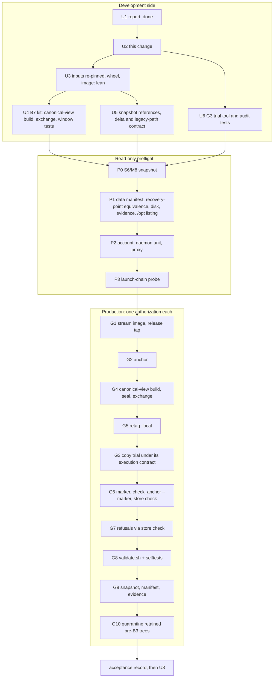

# Production promotion of B1-B3 (B7) - Plan

## Goal Capsule

- **Objective:** install B1, B2 and B3 in production through a gated promotion.
  - B1 refuses root and a missing configuration source.
  - B2 adds checked-hash bytecode, `-B` launchers and an `INSTALL` record.
  - B3 adds the production anchor and the store marker.

  The data directory, the recovery point, the two overdue rechecks and every retained piece of evidence stay unchanged. The only intended change in the data directory is the store marker.
- **Release:** version **0.2.1** (U2) on top of `main` `fdd5003`, which contains B1 (#21), B2 (#22) and B3 (#23). B4-B6 are out of scope.
- **Revision 2026-11-11:** U1 (the compatibility and inventory report, owner-held) is done, and this revision incorporates it. A design review in U2 then specified, and demonstrated on a scratch analog, three things: the cutover topology (KTD9), the copy trial's preventive layer (G3), and the intermediate deployment states. The owner's provisional directions on OB1-OB7 are recorded under "Owner decisions". They direct planning only and authorize nothing.
- **Status:** plan only. U1 is done and U2 is this change. Each step marked **[AUTH]** or **[PRIV-READ]** needs its own explicit owner authorization (`AGENTS.md` §6).
- **Authority:**
  1. `AGENTS.md`;
  2. the B1-B3 plans (`2026-11-09-002`, `2026-11-09-003`, `2026-11-10-001`) and their residual findings;
  3. backlog item B7;
  4. this plan.

  The one departure from a B3 operational note (the G3 trial) is recorded as an amendment in the B3 plan and in `deployment.md` (U2).
- **Stop and ask** if a step would do any of these:
  - alter retained evidence;
  - open the live store or run `run` against it;
  - remove a marker;
  - weaken a check or accept a skip;
  - delete historical evidence to make space.

**Terms:**
- **S6** is the owner kit's "installation accepted" state.
- **T1-T5** are the backlog's §5.3 trial-tooling items.
- "B3 note *n*" is item *n* of the B3 plan's Operational Notes.
- "The backup tool" and "the restore tool" are the owner's tooling, which lives outside this repository.
- Sizes are labelled **measured**, **historical** (from the owner's sealed records), **estimate** or **unknown**.

---

## Problem Frame

B1-B3 are merged but not installed. In the 2026-11-06 incident, root CLI runs wrote bytecode into the code tree and created a stray store, and recovery took several days of gated work. B7 installs those guards before any live run (O7).

B7 differs from M6-M8 in five ways:

1. **New persistent objects outside the code tree:** the anchor `/etc/brandsentinel/production.yaml` and the marker `BRANDSENTINEL-STORE` in the live data directory.
2. **A different installed tree:** B2 adds checked-hash `.pyc` for `site-packages` and the bundled standard library, `-B` launchers and an `INSTALL` record. Every content pin of the M8 tree goes stale.
3. **Copies refused once marked:** B3 refuses a marked copy anywhere but the canonical path. Isolated acceptance and copy-based rehearsals cannot use a marked copy.
4. **The CLI refuses invocations older procedures used:**
   - root, for `sandbox check|selftest|sweep` and `proxy`;
   - on the production store, a relative `-c`, a store variable, `PYTHONPATH` or `python -m`;
   - with no anchor, every store command run from an installation;
   - inside a user namespace, where root-owned files appear as the overflow UID (X12).
5. **The rootless daemon starts from inside the code tree** (X11), so the cutover window has a service dependency that the M8 kit only detected and did not prevent.

---

## U1 results (summary)

The owner holds the U1 report and its sealed evidence. Repository-derivable facts:

- **Schema: unchanged.** The migration trees are byte-identical (v5). Store, pipeline, policy and analysis code is unchanged, and `bundle/4` too. The only store-layer change is the pre-open guard. M8 code opens a marked scratch store and keeps the marker byte-identical.
- **Configuration: unchanged.** The configuration model and its defaults are identical, and `service.yaml` is unchanged. B3's `path_failures(service.yaml)` is empty. The anchor template agrees with `service.yaml`.
- **Dependencies: unchanged.** `uv.lock` was byte-identical to M8's until U2. U2 changes only the project's own version line (X13). `docker/` and the image build script are unchanged.
- **Bytecode (measured, CPython 3.12.14):**
  - code objects compiled from the same source under different paths compare **equal**, so the verifier passes at any prefix;
  - the marshalled `.pyc` bytes **differ** and embed the absolute path.

  So:
  - identical wheels do **not** give byte-identical installations;
  - verifier success does **not** prove byte identity;
  - launcher shebangs, `pyvenv.cfg`, `INSTALL` and the wheel RECORD files also carry the prefix or a time.
- **Sizes:**
  - the M8 install tree is 419,057,664 B (historical: three identical rehearsal installs);
  - B2 adds about 3,650 `.pyc` files and about 73 MB (estimate), so the B7 tree is about 0.49 GB (estimate, 0.48-0.51 GB);
  - the image changes only its two top layers (historical: layers 0-4 are shared with M7 and M8). The increment on a daemon is about 0.67 GB (estimate, 0.45-0.75 GB).
- **Copy classification (measured, B3 `classify` on a synthetic layout):**
  - an unmarked sibling copy, or an unmarked recovery-point copy, is development-class;
  - a marked copy is production;
  - **the account's home `/var/lib/brandsentinel`, an ancestor of the store, is production**;
  - installed B7 code refuses every store command until the anchor exists.

---

## What B7 changes (complete inventory)

| Area | Change | Reversible by |
|---|---|---|
| Installation | new root-owned tree at `/opt/brandsentinel`, built at the canonical path in a private mount namespace, then exchanged into place atomically (KTD9) | exchange back |
| Installation | the M8 tree under an aside name after the exchange; moved into the quarantine parent at G10, after acceptance | rename back, then exchange |
| Installation | a staging directory beside `/opt/brandsentinel` (same filesystem) during G4 only | renamed by the exchange; a failed one is retained |
| Image | new image streamed into the account's daemon under a release tag (G1); `:local` retagged at G5 | retag `:local` to the M8 image |
| Containers | G8 recreates `bs-egress-proxy` (running) and the lab containers (left stopped) on the new image | ordered G8 rollback |
| Account home; `/var/lib` | one `validate.sh` result directory in the account's home; the G3 trial directory `/var/lib/brandsentinel-b7-trial/` (root-owned parent, outside the account's home) | kept as evidence |
| Host configuration | `/etc/brandsentinel/` (0755 root) and `production.yaml` (0644 root), written then renamed into place | root removes; M8 ignores |
| Data directory | adds `BRANDSENTINEL-STORE` (regular file, account uid, mode 0444, one link) and changes the directory mtime. **Nothing else** | the marker stays (KTD6) |
| Schema, configuration, account | **none** | |
| Snapshot references | B7 references beside the M8 ones (U5) | keep M8 references |
| Docs (repo) | U2 (this change); U8 after acceptance | git |

---

## Contradictions between B1-B3 and the M8 deployment

| # | Contradiction | Resolution |
|---|---|---|
| X1 | **Disk.** The root filesystem holds `/opt`, `/var/lib`, `/var/tmp` and `/var/backups`. It has enough space for B7 above its floors for **one** G4 attempt only (see "Capacity") | Capacity contract below. OB2 |
| X2 | **Launch chain.** The runbook used `systemd-run --user -M`, which M8 and I1 r3 abandoned because transient units drift the host-unit snapshot | **Done in U2:** the runbook defines the sudo-first, `env -i` chain with explicit runtime variables and a working directory the account owns |
| X3 | **Copy trial.** B3 and `deployment.md` call pre-marking copies "not a sanctioned trial route" | **Done in U2:** one exception is recorded in both, for G3 only, under its execution contract |
| X4 | **Retained pre-B3 trees** can still open the live store without the guards | G10 quarantine after acceptance; ordering in U5 |
| X5 | **Version** was still 0.2.0 | **Done in U2:** 0.2.1 |
| X6 | **Path-bearing files.** Bytes depend on the prefix | KTD3 verification layers; the canonical-view build (KTD9) makes the final-path bytes reproducible |
| X7 | **Order.** No anchor means every installed store command refuses. `check_anchor.py` needs B3 code. `validate.sh` needs the marker | Order: G1 → G2 anchor → G4 code → G5 retag → **G3 trial** → G6 marker → G7 → G8 → G9 → G10 |
| X8 | **Subprocess tests read the host anchor** (B3 residual) | G2 verification re-runs the developer's suites against the real anchor. G8's scratch `run` invocations use temporary stores only |
| X9 | **First live open** | Deferred beyond B7 (OB4) |
| X10 | **The backup tool** uses `systemd-run -M` (L2) | Not needed if P1 establishes recovery-point equivalence and restore usability (OB6). Otherwise revised tools come first |
| X11 | **Rootless daemon restart hazard.** The account's `docker-rootless.service` has `ExecStart=/opt/brandsentinel/bin/dockerd-rootless.sh`, and that launcher re-executes its own path (`"$0"`) inside rootlesskit. With `Restart=always`, `RestartSec=2` and `StartLimitBurst=3` per 60 s, a daemon exit while the canonical path is absent or incomplete fails three times, then the unit stays failed and every container stays down | KTD9 plus the daemon guards; tested in U4 (see "Cutover topology") |
| X12 | **User namespaces.** Inside one, root-owned files appear as UID 65534 (measured). Installed B3 code then refuses (`anchor_unsafe`), and installation detection fails | No namespace around installed code (G3 uses observation, not confinement). U4 harnesses use `--map-auto` with `setpriv`, as the installed-layout tests do |
| X13 | **Lock hash.** The version bump changes `uv.lock`'s hash (one line, the project's own version). The M8 kit pinned the old hash | U3 re-pins the lock hash and asserts that every dependency entry equals M8's |
| X14 | **Aged inputs.** The pinned Python download cache sits in `/var/tmp`, which has a 30-day age-out rule; its directory dates from 2026-10-18 and its contents are unverified. The M8 inputs on the home filesystem exist | U3 inventories, verifies and re-pins into durable storage before any reproducibility claim (see "Pinned inputs") |
| X15 | **Developer filesystem capacity.** An M8-style build and rehearsal (two image archives, three retained rehearsal trees, three cache copies) would end below the kit's 5,120 MiB floor on the developer's home filesystem | The lean U3/U4 workflow (see "Capacity"). No historical evidence is deleted |

**Confirmed consistent:**
- the backup and restore tools copy (`cp -a`, `mv --exchange`), never hard-link;
- the proxy runs as `pwuser`;
- the interpreter is inside the prefix;
- `store check`, `sandbox check|sweep|selftest` and `check_anchor.py` open no store;
- only `run` promotes deferred work;
- `installed_layout` tests are not in the SP3 selection.

---

## Key Technical Decisions

- **KTD1: the invariant is a manifest of the data directory.**
  - The manifest records every entry with path, type, mode, owner, link count, size and sha256, plus the presence of `-wal`, `-shm` and `-journal`.
  - Taken at P1 and G9, the two must be equal except for the marker and the directory mtime.
  - No `run` and no open against the live store.
- **KTD2: order.**
  - **Anchor (G2) first.** M8 ignores it.
  - **Code (G4) and retag (G5).**
  - **Then the copy trial (G3)** with the installed B7 code, while the anchor exists and the store is still unmarked. This needs no second tree on the root filesystem.
  - **Then marker (G6), refusals (G7), validation (G8), snapshot (G9), quarantine (G10).**
- **KTD3: verification layers.** No single check proves the installed tree.

  | Layer | What it proves | What it does not prove |
  |---|---|---|
  | (a) `check_bytecode.py` verdict (source hash, cache tag, checked-hash flag, code equality) | every `.pyc` matches its source and the launchers are hardened | byte identity, the path embedded in a `.pyc`, the rest of the tree |
  | (b) final-path content manifest: every file's sha256 at the canonical path, compared with the U4 rehearsal **built at the canonical path** (KTD9) | the tree's bytes are the rehearsed bytes | that the rehearsal was right (that is (a), (c) and U3) |
  | (c) package set (`pip freeze`) equals the lock; wheel hash equals U3's double build | the dependencies and the package | file layout |
  | (d) ownership and modes: root-owned, nothing group- or world-writable, no hard links | the permission boundary | content |

  A raw-byte comparison against a rehearsal at any other prefix is never used. A normalized ("N") comparison is the fallback only for files proven to carry nothing but the prefix.
- **KTD4: no automatic restoration.** Rollback is code-only, unless KTD1 breaks. **Any rollback leaves production unguarded:** CLI use against the live store is frozen until B7 is re-promoted.
- **KTD5: root never demonstrates a refusal.** Real root ownership is verified by metadata only.
- **KTD6: the marker is never removed.**
- **KTD7: evidence is read only, by hash and metadata.** G10's renames are the only planned change.
- **KTD8: refusals are exercised only through `store check`,** against the live path, with a manifest after every case.
- **KTD9: build at the canonical view, then exchange.** The design is specified in full under "Cutover topology", and the U2 design review demonstrated its mechanics on a scratch analog.
  - **Build:** the developer builds inside a private mount namespace in which the canonical path is a bind mount of a staging directory, a sibling of `/opt/brandsentinel` on the same filesystem. The rest of `/opt` is masked, so every embedded path is the final one.
  - **Seal:** first the N1 detection check (no live build process or open reference into staging; N1 does not prove that no mount reference persists). Then root takes ownership, which is the write barrier, and checks KTD3 (a)-(d). The sealed content manifest is re-taken after the exchange and at G9.
  - **Exchange:** one `renameat2(RENAME_EXCHANGE)` (`mv -T --exchange`) swaps the trees. Then M8 is renamed to its aside name.
  - **Result:** at every instant the canonical path names a complete tree, with the same pinned launcher. This is **path** atomicity. It does not keep the Docker service up (see "Path atomicity is not service availability").
  - **This replaces the M8 kit's install-in-place window.** Whether `install.sh` runs unchanged in the namespace is unproven until U4 (K11).
- **KTD10: capacity accounting is per filesystem.**
  - Floors are never lowered.
  - Staging image storage (the developer's daemon, home filesystem) and production image storage (the account's daemon, root filesystem) are accounted separately.
  - A failed install is retained, so each retry consumes a tree's worth of space.

---

## High-Level Technical Design

### Sequence and authorization



G-numbers are stable identifiers. G3 runs after G5.

### Rollback architecture

A row covers its step and every later step until the next row. Every rollback is an owner decision with a fresh authorization. Every state after a code rollback is **"production unguarded"** (see "Intermediate deployment states").

| Reached | State | Rollback | Data |
|---|---|---|---|
| G1-G2 | M8; extra image tag; anchor | leave both, or root removes the anchor | unchanged |
| G4 before the exchange | M8 at canonical; staging tree present | none needed; production unchanged. Staging retained as failed | unchanged |
| G4 exchange interrupted | before or after the exchange, never in between (one `renameat2` call) | the classifier reports which; continue or roll back as in the next rows | unchanged |
| G4 exchanged, aside rename pending | B7 at canonical; M8 under the staging name | exchange back (M8 to canonical, B7 to the staging name, then renamed as failed) | unchanged |
| G4 done, G5 | B7 at canonical; M8 at the aside name; `:local` retagged | exchange aside ↔ canonical; rename B7 as failed; retag `:local` to M8 | unchanged |
| G3 stopped | as above + trial directory | trial directory made root-only and retained; assess with KTD1 | unchanged |
| G6 interrupted | the marker's temporary file may remain | STOP. The owner removes only that named temporary file, then the manifest is taken again | temporary file only |
| G6-G7 | + marker | as for G4-G5. The marker stays | marker |
| G8 interrupted or failed | proxy and lab possibly on the new image | in order: stop the lab; retag `:local` to M8; exchange the code back; recreate the proxy from the M8 tree's Compose file **[AUTH Docker]**; recreate the lab stopped | marker |
| G10 done | trees quarantined | rename the M8 tree out of quarantine (root), then exchange | marker |
| any point: KTD1 broken | | STOP and preserve. The owner chooses a restore from the verified recovery point (then re-mark) or an investigation | restore |

**Decision points:**

| Point | Where | Outcome |
|---|---|---|
| DP1 | after the G4 seal | stop before the exchange on any KTD3 or N1 failure |
| DP2 | G6 `store check` | anchor correction by root, or rollback |
| DP3 | G8 | retry only under a new authorization and for an environmental cause; otherwise roll back |
| DP4 | G9 | STOP and preserve |

---

## Intermediate deployment states

From G2 until the acceptance record, a **freeze** applies. The only CLI use against the live store is `store check` (G6, G7), which never opens it. There is no `status`, no `cases list` and no `run`, so the two overdue rechecks stay deferred: only `run` promotes them. The freeze is procedural. The table shows where B3 also enforces it and where nothing does.

| State | Canonical code | Anchor / marker | `:local` / proxy image | Who may open the live store | Unguarded paths | Rollback |
|---|---|---|---|---|---|---|
| after G2 | M8 | yes / no | M8 / M8 | anyone the M8 CLI lets in, as today (M8 ignores the anchor) | all of M8 | none needed |
| after G4 + G5 | B7 | yes / no | B7 / **M8** (a running or restarted container keeps its image ID) | B7 lets only the account with the approved `-c`, clean variables and the installed launcher open it. Root, the developer, a relative `-c`, store or Python variables, and copies are refused with named exit 2. The approved path is frozen procedurally | **the M8 aside tree** and older pre-B3 trees: their CLIs ignore the anchor and refuse nothing for most commands | exchange back |
| during and after G3 | B7 | yes / no | B7 / M8 | as above. The trial identity is refused by the kernel and by B3 (see the G3 contract) | as above | exchange back; trial directory retained root-only |
| after G6 + G7 | B7 | yes / **yes** | B7 / M8 | as above; marked copies are now refused anywhere | as above | exchange back; the marker stays (M8 ignores it) |
| after G8 | B7 | yes / yes | B7 / **B7** | as above | as above | the ordered G8 rollback |
| after G10 | B7 | yes / yes | B7 / B7 | as above | **none reachable by the account** (the quarantine parent is root-only 0700) | un-quarantine, then exchange |

**Datastore integrity across the states:**
- the live database is never opened;
- a rollback is code-only;
- the marker is the only data change.

The KTD1 manifest is checked at G3 (before and after), at G6, after every G7 case, and at G9. Any other delta is a STOP.

**Rechecks:** they stay deferred and unpromoted through every state. G3 no longer runs `run`, even on the copy.

---

## Cutover topology (KTD9)

**Physical layout on the root filesystem:**
- **Canonical:** `/opt/brandsentinel`, the M8 tree, root-owned.
- **Staging:** `/opt/brandsentinel.b7-staging`. Root creates it at G4 as an empty directory owned by the developer, mode 0755, as in runbook step 4. It is a sibling of the canonical directory, on the same filesystem (`stat -c %d` equal; else STOP), and is not a mount point.

**Build namespace** (the developer, no root):

```text
unshare --user --map-current-user --keep-caps --mount --propagation private --net
  1. bind-mount the staging directory onto a private stash point
  2. mount an empty tmpfs (0755) over /opt          -> M8 and every sibling become unreachable
  3. mkdir /opt/brandsentinel; bind-mount the stash onto it
  4. run install.sh with PREFIX=/opt/brandsentinel, offline, from U3's inputs
```

**Properties:**
- **Mount identity:** inside the namespace, `/opt/brandsentinel` has the host staging directory's device and inode, so every write lands in the staging tree.
- **Host visibility:** private propagation means the host's mount table never shows these mounts.
- **Final-path semantics:** `realpath` is the canonical path, so shebangs, `pyvenv.cfg`, `.pyc` and RECORD files carry it. The staging name appears nowhere.
- **UID view:** root-owned files appear as UID 65534 inside (X12). `install.sh` does not need root ownership; the M8 kit already ran it in a user namespace.

**Demonstrated in the U2 design review** on a scratch analog (an ext4 directory tree standing in for `/opt`; no root, no real `/opt`; evidence owner-held):
- equal device and inode inside and outside;
- zero host-visible mounts;
- the sibling tree unreachable from the build;
- the two path-bearing files carrying the final path, with zero occurrences of the staging name;
- the canonical tree untouched during the build.

**Seal (root), only after N1:**
- **N1 (a detection check, at scan time):** no process is in the build's mount namespace (its recorded `mnt:` inode, scanned across `/proc/*/ns/mnt`), and no process references the staging tree by device and inode through an open descriptor, its working directory, its root or a memory mapping (`/proc/*/fd`, `cwd`, `root`, `map_files`). The review showed why: a bind mount alive in another namespace does **not** block the host's rename, and a late write through it lands in the moved tree.
  - **N1 does not prove** that no mount reference persists. A mount namespace can outlive its processes when an nsfs bind mount or a descriptor held by an unrelated process pins it, and a bind mount can exist elsewhere. A process scan sees neither. N1 does not prove the absence of every writable path either.
  - **The write barrier is the seal.** After `chown -R root:root` and `chmod -R go-w`, a surviving non-root mount reference gives no new write access, because opens are checked against root ownership. Only descriptors opened before the seal keep write access, and N1 sees them only while their holder is alive.
  - **The residual is caught after the fact.** The sealed content manifest (KTD3 b) is re-taken after the exchange and at G9 and must be unchanged. A difference is a STOP.
- Then `chown -R root:root` and `chmod -R go-w`, followed by KTD3 (a)-(d) on the staging tree. Layer (b) compares raw bytes with the canonical-view rehearsal, and also checks that the staging name appears in no file.

**Exchange prerequisites:**
- GNU `mv` with `--exchange` (coreutils 9.5 or later; the host has 9.12, measured);
- `renameat2(RENAME_EXCHANGE)` support on the root filesystem (ext4, measured);
- both paths exist;
- same filesystem: `EXDEV` otherwise (demonstrated);
- neither path a mount point in root's namespace: `EBUSY` otherwise (demonstrated);
- N1 passed;
- run by root.

The kit probes the exchange first on two scratch directories in `/var/tmp`, which is on the same filesystem.

**Window:**
1. the daemon guard (below);
2. the exchange;
3. the aside rename;
4. the daemon guard again;
5. the account-side checks (`check_bytecode.py`, `check_anchor.py` without `--marker`).

**Demonstrated on the analog:**
- 2,376 exchanges ran concurrently with 1,312 reads of the canonical launcher, with zero missing or wrong;
- a rollback is one exchange;
- a missing target, a cross-filesystem pair and a local mount point each fail with nothing changed.

**Interruption and failure behaviour:**

| Point | State | Behaviour |
|---|---|---|
| build or seal interrupted | production unchanged | staging retained as failed; no retry without O5 (capacity) |
| exchange call fails | unchanged (a single call) | stop |
| crash or power loss around the exchange | on ext4 the exchange is one journaled metadata operation: expected pre- or post-exchange after recovery | the classifier must recognize both. This is **not** testable by power cut in U4; recorded as an expectation |
| after the exchange, before the aside rename | B7 canonical, M8 under the staging name | classifier state "exchanged, not renamed"; continue, or exchange back |
| post-checks fail | B7 canonical, M8 aside | DP1 or DP2: exchange back |

### Path atomicity is not service availability

The exchange guarantees that a daemon **(re)start** at any instant finds a complete launcher with identical bytes. It does not keep the daemon or the proxy running, and it does not replace them:

- **The running daemon** is unaffected by the exchange: it does not re-read the launcher while running. No BrandSentinel process runs during G4 (holder check by device and inode).
- **A daemon crash for an unrelated reason** still restarts it, and the restart now succeeds. Failures not caused by the path are still bounded by `StartLimitBurst`.
- **Containers keep their image IDs.** The proxy runs the M8 image until G8 recreates it. The G5 retag affects only new containers.
- **Availability is measured, not assumed:** the account's unit `MainPID`, `NRestarts` and `ActiveState`, and the proxy container's ID and state, must be unchanged across the window. Otherwise exit 4.

**Dependency trace (X11)**, from `setup-rootless.sh`, the pinned `dockerd-rootless.sh` and `docker/*.yaml`:
- `docker-rootless.service`: `ExecStart=$PREFIX/bin/dockerd-rootless.sh`, `PATH=/usr/local/bin:/usr/bin:/bin`, `Restart=always`, `RestartSec=2`, `StartLimitBurst=3` per 60 s;
- the launcher re-executes `"$0"` inside rootlesskit, so its path is resolved twice per start;
- the helper binaries are in `/usr/bin`;
- every container is `restart: unless-stopped`.

Moving the launcher outside the code tree (a unit change) is optional later hardening that needs its own authorization.

### U4 acceptance tests for the cutover

The harness runs in a user namespace on a tmpfs `/opt`, with `--map-auto` and `setpriv` (X12).

| Test | Pass |
|---|---|
| W1 | a watcher hashes the canonical launcher in a tight loop through repeated exchange and rename cycles: zero misses and zero mismatches (as on the analog) |
| W2 | killed after staging creation, mid-build, mid-`chown`, after the exchange and after the aside rename: the classifier reports a defined state; rolling back leaves M8 canonical; W1 sees no gap |
| W3 | exchange unsupported, `EXDEV`, `EBUSY` or `ENOENT`: stop before the window, nothing renamed |
| W4 | staged launcher hash ≠ pin: stop before the exchange |
| W5 | a stubbed unit report with a changed `MainPID`, `NRestarts` or `ActiveState`, or a changed proxy container ID: exit 4 with the state printed |
| W6 | a sentinel planted in the "real" tree and in a sibling: never read by the build |
| N1 | (a) a live process in the build namespace, or one holding a writable descriptor, working directory or mapping into staging: seal refused. (b) a namespace pinned with **no** process (an nsfs bind mount or a descriptor held elsewhere): recorded as **not detected** by N1. After the seal, a write through it by a new open fails (root ownership), and a write through a descriptor opened before the seal is caught by the post-exchange manifest re-check |
| N2 | the host mount table shows no build mount during or after the build |
| N3 | the canonical path inside equals the staging directory outside (device and inode); staging on another device: refused |
| N4 | no file contains the staging name; every shebang and `pyvenv.cfg` names the canonical path; the raw manifest equals the canonical-view rehearsal's |
| N5 | `install.sh` completes unchanged inside the namespace (K11); if not, STOP and re-plan |

---

## G3: execution contract for the copy trial

**Purpose:** show the B7 code operating on production-shaped data. The contract has three independent layers:
- **Prevention:** the live store is unreachable. The kernel enforces it, independent of the code under test.
- **Detection:** every access is recorded.
- **Outcome:** the stores are proven unchanged.

**An audit alone prevents nothing, and a classification result alone proves nothing.**

**Placement:**
- after G5, so B7 is installed and the anchor present;
- before G6, so the live store is unmarked and the source is pre-B7;
- before G8: no Docker.

**G3-A only:** `store check`, `status` and `cases list` on the copy. The earlier G3-B (`run --until-idle` on the copy) is removed from B7 and deferred to the approved trial workflow. So the overdue rechecks are not promoted even in the copy.

| # | Layer | Contract element | Verified by |
|---|---|---|---|
| C1 | input | **Source:** the pre-B7 recovery point, unchanged (manifest equals P1's sealed manifest) and unmarked | the root-run copy tool, before copying |
| C2 | input | **Copy:** a byte copy (`cp -a`) into `/var/lib/brandsentinel-b7-trial/<time>/data`, **outside the account's home**. The parent is created root-owned by `mkdir` (T3). The copy is owned by the trial identity, mode 0700. No symlinks; no link count above 1; copy manifest = source manifest; source unchanged afterwards | the copy tool |
| C3 | prevention | **Trial identity:** an unprivileged identity that is **not** the service account, not root, and not in the account's group. The chain uses no sudo for the trial itself. It has no permission to traverse the account's home (`/var/lib/brandsentinel`, 0700) or `/var/backups/brandsentinel` (root-only). Default: the developer account; alternative: a dedicated temporary trial account (a host change; OB3a) | P2 records those directories' owners and modes. G3's first step is a **negative probe**: as the trial identity, `stat` of the live store must fail with `EACCES`, or the trial is refused |
| C4 | prevention (code) | **B3's own refusal:** the live path is production-class by anchor path, so any CLI attempt by the trial identity is refused (`wrong_account`, `config_not_approved`). This layer is in the code under test, so it is not relied on alone | U3 tests; the classification evidence (below) |
| C5 | input | **Configuration:** generated, root-owned 0444, sha256 logged. `data_dir` = the copy; registry and policy at their installed paths; discovery off; sandbox off; no `docker_host`. Never the approved configuration. The tool refuses a `data_dir` that equals, lies under, or is an ancestor of the anchor's store path, lexically or resolved | the trial tool, before launch |
| C6 | input | **Invocation:** `env -i` with a minimal environment, working directory and `TMPDIR` inside the trial directory, absolute `-c`, the installed console script. No user namespace (X12) | argv and environment logged |
| C7 | detection | Each command runs under `strace -f -y -qq -e trace=%file,%network,%process -o <trace>`, as the trial identity on its own child (`ptrace_scope` = 1, measured). Audit, fail-closed: (i) no path under the live store or `/var/backups` except calls that failed with `EACCES`; (ii) every write-mode open lies under the trial directory; (iii) no `AF_INET` or `AF_INET6` socket; (iv) dirfd-relative paths resolved through `-y`; (v) a truncated or unparsable trace is INCOMPLETE, which is a failure. **This records access. It does not prevent it** | the audit script; the trace is sealed |
| C8 | outcome | Live data-directory manifest (KTD1) and recovery-point manifest equal before and after; every table of the copy compared (T2), with no row change expected for G3-A | root-run manifest tool; table diff |
| C9 | retention | The copy and trial directory are made root-only (0700) and retained; trace, configuration, manifests and outputs are sealed | G9 inventory |

**Classification evidence** (U2 design review, scratch layout, B3 code, the live store's parent made inaccessible to the caller):
- the unmarked copy outside the account's home classifies as development;
- the live path and the account's home classify as production by anchor path;
- `stat` and a SQLite open of the live store are refused by the kernel (`EACCES`).

So C3 and C4 are compatible with B3 as written.

**What G3 shows and does not show:**
- **It shows:** the installed B7 code opens, migrates (no-op) and sweeps a production-shaped copy without touching the live store.
- **It does not show:** the service account's behaviour on the production store (G6 and G7 show that), or anything about network stages.
- **Exposure:** the trial identity can read a copy of production data. The owner decides whether that is acceptable (OB3a).

**If no non-account trial identity is accepted, G3 stays blocked.** Running it as the service account would rest on detection and on B3 alone, and this plan does not accept that as prevention.

**U6 tests** (developer side, synthetic layout, the live-store path as a parameter):
- **Refused before launch:**
  - the negative probe succeeds (the "live" store is readable by the trial identity);
  - a `data_dir` equal to, under, or an ancestor of the live path;
  - a symlinked copy directory;
  - a marker in the copy;
  - the approved configuration named;
  - `strace` missing.
- **Audit failures:**
  - a planted `openat` under the live path (a stand-in made readable for the test);
  - a write outside the trial directory;
  - an `AF_INET` socket;
  - a truncated trace.
- **Positive case:** a clean G3-A run passes, with only `EACCES` entries under the live path.

---

## Capacity by filesystem (KTD10)

**Measured on 2026-11-11** (point-in-time; re-measured at P1 and at every gate):

| Filesystem | Holds | Available | Floors kept |
|---|---|---|---|
| root | `/opt`, `/var/lib` (the account's daemon and data), `/var/tmp`, `/var/backups` | about 10.1 GiB | 8 GiB (runbook); 8,704 MiB (M8 kit preflight); 8 GiB at `load-image.sh` start |
| home | the developer's daemon, build and rehearsal outputs, the kit's scratch, the pinned inputs | about 9.4 GiB | 5,120 MiB (M8 kit preflight) |
| `/tmp` (tmpfs) | not used by the kit | | |

**Root filesystem: production image storage and the installation** (estimates until measured):

| Item | Estimate | Measured at |
|---|---|---|
| image increment in the account's daemon (G1) | 0.67 GB (0.45-0.75) | G1 |
| staged B7 tree (G4; becomes canonical) | 0.49 GB (0.48-0.51) | U4 (developer), G4 |
| G3 trial copy | about 1 MB (recovery point about 0.3 MB in 2026-11 records) | P1 |
| `validate.sh` output, container layers | < 0.05 GB | G8 |
| **Total** | **≈ 1.2 GB (worst ≈ 1.3 GB)** | |

- **Headroom after B7:** about 0.4-0.75 GiB above 8,704 MiB.
- **One G4 attempt only.** A failed staging tree is retained, and a second attempt would breach the floor. A retry needs a decision under O5 first.
- **The B7 kit preflight** requires `8 GiB + image + tree + margin` before G1 and before G4, with the estimates replaced by U3/U4 measurements.

**Home filesystem: staging image storage and rehearsals.** Lean U3/U4, preferred over any deletion:

| Item | M8 pattern | Lean |
|---|---|---|
| developer-daemon image build | 0.67 GB | 0.67 GB (one build) |
| image archives | 2 × 1.19 GB | **0**: `docker save` streamed twice into `sha256sum` and compared; G1 streams from the developer's daemon (`load-image.sh`) |
| rehearsal trees | 3 retained | **1 retained** (0.49 GB). Repeats install into fresh scratch directories; each is sealed by its describe output, then cleared before the next (fresh U4 scratch only, under U4's authorization) |
| private uv-cache copies | 3 retained | **1 at a time** (0.32 GB) |
| kit scratch at G4 | 0.33 GB | 0.33 GB |
| **Total** | **≈ 5.8 GB** (below floor) | **≈ 1.8 GB**, about 7 GiB left, above the 5,120 MiB floor |

**No historical evidence is deleted or moved for B7.** If measurements exceed the lean estimates, the owner decides (OB2) between growing a volume (LVM free extents unknown until P1) and moving superseded developer artifacts under O5.

---

## Pinned inputs: reconciliation (X13, X14)

| Input | Historical pin (M8) | State (U1) | U3 action |
|---|---|---|---|
| source | frozen clone of `e40ffcb` | present (home filesystem) | new frozen clone of the release commit, from the local repository with no network (`GIT_OPTIONAL_LOCKS=0`); tree hash recorded |
| `uv.lock` | sha `0f040b7d…` | changes in U2, one line | new sha pinned. A structured comparison shows every dependency entry equal to M8's; only the project's version differs |
| uv package cache | content pin `06076888…` | present (home filesystem) | verify against the pin; work on a private copy (uv writes into its cache: an M7 lesson); prove completeness by an offline install with `--require-hashes` from it |
| Python download cache | in `/var/tmp` | **unverified; subject to 30-day age-out** | verify the CPython 3.12.14 archive (uv checks its published checksum on install) and copy it into durable storage on the home filesystem before use. **If it is missing or damaged:** a re-download needs network authorization, so HOLD |
| `dockerd-rootless.sh` | sha `20020363…` | developer copy matches (measured) | re-verify; `install.sh` checks it |
| uv binary | the version used for M8 | unpinned by hash | record version and hash; pin |

**Reproducibility is claimed only after all of these:**
1. two offline wheel builds from the re-pinned inputs give equal hashes;
2. an offline canonical-view install from them passes KTD3 (a)-(d);
3. its package set equals the lock.

---

## Implementation Units

**Legend:**
- **[DEV]**: development side;
- **[DEV-AUTH]**: needs approval for the developer's own Docker or network (§6);
- **[PRIV-READ]**: privileged, changes nothing;
- **[AUTH]**: changes production.

### U1. Compatibility and inventory report [DEV]: **done** (2026-11-11, owner-held, sealed)

### U2. Release preparation [DEV]: this change

- **Files:**
  - `pyproject.toml`, `uv.lock`, `src/brandsentinel/__init__.py`, `tests/unit/test_version.py` (0.2.1);
  - `README.md`, `docs/guide/getting-started.md`, `docs/project/status.md`;
  - `docs/runbooks/service-account.md` (the launch chain, steps 5-9, rollback, B7 order pointer), `docs/runbooks/media.md`;
  - header comments of `scripts/service-account/{setup-rootless.sh,load-image.sh,validate.sh}` and one refusal message;
  - `docs/operations/deployment.md` (the chain; the G3 exception);
  - the B3 plan (dated amendment);
  - this plan.
- **Test scenarios:**
  - `test_version.py` agrees on 0.2.1 across `pyproject.toml`, the package, the lock and `version`;
  - `uv lock --check --offline` passes;
  - `test_docs.py`, the strict site build, `ruff` and the offline suite pass;
  - shell syntax of the three scripts.
- **Done when:** the owner merges it.

### U3. Pinned inputs, wheel and image, lean [DEV-AUTH]

- **Goal:** the "Pinned inputs" table, then:
  - two offline wheel builds with equal hashes;
  - one image build; `image_manifest.py` with `verdict: ok`; lower layers equal to M8's; two streamed `docker save` digests compared.
- **Acceptance on the developer's runtime:**

  | Suite | Required result |
  |---|---|
  | `-m "docker or security"` | 0 skipped |
  | `sandbox selftest media` and `sandbox selftest browser` | pass |
  | T2a-dev | 28/28 |
  | offline suite | pass |
  | `-m installed_layout` with `REQUIRE_USERNS=1 REQUIRE_INSTALLED_LAYOUT=1` | 0 skipped |

  Afterwards the developer's `:local` tag is restored and the lab stopped.
- **Measure:** the image increment on the developer's daemon (`docker system df` before and after) and home-filesystem use per step.
- **Done when:** a sealed build record names the commit, lock sha, wheel, image ID, digests, counts and measured sizes.

### U4. B7 kit: canonical-view build, exchange, window safety [DEV-AUTH]

- **Goal:** a B7 kit, generated from the M8 kit, that implements KTD9 and KTD3 and fails closed on X11-X12:
  - preflight probes (exchange support, same filesystem, the floors with measured sizes);
  - the daemon-unit guards;
  - the classifier and the code-only restore (exchange back);
  - a refusal to start without the anchor.
- **Rehearsal:** offline, from U3's inputs, in a masked-`/opt` namespace on the developer side, yielding the final-path content manifest for KTD3(b).
- **Test scenarios:**
  - W1-W6 and N1-N5 (see "Cutover topology");
  - every M7/M8 kit defect class;
  - a `.pyc` or launcher built at another prefix is rejected by layer (b), even though layer (a) passes;
  - REALPERM ownership with no pass-through sudo stubs.
- **Unknown resolved here:** K11, whether `install.sh` works unchanged inside the masked namespace. If it does not, STOP and re-plan; do not fall back to install-in-place silently.
- **Done when:** the kit is sealed with test counts and the root installer is regenerated.

### U5. Snapshot references, delta contract and legacy-path contract [DEV; one owner-side check]

- **Delta contract (P0 → G9).** Allowed changes:
  - `/opt`: canonical tree replaced; the M8 aside; the quarantine parent and its entries after G10; a failed staging tree only if one occurred;
  - `/etc/brandsentinel`;
  - the marker with its metadata, and the data directory mtime;
  - the account daemon's image tags; the proxy's and the three lab containers' IDs, images and states; test networks;
  - the account home's `validate.sh` result;
  - the `/var/lib/brandsentinel-b7-trial` directory.

  Anything else is a STOP.
- **Legacy-path contract.** Known retained trees, from the M8 kit's historical pins (existence unverified until P0/P1):

  | Tree | Origin |
  |---|---|
  | the M6 aside tree | M6 |
  | the M7 aside tree | M7; the M8 kit's rollback target |
  | the M7 failed tree | M7 P2 attempt 1 |
  | the M8 aside | from G4 |
  | any B7 failed staging tree | |

  Exact names are in the owner's kit pins and are confirmed at P0/P1.

  **Path dependencies to re-baseline:**
  - the M8 kit's classifier, restore and allow-lists (historical after B7);
  - the production snapshot's `/opt` listing;
  - the incident reference listing (historical);
  - the daemon unit's `ExecStart`, which must name only the canonical path (verified at P2).

  **Ordering:**
  1. nothing moves before G9 passes;
  2. at G10, every pre-B3 tree, the M8 aside included, is renamed into one root-only 0700 parent on the same filesystem;
  3. the M8 rollback path is preserved through acceptance. After G10 a rollback first renames the M8 tree back out of quarantine.

  For each relocated tree, the metadata manifest (owner, mode, links, size, sha256) is equal before and after.
- **Test scenarios** (adversarial, T5). Each must be detected:
  - a planted data file;
  - a changed database byte;
  - a `-wal` appearing;
  - a deleted blob;
  - a hard-linked database;
  - a symlinked anchor;
  - a leftover temporary marker;
  - wrong marker metadata;
  - an extra `/opt` entry;
  - a running lab container;
  - a relocated tree whose manifest changed;
  - a quarantine parent the account can traverse.
- **Owner-side check [PRIV-READ]:** the M8 reference matches pre-B7 evidence.

### U6. G3 trial tool and audit [DEV]

- **Goal:** the copy tool (with its negative probe), the trial tool and the strace audit implementing C1-C9 and T1-T4.
- **Test scenarios:** as listed under the G3 contract.
- **Done when:** sealed with test counts.

### U7. Preflight and production gates

**Read-only preflight:**

| Step | What | Pass |
|---|---|---|
| P0 **[PRIV-READ]** | production snapshot, normalized | S6/M8; invariant matches the M8 reference |
| P1 **[PRIV-READ]** | data-directory manifest; recovery-point manifest and restore usability (OB6: equivalence to live, ownership and modes a restore would produce, the restore tool's dry checks with the anchor in mind); free space and LVM free extents; evidence inventory; `/opt` top-level listing | equal; space ≥ the measured requirements; inventory sealed |
| P2 **[PRIV-READ]** | as the account: identity, ranges, linger, `user@` active, the daemon unit (`ExecStart`, `MainPID`, `NRestarts`, `ActiveState`), launcher hash, proxy image = M8, no rootful socket, no `docker` group, `/etc/brandsentinel` absent; owners and modes of the account's home and `/var/backups/brandsentinel` (K12) | as expected; `ExecStart` = canonical launcher |
| P3 **[PRIV-READ]** | launch-chain probe (`as-account id`, `XDG_RUNTIME_DIR`, D-Bus, socket) | PASS |

**Production changes:**

| Step | What | Pass |
|---|---|---|
| G1 **[AUTH]** | stream the image into the account's daemon under the release tag | `id_matches: true`; `:local` and the proxy unchanged; increment measured |
| G2 **[AUTH]** root | install the anchor | unprivileged read: 0644 root, safe chain, equals the template. The developer's suites pass against it (X8). Delta is `/etc/brandsentinel` only |
| G4 **[AUTH]** root + developer | the B7 kit: staging, canonical-view build, seal (KTD3 a-d), daemon guard, exchange, aside rename | kit exit 0 (S6′). As the account: `check_bytecode.py` exit 0, `check_anchor.py` (no `--marker`) PASS; the daemon unit unchanged |
| G5 **[AUTH]** | retag `:local`; keep the M8 tag | as expected; proxy still on M8 |
| G3 **[AUTH]** (OB3, OB3a) | G3-A on the copy under C1-C9, as the non-account trial identity | the negative probe gives `EACCES`; `store check` on the copy reports development; the audit is clean; live and recovery-point manifests unchanged |
| G6 **[AUTH]** account | marker (temporary `.marker.new`, renamed); `check_anchor.py --marker`; `/opt/brandsentinel/venv/bin/brandsentinel -c /opt/brandsentinel/etc/service.yaml store check` | marker regular, account uid, 0444, one link, no temporary file; PASS; `store class: production (anchor path)`; `store check: ok`; manifest = P1 + marker |
| G7 **[AUTH]** | refusals through `store check` only (KTD8): the developer; a relative `-c`; `BRANDSENTINEL_DATA_DIR`; `PYTHONPATH` = an empty root-owned directory; a symlink to the approved config; a scratch store with a symlinked `artifacts/`. Expected names come from the U3 tests | each exits 2 with exactly its names; manifest unchanged after each |
| G8 **[AUTH Docker + egress]** (OB7) | `validate.sh` through the launch chain; then both selftests | `0 failed, 0 errors, 0 skipped`; no warnings; `SP1 VALIDATION: PASS`; lab stopped |
| G9 **[PRIV-READ]** | snapshot against U5; data manifest; evidence inventory | contracted deltas only |
| G10 **[AUTH]** root (OB5) | quarantine per the U5 legacy-path contract | manifests equal; the account cannot traverse the parent |

### U8. Acceptance record and documentation PR [DEV, after acceptance]

Status (production-accepted, *operator-reported*), `deployment.md` and `AGENTS.md` ("not yet installed"), and the residual pages.

---

## Handling the two overdue rechecks

Only `run` promotes deferred work.

**What B7 guarantees:**
- no `run` and no open against the live store (KTD1);
- G3-A runs no `run`, so the copy's rechecks are untouched;
- G3-B (`run` on the copy) is removed from B7, so the rechecks are not promoted anywhere.

**What B7 does not do:** decide O3. A supersession procedure after marking needs the approved trial workflow (a new backlog item), which is therefore a prerequisite of O3's supersession option and of B16.

---

## Risks from the changed production-copy trial policy

| Risk | Mitigation |
|---|---|
| No trials on marked copies after G6 | G3 runs before G6. **New backlog item:** an approved trial workflow, required before the next migrating promotion, O3 supersession and B16 |
| A restore drops the marker | re-mark after any restore. The next recovery point is taken after G6 |
| Pressure to remove a marker | KTD6. Tools refuse a store whose marker was removed |
| Unmarked pre-B7 copies remain development-class | root-only; each use recorded; retained under O5 |
| A malformed anchor blocks all store commands | G2 verification; a root correction |
| A trial placed at the account's home or under the store | refused by C5 (U1 showed `/var/lib/brandsentinel` is production-class). The trial identity cannot reach that home anyway (C3) |

---

## STOP conditions

On a STOP: stop, classify, preserve, report. Never retry without a new authorization.

- **Space:** below any floor with the measured requirements (X1, KTD10). A second G4 attempt without an O5 decision.
- **Baseline:** P0 not S6/M8. A data or recovery-point manifest delta. An evidence inventory change. `/opt` listing different from the U5 contract.
- **Launch:** the chain probe fails. A tool's self-hash differs from its seal (T1).
- **Inputs and build:**
  - an input not verifiable against its pin, or the Python archive missing (X14);
  - an image or wheel mismatch;
  - a KTD3 layer failing;
  - exchange unsupported;
  - the staged launcher hash wrong;
  - the daemon unit changed across the window.
- **Checks:** `check_bytecode.py` or `check_anchor.py` exits 1 or 2. `store check` not `ok`.
- **G3:** any C1-C9 violation: a negative probe that succeeds, an INCOMPLETE trace, any non-`EACCES` access under the live store or `/var/backups`, or an `AF_INET`/`AF_INET6` socket.
- **Refusals:** a G7 case accepted, or refused with unexpected names.
- **Tests:** any failure, error or skip in U3, U4, U6, G2's re-runs, G8 or a selftest.
- **Data:** any data-directory delta beyond the marker and the directory mtime.
- **Runtime:** a daemon, proxy or lab identity change outside its step. Any CLI use against the live store after a rollback.

---

## Acceptance criteria

1. **Build:** wheel and image equal U3's record; image loaded with `id_matches: true`.
2. **Installation:** KTD3 (a)-(d) pass at the canonical path; the `INSTALL` record names the commit; the M8 tree is kept and restorable.
3. **Anchor and marker:**
   - the anchor is root-owned 0644 in a safe chain and equals the template;
   - the marker is regular, account uid, 0444, one link;
   - `check_anchor.py --marker` and `store check` pass.
4. **Refusals:** every G7 case refused with its names. Root is covered only by U3's user-namespace tests.
5. **Validation:** SP3 under the account with 0 skipped, `sandbox check --strict` clean, both selftests pass.
6. **Invariants:**
   - data manifest from P1 to G9 differs only by the marker and the directory mtime;
   - evidence inventory unchanged except for G10;
   - snapshot delta equals U5;
   - daemon unit unchanged across G4.
7. **No bypass:** pre-B3 trees quarantined (G10), or the stage is not claimed.
8. **Isolated acceptance:** G3 accepted under C1-C9, or waived with the gap recorded.
9. **Stage:** Production promoted. **Not** Operationally validated (no live run, no first open).

---

## Prerequisites and owner decisions

**Prerequisites:**
- U2 merged;
- U3-U6 sealed;
- all of KTD10's per-filesystem requirements met with measured values;
- the developer's Docker and network use authorized for U3 and U4;
- P0-P3 passed.

**Owner decisions** (provisional directions of 2026-11-11 are recorded; none is an authorization):

| ID | Decision | Direction so far | Blocks |
|---|---|---|---|
| OB1 | release version | 0.2.1, confirmed after U1 (implemented in U2) | U3 |
| OB2 | disk management | decide on measured needs only; prefer the lean workflow over deletion | P1, G1-G4 if measurements exceed headroom |
| OB3 | the G3 trial | one B7-specific trial on an unchanged, unmarked pre-B7 recovery-point copy; markers untouched; B3 classification unchanged. G3-A only | G3 |
| OB3a | the G3 trial identity and data exposure | open. Default proposal: the developer account, which can then read the copy. Alternative: a dedicated temporary trial account (a host change). If neither is accepted, G3 stays blocked | G3 |
| OB4 | first live open | deferred beyond B7 | none |
| OB5 | quarantine of pre-B3 trees | root-only quarantine provisionally accepted, subject to the U5 path and rollback review | G10 |
| OB6 | recovery point | reuse only if equivalence and restore usability are established (P1) | P1, G3 |
| OB7 | Docker and egress for G8 | not authorized yet | G8 |
| — | O3, O4, O6 | not decided by B7 | live runs |

---

## Scope Boundaries

- **Out of scope:**
  - live collection; any `run` on, or open of, the live store;
  - O3;
  - B4-B6;
  - B21;
  - kernel immutability;
  - moving the daemon launcher outside the code tree (later hardening; a service change).
- **Deferred:**
  - the approved trial workflow for marked copies;
  - JSON output for `store check`;
  - scheduled backups (B17).

---

## Unknowns carried forward

| # | Unknown | Resolved by |
|---|---|---|
| K1 | Python download cache integrity | U3 |
| K2 | exact B2 `.pyc` count and size | U4 |
| K3 | image increment on each daemon | U3, G1 |
| K4 | SP3 and selftests on B3 code (never run) | U3, G8 |
| K5 | current `/opt` listing | P0/P1 |
| K6 | data manifest; recovery-point equivalence and restore usability | P1 |
| K7 | free space at gate time; LVM extents | P1, each gate |
| K8 | daemon unit values | P2 |
| K9 | `validate.sh` output sizes | G8 |
| K10 | developer `.venv` ≠ install site-packages (2,929 vs 3,006 `.py`) | U4 |
| K11 | `install.sh` inside the masked canonical-view namespace | U4 (N5) |
| K12 | owners and modes of the account's home and `/var/backups/brandsentinel`, on which C3's prevention depends | P2 |
| K13 | crash consistency of the exchange (expected from ext4 journaling; not testable by power cut) | recorded expectation; the classifier handles both outcomes |

---

## D1-D9 for B7

| # | How B7 meets it |
|---|---|
| D1 | this plan, revised after U1; backlog B7; the B3 notes as amended |
| D2 | privilege and account (anchor, root refusal); the store (marker); the container runtime; host configuration. Every gate fails closed. No new privilege, egress or dependency |
| D3 | G7; the U4 W1-W6, N1-N5 and kit suites; the U5 and U6 adversarial suites; the U3 user-namespace tests with skips forbidden |
| D4 | U3 suites on 0.2.1; U4 regression cases for every past kit defect class |
| D5 | U3 and G8 counts with 0 skips; manifests in the owner's records |
| D6 | named exit-2 refusals; `status` shows the store class; `store check` |
| D7 | U2 and U8 |
| D8 | the plan's document review (2026-11-10); each tool and kit revision reviewed before its gate |
| D9 | every privileged step tagged; this plan authorizes none |

---

## GO/HOLD

- **U2:** this change, for owner review.
- **U3:** **HOLD** until all of these hold:
  1. U2 is merged;
  2. the owner authorizes U3's use of the developer's Docker daemon and of the Python archive, re-verified or re-downloaded (network only if X14's check fails);
  3. the lean workflow is accepted.
- **Every [PRIV-READ] and [AUTH] step:** HOLD.
- **Open review blockers carried by this plan:**
  - K11 (namespace install) is unproven until U4 N5. If it fails, KTD9 must be redesigned before any G4.
  - OB3a (trial identity) is undecided. If no non-account identity is accepted, G3 stays blocked and acceptance criterion 8 is waived with the gap recorded.
  - K12 (permissions behind C3) is unverified until P2.
  - The freeze is procedural for the approved account invocation and for pre-B3 trees until G10.

---

## Sources

- `AGENTS.md`
- `docs/plans/2026-11-09-001-post-i1-engineering-backlog.md`
- `docs/plans/2026-11-09-002-cli-root-and-config-guard-plan.md`
- `docs/plans/2026-11-09-003-fix-install-bytecode-hardening-plan.md`
- `docs/plans/2026-11-10-001-feat-b3-production-store-enforcement-plan.md`
- `docs/residual-review-findings/` (B1-B3)
- `docs/operations/deployment.md`, `docs/runbooks/service-account.md`
- `scripts/service-account/{install.sh,setup-rootless.sh,load-image.sh,validate.sh,check_anchor.py,check_bytecode.py,harden-bytecode.sh}`
- `config/production-anchor.yaml`, `config/service.yaml`, `docker/compose.yaml`, `docker/lab.compose.yaml`, `docker/Dockerfile.sandbox`
- `src/brandsentinel/store/{identity.py,policy.py}`, `src/brandsentinel/pipeline/scheduling.py`
- The owner-held U1 report and the owner's M6-M8 promotion, backup and incident records outside this repository: read only, summarized, not cited by path.
